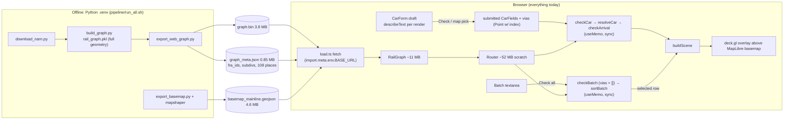

# VisNARN today, and what constrains the full-stack Shop Arrival Check

Read-only synthesis. I checked the code wherever the explorers disagreed or a claim carried weight. My only writes were throwaway probes in /private/tmp/claude-501/-Users-jiaqiyang-Documents-VisNARN/b87b3f7b-8c95-4b88-b9bb-a4d72660502e/scratchpad/synth. No repo file was touched.

## Overview

VisNARN runs entirely in the browser today. It is a React 18 + Vite 5 app, with deck.gl 9 drawn over MapLibre 4. It has no server, no persistence (持久化), no URL routing and no auth.

There are three layers:

1. **Producer (offline Python).** `pipeline/run_all.sh` turns the public NARN rail network into three static files in `public/data`: `graph.bin`, `graph_meta.json` and `basemap_mainline.geojson`.
2. **Domain engine (`src/lib`, TypeScript).** This is pure logic plus two classes, `RailGraph` and `Router`. It does three things:
   - resolves text to a point;
   - routes over the network with railroad and train-movement rules;
   - runs the arrival check.

   It barely touches the browser.
3. **UI (`src/*.tsx`, `src/components`).**
   - State lives in three places: `App`, the `useSingleCar` reducer and `useBatch`.
   - `MapView` draws a pure "scene" with deck.gl.
   - Each check runs synchronously on the main thread inside a React `useMemo`.

At startup the browser downloads about 9.2 MB. It then builds an ~11 MB typed-array graph and a ~52 MB router.

**Bottom line for the split.** The engine is a good back-end core, and porting it to Node 25 is mechanical. Four other things are the real design work:

- **No stable identity.** The engine speaks in node indices that are only valid for one `graph.bin` build.
- **No user-defined names.** The only names the engine knows are 108 baked-in public cities. The resolve chain has no slot for user-defined shops or company node codes.
- **The output does not match the mockups.** Results hold `Date` objects and full polylines. There are only three statuses, reversal records are thin, and the router returns a single route.
- **The router is heavy.** It is a CPU-bound, non-re-entrant (不可重入) 52 MB object. Batch work therefore blocks a single-threaded `node:http` server.

## Key Concepts

- **A / B / shop.** The car is between node A (last passed) and node B (next), heading to the shop. Today all three are free text, resolved the same way.
- **Point** `{label, lon, lat, node?}` (graph.ts:22-28). `node` is set only for exact nodes, which come from an FRA ID or a map pick.
- **Node index vs FRA ID (节点编号).**
  - A node index is the node's position in networkx insertion order at export (export_web_graph.py:51). It changes on every pipeline rerun.
  - An FRA ID is the public NARN node ID. It is stable and unique. All 116,815 are 6-digit integers from 301185 to 902436 (I checked).
  - These fields hold indices, not FRA IDs: `Leg.nodes`, `RouteEnd.edge/node`, `Reversal.node`, `Point.node` (router.ts:18-41, graph.ts:27).
- **Railroad mask (位掩码).**
  - Six Class I railroads in a fixed bit order: BNSF, UP, CSXT, NS, CN, CPKC (railroads.ts:2).
  - Each node and edge has a uint8 mask, so 8 railroads at most.
  - `RailGraph` throws if `meta.railroads` differs from that list (graph.ts:68-70).
- **mainMask vs atMask.**
  - `mainMask` means the railroad has mainline track at the node. It is used to snap coordinates.
  - `atMask` means the railroad has any track at the node. It is used for interchanges and for exact nodes.
- **`serving(p)`** (graph.ts:199-210) answers "for each railroad, which node does the car get on or off at?"
  - For an exact node: that node, for every railroad that has track there.
  - For coordinates or a place name: the nearest mainline node, chosen separately for each railroad, within 15 km. That can give up to six different nodes.
- **Search state** (router.ts:156-162) is (directed segment, railroad, interchanges used, at most 3).
  - That makes 135,898 × 2 × 6 × 4 = 6,523,104 states.
  - Float32 `dist` plus Int32 `prev` comes to about 52 MB per Router.
- **Movement rules.**
  - Outside a yard, a turn may be at most 90°.
  - A reversal (掉头) is allowed only between two yard segments. It costs `reverseKm=100` and is reported.
  - An interchange (换线) is allowed where both railroads have track. It costs `interchangePenaltyKm`, default 500.
  - These penalties only steer which route is chosen. `Route.km` is the real track distance.
- **Approach.** This is the route from A to B. Its `RouteEnd` lets the B→shop route continue in the same direction (`continueFrom`).
- **earliest / latest.**
  - `earliest` means "the car is at B now". `latest` means "the car just passed A", so it adds `abKm`.
  - Both use one speed. So this is a bound on where the car is, not a forecast range (one of the SCOPE honesty fixes).
- **Slack and status.**
  - `slackH = earliest − prepEnd`.
  - `classify(slack, buffer)` returns good, warn or bad (arrival.ts:70-72), shown as On time, Tight, At risk.
- **Assumptions** (arrival.ts:24-38) come in two groups:
  - Routing: `allowedMask` and `interchangePenaltyKm`.
  - Timing only: `speedKmPerDay` 400, `interchangeDelayH` 24 and `bufferH` 24.
- **draft vs submitted** (useSingleCar.ts:10-22).
  - Typing changes only the draft.
  - Submit copies the draft into submitted.
  - A map pick writes its field into both.
- **Scene.** A pure view model (scene.ts:35-88) built from `ArrivalInput` plus `ArrivalCheck`. `layers.ts` turns it into deck.gl layers.

## How It Works

**1. Offline producer**
- The pipeline runs `download_narn.py`, then `build_graph.py`, then `export_web_graph.py`.
  - `build_graph.py` keeps the largest connected component and, of parallel edges, the shortest.
  - Full edge geometry exists only in `data/processed/rail_graph.pkl` (69.7 MB, gitignored).
- `export_web_graph.py` writes:
  - `graph.bin`: 3,769,304 B, 116,815 nodes and 135,898 edges. The layout is documented in graph.ts:1-10 and matches the file size exactly.
  - `graph_meta.json`: railroads, pad, 1,896 subdivision names, `fra_ids`, and 108 places taken from `pipeline/places.py`.
- `export_basemap.py` plus mapshaper (via npx) writes the basemap.
- `run_all.sh` also writes `countries.geojson` and `states.geojson`. Neither is present in `public/data` and nothing uses them.
- `data/raw` is empty at the moment, so a rerun downloads everything again. Every rerun also reshuffles node indices.

**2. Load**
- `useMapData` (useMapData.ts:23-36) calls `loadMapData` (load.ts:12-29), which fetches the three files.
- It builds `RailGraph`: buffer slices, CSR adjacency (邻接表), and the FRA index map. This takes about 19 ms.
- It then builds `new Router(graph)` once, guarded against a stale load.

**3. One car**
- `CarForm` shows a datalist of `meta.places`. On every render it calls `describeText` for A, B and shop (CarForm.tsx:42, check.ts:61-69).
- `checkCar` runs in `useMemo` (useSingleCar.ts:77-80): `assumptionsError`, then `resolveCar`, then `checkArrival`.
- `resolveCar` (check.ts:80-105):
  - Each node field goes through `graph.resolve` (graph.ts:181-196). The order is: place name, then FRA ID, then `"lon, lat"`, with an automatic swap if it looks like `lat, lon`.
  - `locate()` then appends "(near X)".
  - Times go through `parseTime`, which reads a time with no zone in the runtime's local zone (check.ts:72-78).
  - Any failure becomes `{ok:false, error, field}`.
- `checkArrival` (arrival.ts:74-100):
  - Routes A to B. If that throws, `abKm` = haversine × 1.2 and the start becomes the straight-line A→B heading.
  - Routes B through the vias to the shop, continuing from the approach.
  - `earliest` and `latest` = `reportedAt` + `travelHours(km, interchanges)`. Slack and status follow.
- Assumption edits re-route with no submit. They pass through `useDeferredValue` (App.tsx:34).

**4. Router** (router.ts)
- `route(points)` (router.ts:300-325):
  - Starts from `serving(start)` or `continueFrom`.
  - Runs Dijkstra (`search`, router.ts:192-283) for each segment between points. Each call refills the 6.5M-state arrays, about 1.5 ms.
  - At a via, it keeps every arrival within `VIA_SLACK_KM=1000` of the best one (router.ts:149). A costlier arrival direction may be the only one the car can leave by.
  - At the last point it returns `hits[0]` only (router.ts:318). There are no alternative routes.
- `describe` (router.ts:327-367) turns the steps into the result:
  - It groups steps into one leg per railroad: km, node indices, subdivision names, a node-to-node polyline, and from/to labels from `nearestPlace`.
  - `nearestPlace` is a linear scan of the 108 places. Beyond 25 km it says "N km from X".
  - It detects reversals but keeps only `{node, position, place, railroad}` (router.ts:342). The heading and turn angle it computes are thrown away.
  - `interchanges = legs − 1`.

**5. Batch**
- `useBatch` keeps the textarea text, seeded by `exampleCsv`. "Check all" freezes that text as submitted.
- `sortBatch(checkBatch(...))` runs in `useMemo` (useBatch.ts:25-32).
- `checkBatch` (check.ts:161-172) parses the fixed columns `car_id,last_node,next_node,reported_at,shop,prep_end`. It then calls `checkCar` for each row with **vias = []** (check.ts:167).
- A bad row becomes an entry with `error`.
- Sort order is errors, then bad, warn, good, with least slack first within a status.
- The batch re-runs when assumptions change, but only while its tab is active.
- Export is `batchToCsv`. "Edit in one car" calls `rowToForm` and then `car.load`, which also resets vias.

**6. Map**
- `App` builds the scene for whichever tab is active (App.tsx:40-44).
- `MapView` owns `basemap`, `showNetwork` and `showTracks` itself (MapView.tsx:42-44).
- Layer stack, bottom to top:
  - MapLibre basemap style: OpenFreeMap, or Esri satellite.
  - OpenRailwayMap raster, as a source inside that style.
  - A non-interleaved deck.gl `MapboxOverlay` (DeckOverlay.tsx:10), holding in order: the Class I network, the approach, route legs coloured by railroad, interchange rings, reversal dots, pins, labels.
- Picking:
  - The click tolerance is 36 px × km per pixel (MapView.tsx:19-24, 56).
  - The click snaps with `graph.nearestNode`, a 0.2 ms linear scan of 116,815 nodes.
  - A, B and shop picks are stored as FRA ID strings.
  - Via picks are stored as a `Point` with a **node index**, placed by `viaInsertIndex` (useSingleCar.ts:94-110).

**Measured cost** (Node 25.6.1, this laptop):

| Work | Time or size |
|---|---|
| Graph + Router build | 19–23 ms, RSS ~91 MB |
| Regional car | 13–27 ms |
| Continental car (LA→Miami, Vancouver→Halifax, Seattle→Miami via Denver) | 196–311 ms |
| 6-row example batch | 75–77 ms |
| Route with no path, BNSF only | 22 ms |

## Where Things Live

| Concern | Location |
|---|---|
| Binary graph format, resolve, snap, serving | src/lib/graph.ts (layout :1-10, nearestNode :144-161, nearestPlace :163-174, resolve :181-196, serving :199-210) |
| Railroad list and bit order | src/lib/railroads.ts:2 (must equal graph_meta.json `railroads`) |
| Router: state space, rules, via slack, describe | src/lib/router.ts (constructor :156, search :192, route :300, describe :327) |
| Arrival math, assumptions, status | src/lib/arrival.ts (DEFAULT_ASSUMPTIONS :32-38, travelHours/classify :66-72, checkArrival :74-100) |
| Text → input, batch, sort/count | src/lib/check.ts (FieldError :29, parseTime :72, resolveCar :80, checkCar :122, checkBatch :161, sortBatch :177) |
| CSV in and out | src/lib/csv.ts (fixed columns :4, parser :8-31, batchToCsv :52-62) |
| JSON export (ISO times, 5 dp, includes vias, no approach or reversals) | src/lib/routeJson.ts |
| Pure map view model, via ordering | src/lib/scene.ts, src/lib/vias.ts |
| Browser-only lib | load.ts (`import.meta.env`, fetch), clipboard.ts; format.ts (locale and time zone) |
| Test loader | src/lib/testing.ts (node:fs + `__dirname`, works only under vitest) |
| State owners | src/App.tsx (mode, assumptions, `now`), src/useSingleCar.ts, src/useBatch.ts, src/useMapData.ts |
| Map | src/components/map/{MapView,DeckOverlay,layers,FitBounds,MapLayersPanel,RealTracks,Legend}.tsx; src/basemaps.ts |
| Producer | pipeline/run_all.sh, download_narn.py, build_graph.py, export_web_graph.py, export_basemap.py, places.py |
| Stale Python routers (unused by the app) | pipeline/carrier_route.py, pipeline/railroute.py (+ test_routes.py) |
| Target UI | docs/design/{Main,Cars,FixRoute,Shops,Phone}.dc.html, canvas.json |
| Older plans (partly superseded by the user's request) | docs/SCOPE.md, docs/UX_PLAN.md |
| Config | package.json (`"type":"module"`), tsconfig.json (include src + vite.config.ts; lib DOM; types vite/client + node; bundler resolution), vite.config.ts (vitest env node, no `server.proxy`) |

## Gotchas

**Identity and resolution**
1. **Node indices leak everywhere and are not stable.**
   - Picked vias store `Point.node` as an index.
   - Via de-duplication compares `v.node` indices (useSingleCar.ts:60).
   - Anything persisted (vias, fixes, shops) must store FRA IDs or lon/lat, never indices.
2. **Company codes can silently collide with FRA IDs.** This is new and I verified it.
   - `graph.resolve` tries FRA IDs before anything else numeric, and every FRA ID is a 6-digit integer.
   - SPLC codes are also 6 digits, and FSAC codes are numeric. Either kind of code typed or imported into today's fields could quietly resolve to an unrelated FRA node.
   - Place names also win over any later lookup.
   - So user and company lookups need an explicit namespace or a code type, not just a longer fallback chain.
3. **Coordinates snap differently from exact nodes.**
   - A shop given as `lon, lat` or as a place name snaps on its own for each railroad, up to 15 km away. It may enter BNSF and UP at different nodes.
   - An exact node uses `atMask`, which includes yard-only track.
   - "15 km" is hard-coded in the error text (router.ts:303, 308).
   - Shops should store an FRA node. Coordinates are only a fallback.
4. **Only 108 public city names exist.** They feed `describeText`, `locate`, the from/to labels on legs and the reversal places. Names like "TEMPLE, TX wye" or "yard track (stub end)" have no data source today.

**Engine semantics**

5. **Penalties shape the route, not the time.** `Route.km` excludes the reversal and interchange penalties, and `travelHours` uses only real km and the interchange count.
   - So timing assumptions (speed, delay, buffer) do not change the route.
   - Only `allowedMask` and `interchangePenaltyKm` do (arrival.ts:79).
   - This is a free cache seam: re-timing a batch after a speed change needs no re-routing.
6. **The interchange limit is fixed when the Router is built.** `maxInterchanges=3` is set in the constructor, so a route that needs more than 3 interchanges simply returns "No route". Changing the limit means a new 52 MB Router.
7. **The router returns one route.** It returns `hits[0]` only, so it has no alternatives. The mockups' "2 routes" with Shortest / Fewest interchanges / No turn-backs tags need new router work.
8. **Reversal records are thin.** A `Reversal` has no arriving or leaving subdivision, no headings, no turn angle and no yard detail. The junction inspector needs `describe()` to keep those.
9. **There are only three statuses.** `ArrivalStatus` is good/warn/bad, and that set is wired into `STATUS_LABELS`, `URGENCY`, `countBatch`, the CSS pills and the exact-string render tests (render.test.tsx:78). "Check route" and "Cannot check" do not exist yet. Today a car that cannot be resolved is just an `error` entry.
10. **Batch rows cannot carry vias.** `checkBatch` passes `[]` (check.ts:167), the CSV has no via column, and "Edit in one car" drops vias. "Use for this batch row" needs per-row vias wired through.
11. **The Python routers have drifted.** `pipeline/carrier_route.py` has no direction state, no turn rule and no yard rule. Temple→North Little Rock comes out at 807 km in Python and 936 km in TS; re-running TS with a 179.9° turn limit gives 807, so the gap is the TS 90° turn rule. Nothing calls this router. Do not use it for the back end, the backtest or a cross-check.

**Wire format and time**

12. **Dates do not survive JSON.** `ArrivalInput.reportedAt/prepEnd` and `ArrivalCheck.earliest/latest` are `Date` objects, and the client calls `.toISOString()` and `toLocaleString` on them. An API needs DTOs (数据传输对象) or a revive step.
13. **Payloads scale with route length.** A full outcome is about 45 bytes per path point, plus the node-index arrays. Measured:

    | Outcome | Size | Path points |
    |---|---|---|
    | Example car 104233 | 20,474 B | 399 + 24 |
    | LA→Miami | 71–77 KB | ~1,515 |

    The two explorers' numbers ("~20 KB" and "76 KB") are both right; they measured different routes. A batch list should send summaries and fetch geometry for the selected row only.
14. **Time zone.** A time with no zone is read in the zone of whichever runtime parses it. Moving parsing to the server makes the server process's TZ the rule. That is usually, but not always, the same as the browser's on one laptop.
15. **The CSV parser cannot handle a newline inside a quoted cell.** It splits lines before it handles quotes. Since `batchToCsv` quotes `\n`, its output does not round-trip. A UTF-8 BOM is fine.

**Toolchain and runtime**

16. **`src/lib` does not run under Node 25 type stripping as it stands.** Both explorers confirmed this.
    - The two parameter properties fail with `ERR_UNSUPPORTED_TYPESCRIPT_SYNTAX`: router.ts:156 and check.ts:29.
    - Imports without an extension fail with `ERR_MODULE_NOT_FOUND`.
    - load.ts uses `import.meta.env`.
    - testing.ts uses `__dirname`.
17. **On `allowImportingTsExtensions`, the explorers disagreed. I tested it with TypeScript 5.6.3:**
    - `tsc -p . --noEmit` passes.
    - Plain `tsc` fails with TS5096, because `tsconfig.json` has no `noEmit`.
    - So the npm scripts work, but the setting should be `"noEmit": true` in the tsconfig.
    - Node 25 runs `./a.ts` imports natively (also tested).
    - `rewriteRelativeImportExtensions` (TS 5.7) and `erasableSyntaxOnly` (TS 5.8) are not available.
    - esbuild and vite-node are already in `node_modules`. I bundled the lib with esbuild and it ran.
18. **The tsconfig loads DOM types for everything under `src`.** Server code placed there would typecheck with `window`/`document` visible. A server needs its own tsconfig or include entry.
19. **The Router cannot be shared between requests or threads.** Its scratch arrays are shared and it rebuilds paths in place.
    - It is fine inside one synchronous handler.
    - Each worker thread needs its own 52 MB Router.
    - Rough load: a few hundred continental cars come to about 30–90 s of blocking CPU; a few hundred regional cars, a few seconds.
20. **Small runtime gotchas.**
    - `http.createServer().listen()` with no host binds `::`, which means all interfaces. It must bind to 127.0.0.1.
    - `node:sqlite` works on 25.6.1 but prints an ExperimentalWarning.
    - Anything in `public/` is served by Vite and copied to `dist/`, which already holds `dist/data`. The DB file must live elsewhere.
    - The folder is not a git repo, although a `.gitignore` exists.
21. **There is no graph version.** `graph_meta.json` has no version or hash. If client and server both hold the graph, or saved data refers to it, there is no way to detect a mismatch.
22. **Tests.** vitest runs in a node environment, with no jsdom. The render tests assert exact UI strings and the pill order, and the layer tests assert layer ids and order. A UI rewrite will replace most of them. The lib tests (check, router, format) are the ones to keep as the engine's contract.

## Constraints for the full-stack design

### Hard constraints

From the user request and the environment:
1. It is a local laptop tool: no hosting and no auth yet. The server must bind to loopback only (127.0.0.1). Real car data never leaves the laptop: the SQLite file goes outside `public/`, `dist/` and any shared path, and shared pages use EXAMPLE rows only.
2. The runtime is Node v25.6.1 (built-in `node:sqlite`, `node:http`, type stripping). The stack is npm, React 18, TS strict, Vite 5, deck.gl 9 and MapLibre 4. Small dependencies only when they earn their place.
3. Shops and node codes stay general and user-defined. Nothing company-specific is hard-coded. The only fixed list today is the six Class I railroads, which `graph.bin` dictates.
4. Company data comes in by CSV now and a database later (Synapse/CPS), and the node-code format is unknown. Imports must go through a source adapter that produces the same row types, and code lookup must be pluggable by code type.
5. The front end is the mockup UI: Route (Main), Cars, FixRoute, Shops and Phone. Where docs/SCOPE.md says no persistence, no live DB, a UI freeze and no saved via fixes, the user's request overrides it. The mockups also override the UX_PLAN tiers for alternatives, the junction inspector and the fix-route flow.

From the code:

6. **One engine.** Keep `src/lib`'s router, graph, arrival and check as the single engine, shared by the server and the future headless backtest. Retire the Python routers.
7. **Make `src/lib` load under Node.** Replace the two parameter properties with explicit fields, add `.ts` extensions with `allowImportingTsExtensions` and `noEmit` in the tsconfig, or use esbuild or vite-node. Give `load.ts` a Node twin that reads `public/data` with `fs`. Keep server code out of the DOM-typed tsconfig scope.
8. **Persist stable keys only.** Shops, vias, route fixes and code lookups store FRA ID (or lon/lat) plus an optional railroad, never node or edge indices. Add a graph version or hash to the export and record it with saved results.
9. **Resolution becomes a layer in front of `graph.resolve`.** It maps a user shop or company code to an FRA node or coordinates, with code type, match method and confidence. It needs an explicit namespace so numeric codes never fall through to the FRA lookup. Anything unresolved, or a shop off the network, must come out as "Cannot check", never "On time".
10. **The API speaks DTOs.** ISO time strings, coordinates rounded to 5 decimal places, no internal indices. List endpoints return summaries; route geometry comes per car on demand.
11. **CPU isolation.** The Router is ~52 MB, synchronous and non-re-entrant. Batch checks need a worker thread (its own Router, about 70 MB) or chunked jobs with progress, so `node:http` stays responsive. Cache routes by (graph version, A, B, vias, shop, allowedMask, interchangePenaltyKm), so that changing speed, delay or buffer only re-times.
12. **New engine work the mockups need:**
    - route alternatives (the router returns one hit today);
    - a richer `Reversal` (subdivisions in and out, headings, turn angle, yard/stub);
    - per-step km and rough day;
    - route checks with "Check route" and "Cannot check" statuses, plus the Act now / Check first / OK grouping;
    - per-row vias in batch;
    - a via with a chosen railroad ("Which line?"), since `serving()` allows every railroad today;
    - position age against a batch "as of" time;
    - a `basis` on results ("placeholder" until calibrated).
13. **The client still needs map data.** `basemap_mainline.geojson` (4.6 MB) stays a static client asset. Instant pick snapping, live "Found on the network · served by X" hints and via ordering need either a slim client index or server endpoints. The client index is node lon/lat, `fra_ids` and `atMask`, about 2 MB, or it can simply keep `graph.bin`. With endpoints, the synchronous `useMemo` checks become async, with loading, stale and cancel states.
14. **State lifts.** Batch results become app-wide, because the tab bar shows the Act-now count. `showTracks` must be controllable from outside `MapView`, because FixRoute forces Real tracks on. Tabs need URL routes.

### Open questions

1. **Grouping.** Where does a Tight car with no route problem go: Act now or OK? Should every turn-back send a car to Check first? Thresholds are still guesses: detour 1.4–1.6×, position age 48 h, Tight noise 12 h.
2. **Time zones.** Should times with no zone be rejected, or parsed in a configured zone? Which zone does the company export use?
3. **Route fixes.** What key: batch row only, car, or lane (A, B, shop)? Are fixes reused next morning? How much history is kept? Does the batch CSV get an optional via column?
4. **Batch retention.** How long are batches and their results kept, and where does the DB file live (outside the repo)? Do we store results or recompute them on open?
5. **Shops.**
   - Is the serving railroad derived from the node, hand-checked (SCOPE), or derived with an override?
   - Where does the destination dwell term (1–3 days) live?
   - Is a delete action needed (none is drawn)?
   - Must the batch `shop` column match a Shops entry by code or name, or can it also be free text?
6. **Node codes.** What type (SPLC, FSAC, station + state, internal, FRA)? Is there a station master table with lat/lon in Synapse/CPS? Railinc CSM is licensed, so we must not rebuild it.
7. **Existing ETA.** Does Synapse/CPS already hold a railroad or Railinc ETA? If so, it may replace most routing detail and changes what the back end owns.
8. **Graph on the client.** Is the client a full graph holder (instant hints, version coupling) or a thin client (round-trips per keystroke and click)?
9. **Batch size.** What is a realistic morning-list size and route length? The answer decides between blocking requests, one worker, or a job queue with progress.
10. **Alternatives.** How are they generated (penalty sweeps, no-reversal runs, de-duplication)? What counts as distinct enough to show?
11. **Calibration (M2).** Which event counts as "arrived"? What history import format? Is the fallback lane → region → global?
12. **Third-party tiles and fonts.** These requests send map viewports, not car rows, to OpenFreeMap, Esri, OpenRailwayMap and Google Fonts. Is that acceptable under "data stays on the laptop", and should it be documented?