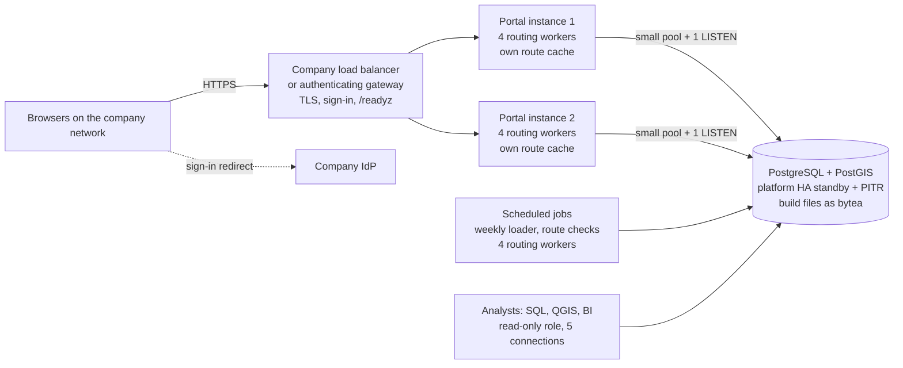

# VisNARN data architecture on PostgreSQL + PostGIS

**For:** you (the operations analyst who owns VisNARN) and the developer who builds it next.
**Date:** 2026-11-18. **Status:** final merged design. Stage 1 can start now.

**How it was made.** Two designers (Claude Opus and Fable) each wrote a full design. Each then reviewed the other's design and ran it. This document merges the two. Where they still disagreed, it decides and gives the reason (section 3.1).

**How it was checked.** The DDL in section 4 ran on PostgreSQL 18.6 with PostGIS 3.6 (PGlite, in a scratch folder). The real NARN download (185,153 segments) went through the weekly loader three times: a first load, an unchanged week, and a changed week. Then a shop, a link, a saved route, an observed trip, events and statistics were written, and 43 of 43 checks behaved as designed: good rows were accepted, bad rows were refused. Nothing in the repo, in `~/.visnarn` or on port 5173 was touched.

**Your correction "不是 parsec"** is read as: the company database is PostgreSQL.

**Labels.** (measured) = run for this design. (code) = read in the repo. (research) = the research notes on freight speed and on route requests.

---

## 1. The answer in 8 lines

1. PostgreSQL becomes the system of record (权威数据源): it holds everything a person or a company feed creates.
2. The router keeps its binary files (graph.bin, track.bin) for speed. PostgreSQL registers each build with checksums (校验和), and the server refuses files that do not match.
3. The public network is stored as versions (版本): a node or segment row opens in one weekly release and closes in a later one. An unchanged week adds 0 rows, and every saved reference keeps its target.
4. A shop joins the network through links (连接线). One confirmed link makes a stub end (尽头线); two make through track (贯通线). The database counts them; nobody types the shape.
5. A working route is saved as a sealed version (封存版本): the question (places and choices) and the answer (carriers, hand-offs, exact track). Each new build re-checks it: same, track changed, carriers changed, or broken.
6. Car events time stretches (区段) between reporting stations, and dwell (停留时间) at places. A track segment gets a time only as a labelled share of a stretch time.
7. Every statistic is a distribution (分布): count, distinct cars, P10, P50, P90, and the level it was pooled at. Every estimate lists the rows it used.
8. Stage 1 is 32 tables with no times and no cars. Company car data waits for a written agreement. Your own trip times can start now in two small tables.

---

## 2. Your ideas, evaluated

Each idea gets a verdict, a refinement, and one question for you.

### Idea 1. Fixed working routes: the router proposes, a person steers and saves

- **Verdict.** Right, and it matches the industry: an owner names the carriers and junctions (接轨站), and the railroad runs the trains (research). The gap is in what is saved. Today the app saves only the question: waypoints, one strategy label and a text string. The route is worked out again on every open (code, `shared/plans.ts:46-49`). After a weekly rebuild, the same saved route can open as different track, and nobody is told. A saved route also has no author, date or network version.
- **Refinement.** Save the answer too, in a sealed version:
  - the places, with the choices made at each (next line, may turn back);
  - the legs: carrier, hand-off node, and who chose the hand-off (person or router);
  - the exact track, piece by piece: segment or shop link, direction, the part travelled, km, and any turn-back (折返).

  The server builds the route string from the legs (today the browser sends it: code, `RoutePanel.tsx:588`). Each new build recomputes every open version and records the result. A new version exists only when a person saves one. One engine change is needed: legs must carry FRA node ids and segment ids (FRAARCID). The engine has them and drops them (code, `engine/trip.ts:221-231`).
- **Question.** When you call a route fixed, which change needs your click: a change of carriers and hand-offs only, or any change of track? The schema records both, so your answer is a setting.

### Idea 2. Shops as a "resistor": one link (stub) or two links (through)

- **Verdict.** A good generic element. It reuses a rule the router already has: a car reverses only on yard track, with "stub-end" as a named case (code, `shared/route.ts`). You are right that plant tracks are missing: 8 of the 12 public shops have no dead-end track within 1 km in NARN (measured). At Edmonton, 43 dead ends lie within 1 km, so only a person can choose. "1 or 2" has three limits:
  - a wye, a loop or two serving railroads give 3 or more links;
  - the real switch often sits between two network nodes; for seven shops the nearest node is 0.4 to 1.1 km away (measured);
  - a weekly rebuild can remove the node a link joins.
- **Refinement.** Store each link as a row (`app.shop_link`): the drawn line, the join point, the carrier that switches it, the source, and who confirmed it. The join is a network node, or a point part-way along a segment (linear referencing, 线性参照). Stub or through is the count of confirmed links. A link is never redrawn: a correction closes the old row and opens a new one, so a saved route keeps the link it used. The engine merges confirmed links in memory as yard track (an overlay, 叠加层), so the existing stub-end rule covers them with no special case. OpenStreetMap lines stay suggestions, and a person confirms each one. The OpenStreetMap licence has share-alike terms, so counsel decides what may be shared.
- **Question.** For each real shop, which railroad switches cars into it, and at how many points does its track join that railroad?

### Idea 3. Caches that count hits; later, learn preferred places

- **Verdict.** Two different things are mixed here. A cache (缓存) is disposable and must never change an answer. Usage is a record. Cache hits also count the wrong thing: one plan runs four searches, tests and the weekly check add hits, and every rebuild changes every key (code). A search takes at most about 0.3 s, so ranking by hits solves a problem the app does not have yet. With 12 shops and a small team, learned preferences feed themselves: what is shown first gets picked more.
- **Refinement.** Persist nothing from the cache. Key it by build, routing rules, overlay revision and the plan. Today the key holds only the network version and the waypoints (code, `engine/trip.ts:297-302`), so an edited link could serve a stale route. After a restart, warm the cache with the open saved routes: they are the hot set by definition, and the warm-up is the same work as the weekly route check. "Hot shops" today is a count of open routes per shop, which is a view with no new table. When a screen needs a ranking, add weekly counts of deliberate actions (route saved, place chosen), by stable id, with no person.
- **Question.** Which screen should show a different order because of a count?

### Idea 4. Per-segment averages for accurate ETAs

- **Verdict.** The goal is right. Your own history is the largest accuracy gain available (research). The word "segment" needs a new meaning:
  - A NARN segment is short: median 0.485 km (measured).
  - Car events come from sparse trackside readers at stations coded by SPLC. Between two events lie tens to hundreds of segments, and the path between them is not observed.
  - Most transit time is yard dwell, and dwell belongs to a place (research).
  - An average hides the long tail: P90 is about twice the mean (research).
  - A granted patent covers ETAs built by recombining segments of past trips (research). Counsel should read it before the estimator is built.
- **Refinement.** Time three things, each as a distribution (分布):
  - running time per stretch (区段): one railroad, from one reporting station to the next, in that direction;
  - dwell per place: yard dwell, release to pull, arrival to placement;
  - interchange (交接) per station and carrier pair.

  Thin data pools upward (逐级合并): stretch, then carrier by length band, then the whole network, then public figures. A per-segment time exists only as a view that shares a stretch time out by length, and its `method` column says so.
- **Question.** For each car event, what does the company database store (car, event code, place code, event time, time zone, receipt time, reporting railroad, train, loaded or empty), and how many years back?

### Idea 5. Physics-style simplification, generic modules, YAGNI

- **Verdict.** The code already works this way: "trains cannot reverse at a switch" is one geometric rule, and the policy numbers sit in one file. Much of rail is contract: registered interchanges, haulage, trackage rights, the reverse-route default (research). A physical model finds every route the track allows, and the paperwork forbids some of them. "Generic" and YAGNI also pull against each other: a generic module with one user is a guess about the future.
- **Refinement.** Sort every fact into three kinds:
  - law of the track: code;
  - rule of the industry: reference tables with a source and a date;
  - choice of the team: user tables with an author and a time.

  Each route version records the routing rules it used, so a changed penalty shows up as the cause of a changed route. YAGNI applies to features. Keys, versions and data that cannot be fetched again are designed now: the event-history API reaches back 90 days only (research), and an old NARN release cannot be downloaded later. Create a table only when it has a reader. The car-stage tables dropped by migration 4 are the lesson (code, `server/store/sqlite.ts:46-53`).
- **Question.** When a route is physically possible but has no registered interchange, who catches that today?

### Idea 6. Everything must fit PostgreSQL

- **Verdict.** The right home. Foreign keys (外键), checks, time zones, partitions (分区) and spatial types are what this data needs. Four limits:
  - The router needs its graph in memory, about 70 to 85 MB per worker. Routing stays in the engine.
  - The store interface is synchronous today (code, `server/store/store.ts`). A PostgreSQL driver is asynchronous.
  - The revision counter lives inside one process today (code, `sqlite.ts:97-103`). With several users it must live in the database.
  - The README promises that shops and routes never leave the laptop. That holds only while PostgreSQL runs on the laptop.
- **Refinement.** One rule: PostgreSQL holds what a person or a feed created. Everything computable from it (graph.bin, route answers, caches, statistics) is derived data (派生数据), and each derived row names the versions it came from. Geometry is a typed column. The one opaque column is the untouched bytes of an inbound message, kept as evidence.
- **Question.** Which PostgreSQL will the company give this tool: which version, are PostGIS and btree_gist allowed, and who owns it?

---

## 3. Entity map

### 3.1 How the two designs were merged

A and B are the two designs. Rows marked "agreed" were settled in the review round.

| Topic | Design A | Design B | Decision | Why |
|---|---|---|---|---|
| Segment key | FRAARCID | own id; same id = same FRAARCID and same two end nodes | **FRAARCID** | Every user of a segment id either reads its geometry at a stated release (saved track) or is re-tested by geometry at each build (links, station anchors). An own id adds a lookup to every save and every analyst query and catches nothing those tests miss. A FRAARCID whose end nodes change becomes a new version, and its links are re-tested. |
| Node identity | FRA node id; position in versions | new id when a node moves | **A** (agreed) | A moved node would otherwise orphan every link, stop and leg that names it. |
| Release and build | two levels | one level | **two levels** | NARN facts change when FRA edits. Routability also changes when our pipeline or class list changes. Two causes, two clocks. |
| Version ranges | `int4range` column | first and gone columns | **two integer columns plus an exclusion constraint (排除约束) on their range** | Easy to read, and the database forbids overlapping versions. |
| Network version | hash of the files | hash of the rows | **hash of the canonical rows; file checksums as rows; one directory per build** | Measured: `data/source-version.json` says `a4f92a6420cb`, the files hash to `02f83661e03d`. A key rename in graph_meta.json changed the version while graph.bin stayed byte-identical. |
| Today's node shops | anchor on the shop | one zero-length link | **anchor on the shop; a link is real track longer than 0** (agreed) | Under the stub rule, every zero-length link would turn a node shop into a place where cars back out. |
| Turn-backs | own table | read off the path | **a column on the path piece that leaves the reversal** | A yard reversal arrives on one segment and leaves on another (code, `engine/trip.ts:168`), so it must be stored. A column stores it once. |
| Freezing saved routes | draft state and five triggers | column privileges | **write in one transaction, then seal with checks; a commit-time check; guards on child rows; no cascade. Privileges come later as a second layer.** | Privileges do nothing when the app connects as the table owner (the laptop case), and an INSERT grant lets rows be added to an old version. |
| Who changed what | per-row change log | one changeset (变更集) per transaction under a lock | **B, with the lock taken before the id is drawn; NOTIFY at commit (from A)** | Ids then rise in commit order, so "everything up to changeset N" is a state that really existed. |
| Overlay revision | newest change id of links | a flag the app sets | **computed from the stamps on shops and links** | A probe showed a shop move left A's value unchanged. B's flag depends on app code remembering to set it. |
| Stops | shop, node or coordinates | adds city and unresolved text | **B, plus A's `snap_km`** | "Kansas City, MO" stays a reference row. |
| Imported routes | recomputed and confirmed at migration | imported; a person confirms later | **B** | A person steers and saves (idea 1). |
| Classes on a route | 3 booleans | child table | **child table** | A class list is reference data. |
| Routing rules | 8 fixed columns | name and value rows | **B** | A new constant needs no migration. |
| Raw events | instant fixed at load; place code required | local time and precision flags | **B's columns, A's key per feed, no foreign key on event code or place** | A's schema refused an event with an unknown SPLC (probe). The year and zone often come later. |
| Station to track | SPLC to node, with a weight | one anchor per station and carrier | **many sites per station, each with a role** | One SPLC can hold dozens of sites. The role says which events use which site, so a weight has no reader. |
| Statistics | materialized views (物化视图) | tables written per run | **tables per run, thresholds as columns of the run, plus A's estimate with pool level and its parts** | An estimate must point at the exact numbers it used, and a view row cannot be pointed at. |
| Usage | event rows with person and consent trigger | weekly counts, no person | **B** | The smallest record that still ranks. |
| Extensions | PostGIS, btree_gist, citext; PostgreSQL 15+ | PostGIS; PostgreSQL 12+ | **PostGIS and btree_gist; PostgreSQL 12+** | btree_gist ships with PostgreSQL. Without it, drop the exclusion lines (section 6.4). |
| Lineage (来源追溯) | includes "removed" rows | no "removed" rows | **no "removed" rows; match by the same end nodes, or within 3 m** | Measured: a 15 m match paired a removed yard track with its neighbour (overlap 0.77). Yard tracks lie a few metres apart. |
| Own observations | none | none | **`app.trip` and `app.trip_time`** | You asked what to record now. |

### 3.2 The map

```mermaid
erDiagram
  net_release ||--o{ net_build : "built into"
  net_build ||--o{ net_build_artifact : "files"
  net_node ||--o{ net_node_version : "positions"
  net_segment ||--o{ net_segment_version : "versions"
  net_node ||--o{ net_segment_version : "ends"
  net_subdivision ||--o{ net_segment_version : "names"
  net_segment_version ||--o{ net_segment_carrier : "owners and rights"
  ref_carrier ||--o{ net_segment_carrier : "listed as"
  net_segment ||--o{ net_segment_build : "routable per build"
  ref_track_class ||--o{ ref_carrier : "class"
  ref_carrier |o--o| ref_routing_line : "Class I line"
  app_person ||--o{ app_changeset : "writes"
  app_changeset ||--o{ app_shop : "stamps"
  app_shop ||--o{ app_shop_link : "links"
  net_node |o--o{ app_shop_link : "join at node"
  net_segment |o--o{ app_shop_link : "join along"
  app_route ||--o{ app_route_version : "versions"
  app_route_version ||--o{ app_route_allowed_class : "classes"
  app_route_version ||--|{ app_route_stop : "places"
  app_shop |o--o{ app_route_stop : "shop"
  ref_city |o--o{ app_route_stop : "city"
  app_route_version ||--o{ app_route_leg : "carriers"
  app_route_leg ||--|{ app_route_path : "track"
  net_segment |o--o{ app_route_path : "piece"
  app_shop_link |o--o{ app_route_path : "or link"
  net_build ||--o{ app_route_version : "computed on"
  app_ruleset ||--o{ app_route_version : "rules"
  app_route_version ||--o{ app_route_check : "re-checks"
  app_route_version ||--o{ app_trip : "observed trips"
  app_trip ||--|{ app_trip_time : "times"
  ref_station ||--o{ app_station_anchor : "sites"
  net_node |o--o{ app_station_anchor : "at"
  obs_ingest_batch ||--|{ obs_raw_message : "records"
  obs_raw_message ||--o| obs_car_event : "typed as"
  obs_equipment ||--o{ obs_car_event : "car"
  obs_car_event ||--o| obs_event_match : "matched"
  ref_station |o--o{ obs_event_match : "station"
  obs_car_event ||--o{ obs_movement : "pairs"
  stat_stretch |o--o{ obs_movement : "run on"
  stat_stretch ||--o{ stat_stretch_track : "assumed track"
  stat_stretch_track ||--|{ stat_stretch_segment : "pieces"
  net_segment ||--o{ stat_stretch_segment : "segment"
  stat_stat_run ||--o{ stat_run_time : "writes"
  stat_stat_run ||--o{ stat_dwell_time : "writes"
  stat_stretch ||--o{ stat_run_time : "timed"
  ref_station ||--o{ stat_dwell_time : "timed"
  app_route_version ||--o{ stat_eta_estimate : "estimated"
  stat_eta_estimate ||--|{ stat_eta_component : "parts"
  stat_run_time |o--o{ stat_eta_component : "used"
  stat_dwell_time |o--o{ stat_eta_component : "used"
```



Schemas (模式): `ref` (vocabulary other people define), `net` (the public network; only the weekly loader writes), `app` (what the team decides), `obs` (car events, LATER), `stat` (statistics, LATER), `ops` (migrations).

### 3.3 The areas

**Network snapshots and stable identity.** A release (发布版) is one NARN download. A build (构建) is one pipeline run over a release: the files the router loads. Nodes are keyed by FRA node id, and segments by FRAARCID. These identity rows are never deleted, so a foreign key from a link or a saved route always finds its target. What NARN says about a node or a segment sits in version rows, valid from `first_release_id` up to `gone_release_id` (NULL means current). The loader hashes every attribute, carrier and vertex. The same hash writes nothing. A change closes the old version and opens a new one. Routability (is the segment an edge of graph.bin, and if not, why) sits in `net.segment_build`, opened and closed per build. Measured on the real download: the first release took 21 s and about 200 MB; an unchanged week took 4 s and added 0 rows; a changed week (3 segments removed, 1 re-surveyed, 1 renumbered) closed and opened exactly those rows and found the renumbered segment by its end nodes. When a FRAARCID vanishes, `net.segment_lineage` suggests where it went, and a person decides. One build is live at a time, and the server loads only files whose checksums match it. A graph index is never stored (code rule, `shared/places.ts:4-7`).

**Railroads and track classes.** `ref.carrier` holds the 839 NARN codes (measured), each with a class, the basis of the class (listed, or default for a code on no list), a source and a date. The regional list came from Wikipedia on 2026-11-17 (code, `pipeline/railroad_classes.py`), so it is stored as policy with its source, and each build records a hash of the class list it used. `ref.routing_line` mirrors the 8 bits of graph.bin. A composite foreign key makes each Class I line point at a Class I carrier, and the server compares the table with `graph_meta.json` at start. `net.segment_carrier` keeps every owner and trackage-rights holder exactly as NARN lists them, so a leg on a short line can name the real railroad; graph.bin knows only "short line". NARN has no speed, signal or FRA track class (research), so no such column exists. Track type is `net.net_type` (main, siding, yard), and its `is_yard` flag drives the reversal rule.

**Shops and shop links.** A shop keeps today's anchor: a node picked on the map with its "Which line?" answer, or coordinates that snap as today. The shop couplet (company mark + SPLC, research) and the serving carrier are columns, blank until known. Each link is a row: the drawn line from the join to the shop, the join (a node, or a segment plus a fraction), the join point as drawn, the carrier, the source, and stamps for created, confirmed, detached and closed. Length is computed from the line. A trigger refuses any redraw or deletion, and stamps only move forward. The shape is the count of confirmed open links: 0 means "at node" or "snapped", 1 stub, 2 through, 3 or more multi. Each build re-tests every join: the node must still exist, or the join point must lie within 3 m of a routable segment. A failed join marks the link detached, and the router ignores it until a person replaces it. Spur suggestions are yard dead ends within 1 km: at Sarnia the nearest is 340 m away, found in 46 ms (measured).

**Working routes and their places.** `app.route` is the identity and the name. `app.route_version` is one saved state: strategy, build, routing rules, overlay revision, km and route string. Its rows are the allowed classes, the stops, the legs and the path. A version is written in one transaction and then sealed. Sealing checks that the places are numbered 1..n with n ≥ 2, that legs and path pieces are numbered without gaps, that every leg has track, and that leg km and path km equal the version km. After sealing, nothing in the version or its rows can change; only `closed_changeset_id` is set when the next version is saved. One version per route is open (a partial unique index). A route with versions cannot be deleted; it is retired. `app.route_check` stores each re-computation: the result, the km found now, the first piece of difference, and whether a person saw it and kept the route. Routes imported from SQLite start as `basis = 'imported'`: places only, waiting for a person to confirm.

**Caches and usage.** Nothing from the caches is stored. Two revisions drive them. The store revision is the newest changeset id, and a NOTIFY at commit tells every process. The overlay revision is computed from the stamps on shops and links (view `app.overlay_revision`). The route cache key is build + ruleset + overlay revision + plan. "Hot shops" is the view `app.shop_use`. Ranking by use waits for a screen that needs it. Then `app.usage_weekly` holds counts of deliberate actions per week by stable id, with no person, because in a team of three a daily count points at one person.

**Company codes.** LATER, when the company gives reference files or shop couplets. `ref.station` is one place an event can name: a 9-digit SPLC, with its city part and a city-level flag (sub-code 000). `ref.station_code` holds the other names: a railroad's FSAC, the 9-letter city of a location message, the company's own code, each valid over a date range (an FSAC is not reused for 3 years, research). `ref.junction` and `ref.interchange` hold Rule 260 junctions and registered interchanges; an exclusion constraint allows one interchange type per carrier pair per station at a time. `ref.carrier_alias` maps reporting marks, SCAC and Umler marks to one carrier (a feed may say CPRS where NARN says CPKC). `app.station_anchor` ties a station to the network: many sites per station, each with a role (yard, station, junction, industry, shop), a method and a confidence (置信度), confirmed by a person and re-tested at each build. `app.route_leg.junction_id` then ties each hand-off to its Rule 260 junction.

**The observation layer.** LATER, behind the contract gate (section 5, step 0). Four layers, each rebuildable from the one below:
1. **As received** (`obs`): a batch with its file hash, the raw bytes, and a typed event with nothing interpreted (local clock time, precision, whether the year was inferred, receipt time). Unknown codes and places are stored too. Car numbers live only in `obs.equipment`.
2. **Matched** (`obs.event_match`): event class, railroad, station with method and confidence, network site, the instant (from the station's time zone), the reporting lag, and the reason when an event is unusable (duplicate, corrected, unknown place, and so on).
3. **Movements** (`obs.movement`): each pair of consecutive usable events of one car, with a kind from rule rows: run, dwell, interchange, first mile, last mile, or mixed. Mixed never enters a statistic.
4. **Statistics** (`stat`): one run writes running time per stretch, dwell per place and speed pools, each with n, distinct cars, mean, P10, P50 and P90, by load and by quarter. A run is published whole. `stat.run_estimate` picks the pool level. `stat.eta_estimate` and `stat.eta_component` store each ETA and the exact rows it used. The track of a stretch is a routed guess per build (`stat.stretch_track`) with a confidence and a count of near alternatives. `stat.segment_time_allocated` shares a stretch time out over its segments and labels the result.

---

## 4. Full DDL: PostgreSQL + PostGIS

Three files, run in order. Every statement below ran as printed. Stage 1 is section 4.1 to 4.8; section 4.9 to 4.12 are LATER.

Conventions:
- Every table that a person writes carries changeset stamps (who and when). Every imported row carries a source.
- Open rows have `gone_*` or `closed_*` NULL. "Now" views read open rows through partial indexes (部分索引).
- Lists are rows or CHECKs. A list that changes with the industry is a table; a list that changes only with the code is a CHECK.
- No JSON column anywhere.

### 4.1 Setup

```sql
-- VisNARN data architecture, stage 1 (NOW).
-- PostgreSQL 12 or newer, PostGIS 3, btree_gist. No JSON column. Tested on PostgreSQL 18.6 + PostGIS 3.6 (PGlite).

CREATE EXTENSION IF NOT EXISTS postgis;
CREATE EXTENSION IF NOT EXISTS btree_gist;   -- lets one EXCLUDE constraint say "same id AND overlapping releases"

CREATE SCHEMA ops;   -- migrations
CREATE SCHEMA ref;   -- vocabulary other people define: carriers, classes, cities, sources
CREATE SCHEMA net;   -- the public network (NARN), release by release; only the weekly loader writes here
CREATE SCHEMA app;   -- what the team decides: shops, shop links, working routes, own observations
```

### 4.2 Migrations and reference data

```sql
-- ============================================================ ops
CREATE TABLE ops.schema_migration (
  version    integer PRIMARY KEY CHECK (version > 0),
  name       text NOT NULL,
  sha256     text NOT NULL CHECK (sha256 ~ '^[0-9a-f]{64}$'),   -- a shipped migration file never changes
  applied_at timestamptz NOT NULL DEFAULT now()
);
```

```sql
-- ============================================================ ref
-- Where a fact came from, and on what terms. Every imported or traced row points here.
CREATE TABLE ref.source (
  source_code text PRIMARY KEY CHECK (source_code ~ '^[a-z][a-z0-9_]{1,39}$'),  -- 'narn', 'osm', 'person', 'legacy_sqlite', 'class_policy'
  title       text NOT NULL,
  kind        text NOT NULL CHECK (kind IN ('public', 'licensed', 'company', 'person', 'policy')),
  licence     text,
  share_alike boolean NOT NULL DEFAULT false,   -- ODbL and similar: counsel decides what may be shared
  restricted  boolean NOT NULL DEFAULT false,   -- entitled company data: never in a personal build
  url         text
);

-- The classes of track a route may use (shared/railroads.ts NETWORK_CLASSES).
CREATE TABLE ref.track_class (
  class    text PRIMARY KEY CHECK (class ~ '^[a-z][a-z_]{1,19}$'),   -- class_i, regional, short_line, passenger
  label    text NOT NULL,
  optional boolean NOT NULL                                         -- false: every route may use it (class_i)
);

-- A railroad by its NARN code (839 codes, all 2 to 4 capitals, measured). Readable text key on purpose.
CREATE TABLE ref.carrier (
  carrier_code   text PRIMARY KEY CHECK (carrier_code ~ '^[A-Z]{2,4}$'),
  name           text,
  class          text NOT NULL REFERENCES ref.track_class,
  class_basis    text NOT NULL CHECK (class_basis IN ('listed', 'default')),   -- default: on no list, so a short line
  class_source   text NOT NULL REFERENCES ref.source,
  class_as_of    date NOT NULL,
  successor_code text REFERENCES ref.carrier,                                  -- KCS -> CPKC
  UNIQUE (carrier_code, class)                                                 -- target of the composite FK below
);

-- The 8 lines graph.bin tells apart, by bit position. The server compares this table with graph_meta.json at start.
CREATE TABLE ref.routing_line (
  line_id      smallint PRIMARY KEY CHECK (line_id BETWEEN 0 AND 7),  -- graph.bin stores the mask in one byte
  label        text NOT NULL UNIQUE,                                   -- 'BNSF' ... 'CPKC', 'regional', 'short line'
  class        text NOT NULL REFERENCES ref.track_class,
  carrier_code text UNIQUE,
  FOREIGN KEY (carrier_code, class) REFERENCES ref.carrier (carrier_code, class),   -- a Class I line must name a Class I carrier
  CHECK ((class = 'class_i') = (carrier_code IS NOT NULL))
);

-- Public city names a person may type as a place (108 today, pipeline/places.py).
CREATE TABLE ref.city (
  city_id     integer GENERATED ALWAYS AS IDENTITY PRIMARY KEY,
  name        text NOT NULL CHECK (name = btrim(name) AND name <> ''),   -- 'Kansas City, MO'
  geom        geometry(Point, 4326) NOT NULL,
  source_code text NOT NULL REFERENCES ref.source,
  withdrawn   boolean NOT NULL DEFAULT false
);
CREATE UNIQUE INDEX city_name_key ON ref.city (lower(name));
```

### 4.3 Network: releases and builds

Why two levels: NARN facts change when FRA edits the layer; routability also changes when our pipeline or class list changes.

```sql
-- ============================================================ net: releases and builds
-- NARN NET: M main, S siding, Y yard. A new value is one more row; the schema stays.
CREATE TABLE net.net_type (
  net_type text PRIMARY KEY CHECK (net_type ~ '^[A-Z]$'),
  label    text NOT NULL,
  is_yard  boolean NOT NULL          -- a car may reverse only between two yard segments
);

-- One NARN download. Node and segment versions count in releases.
CREATE TABLE net.release (
  release_id     integer GENERATED ALWAYS AS IDENTITY PRIMARY KEY,
  source_code    text NOT NULL REFERENCES ref.source,
  source_edit_at timestamptz NOT NULL,          -- the layer's editingInfo.dataLastEditDate
  downloaded_at  timestamptz NOT NULL,
  content_sha256 text NOT NULL CHECK (content_sha256 ~ '^[0-9a-f]{64}$'),  -- of the canonical rows in FRAARCID order; a new file encoding does not change it
  feature_count  integer NOT NULL CHECK (feature_count > 0),
  status         text NOT NULL CHECK (status IN ('loading', 'loaded', 'failed')),
  loaded_at      timestamptz,
  UNIQUE (source_code, source_edit_at),
  CHECK ((status = 'loaded') = (loaded_at IS NOT NULL))
);

-- One pipeline run over one release: the files the router loads. Routability counts in builds.
-- Why two levels: NARN facts change when FRA edits; routability also changes when our pipeline or class list changes.
CREATE TABLE net.build (
  build_id            integer GENERATED ALWAYS AS IDENTITY PRIMARY KEY,
  release_id          integer NOT NULL REFERENCES net.release,
  pipeline_version    text NOT NULL,                                               -- git commit of pipeline/
  class_policy_sha256 text NOT NULL CHECK (class_policy_sha256 ~ '^[0-9a-f]{64}$'), -- the class list this build used
  content_sha256      text NOT NULL CHECK (content_sha256 ~ '^[0-9a-f]{64}$'),      -- canonical edge list (FRAARCID, ends, km, lines, flags)
  edge_count          integer NOT NULL CHECK (edge_count > 0),
  built_at            timestamptz NOT NULL,
  validated_at        timestamptz,
  live_from           timestamptz,
  live_to             timestamptz,
  rejected_reason     text,
  CHECK (live_from IS NULL OR validated_at IS NOT NULL),
  CHECK (live_to IS NULL OR (live_from IS NOT NULL AND live_to > live_from)),
  CHECK (rejected_reason IS NULL OR live_from IS NULL)
);
CREATE UNIQUE INDEX build_one_live ON net.build ((true)) WHERE live_from IS NOT NULL AND live_to IS NULL;

-- The files of a build, as checksums. The server refuses to start when the files on disk differ.
CREATE TABLE net.build_artifact (
  build_id  integer NOT NULL REFERENCES net.build,
  file_name text NOT NULL,                     -- graph.bin, graph_meta.json, track.bin, basemap_mainline.geojson
  bytes     bigint NOT NULL CHECK (bytes > 0),
  sha256    text NOT NULL CHECK (sha256 ~ '^[0-9a-f]{64}$'),
  PRIMARY KEY (build_id, file_name)
);
```

### 4.4 Network: nodes, segments, and the weekly loader

`net.apply_release` is the whole weekly comparison in set-based SQL. Measured on the real download: 21 s for the first release, 4 s for an unchanged week (WASM build; a native server is faster).

```sql
-- ============================================================ net: nodes and segments
-- Identity rows are never deleted, so no foreign key ever dangles. What changes sits in version rows.
-- A version is valid from first_release_id up to (not including) gone_release_id; NULL = still current.
CREATE TABLE net.node (
  fra_node_id      integer PRIMARY KEY CHECK (fra_node_id > 0),   -- FRFRANODE / TOFRANODE. Its number range overlaps FRAARCIDs: never one column for both
  first_release_id integer NOT NULL REFERENCES net.release
);
CREATE TABLE net.node_version (
  fra_node_id      integer NOT NULL REFERENCES net.node,
  first_release_id integer NOT NULL REFERENCES net.release,
  gone_release_id  integer REFERENCES net.release,
  geom             geometry(Point, 4326) NOT NULL,   -- a moved node keeps its identity and gets a new version
  PRIMARY KEY (fra_node_id, first_release_id),
  CHECK (gone_release_id IS NULL OR gone_release_id > first_release_id),
  EXCLUDE USING gist (fra_node_id WITH =, int4range(first_release_id, gone_release_id) WITH &&)
);
CREATE UNIQUE INDEX node_version_now ON net.node_version (fra_node_id) WHERE gone_release_id IS NULL;
CREATE INDEX node_version_geom_now ON net.node_version USING gist (geom) WHERE gone_release_id IS NULL;

-- A subdivision is a name under an owner (2,622 names, 504 under several owners, measured).
CREATE TABLE net.subdivision (
  subdivision_id integer GENERATED ALWAYS AS IDENTITY PRIMARY KEY,
  owner_code     text REFERENCES ref.carrier,          -- RROWNER1; NULL when its segments list no owner
  name           text NOT NULL CHECK (name = btrim(name) AND name <> ''),
  UNIQUE (owner_code, name)
);
CREATE UNIQUE INDEX subdivision_unowned_key ON net.subdivision (name) WHERE owner_code IS NULL;

-- A segment is a NARN arc. FRAARCID is its key: the public number the FRA, the engine and an analyst all use.
CREATE TABLE net.segment (
  fraarcid         integer PRIMARY KEY CHECK (fraarcid > 0),
  first_release_id integer NOT NULL REFERENCES net.release
);
CREATE TABLE net.segment_version (
  fraarcid         integer NOT NULL REFERENCES net.segment,
  first_release_id integer NOT NULL REFERENCES net.release,
  gone_release_id  integer REFERENCES net.release,
  from_fra_node_id integer NOT NULL REFERENCES net.node,   -- FRFRANODE; equal to the to-node on 4 raw loops
  to_fra_node_id   integer NOT NULL REFERENCES net.node,   -- TOFRANODE
  net_type         text NOT NULL REFERENCES net.net_type,
  tracks           smallint CHECK (tracks >= 0),
  subdivision_id   integer REFERENCES net.subdivision,
  yard_name        text,
  country          text NOT NULL CHECK (country IN ('US', 'CA', 'MX')),
  region           text,                                    -- STATEAB
  length_km        double precision NOT NULL CHECK (length_km > 0),
  geom             geometry(LineString, 4326) NOT NULL,     -- runs from the from-node to the to-node
  attr_sha256      text NOT NULL CHECK (attr_sha256 ~ '^[0-9a-f]{64}$'),   -- every attribute, carrier and vertex: same hash = unchanged
  PRIMARY KEY (fraarcid, first_release_id),
  CHECK (gone_release_id IS NULL OR gone_release_id > first_release_id),
  EXCLUDE USING gist (fraarcid WITH =, int4range(first_release_id, gone_release_id) WITH &&)
);
CREATE UNIQUE INDEX segment_version_now ON net.segment_version (fraarcid) WHERE gone_release_id IS NULL;
CREATE INDEX segment_version_geom_now ON net.segment_version USING gist (geom) WHERE gone_release_id IS NULL;
CREATE INDEX segment_version_from_now ON net.segment_version (from_fra_node_id) WHERE gone_release_id IS NULL;
CREATE INDEX segment_version_to_now ON net.segment_version (to_fra_node_id) WHERE gone_release_id IS NULL;

-- Owners and trackage-rights holders exactly as NARN lists them (replaces 12 columns).
CREATE TABLE net.segment_carrier (
  fraarcid         integer NOT NULL,
  first_release_id integer NOT NULL,
  role             text NOT NULL CHECK (role IN ('owner', 'rights')),
  slot             smallint NOT NULL CHECK (slot BETWEEN 1 AND 9),   -- RROWNER<slot> or TRKRGHTS<slot>
  carrier_code     text NOT NULL REFERENCES ref.carrier,
  PRIMARY KEY (fraarcid, first_release_id, role, slot),
  FOREIGN KEY (fraarcid, first_release_id) REFERENCES net.segment_version,
  CHECK (role = 'rights' OR slot <= 3)
);
CREATE INDEX segment_carrier_by_carrier ON net.segment_carrier (carrier_code);

-- What the pipeline made of a segment. Open-close over builds: an unchanged build writes 0 rows.
CREATE TABLE net.segment_build (
  fraarcid        integer NOT NULL REFERENCES net.segment,
  first_build_id  integer NOT NULL REFERENCES net.build,
  gone_build_id   integer REFERENCES net.build,
  routable        boolean NOT NULL,                     -- it is an edge of graph.bin
  dropped_because text CHECK (dropped_because IN ('no_freight_carrier', 'self_loop', 'parallel', 'mexico_non_class_i',
                                                  'class_i_detached', 'outside_main_component')),
  kept_fraarcid   integer REFERENCES net.segment,       -- parallel: the shorter segment that stands for this one
  PRIMARY KEY (fraarcid, first_build_id),
  CHECK (routable = (dropped_because IS NULL)),
  CHECK ((kept_fraarcid IS NOT NULL) = (dropped_because IS NOT DISTINCT FROM 'parallel')),
  CHECK (kept_fraarcid IS DISTINCT FROM fraarcid),
  CHECK (gone_build_id IS NULL OR gone_build_id > first_build_id),
  EXCLUDE USING gist (fraarcid WITH =, int4range(first_build_id, gone_build_id) WITH &&)
);
CREATE UNIQUE INDEX segment_build_now ON net.segment_build (fraarcid) WHERE gone_build_id IS NULL;

-- Where a vanished id went. No row means it simply went: the closed version already says so.
CREATE TABLE net.segment_lineage (
  old_fraarcid  integer NOT NULL REFERENCES net.segment,
  new_fraarcid  integer NOT NULL REFERENCES net.segment,
  release_id    integer NOT NULL REFERENCES net.release,      -- the release where the change appeared
  kind          text NOT NULL CHECK (kind IN ('renumbered', 'split', 'merged')),
  overlap_share real NOT NULL CHECK (overlap_share > 0 AND overlap_share <= 1),   -- share of the old line lying on the new one
  matched_by    text NOT NULL CHECK (matched_by IN ('geometry', 'person')),
  PRIMARY KEY (old_fraarcid, new_fraarcid, release_id),
  CHECK (old_fraarcid <> new_fraarcid)
);
CREATE INDEX segment_lineage_new ON net.segment_lineage (new_fraarcid);
CREATE TABLE net.node_lineage (
  old_fra_node_id integer NOT NULL REFERENCES net.node,
  new_fra_node_id integer NOT NULL REFERENCES net.node,
  release_id      integer NOT NULL REFERENCES net.release,
  distance_m      real NOT NULL CHECK (distance_m >= 0),
  matched_by      text NOT NULL CHECK (matched_by IN ('position', 'person')),
  PRIMARY KEY (old_fra_node_id, new_fra_node_id, release_id),
  CHECK (old_fra_node_id <> new_fra_node_id)
);

-- Staging for the weekly loader (UNLOGGED: fast, and empty after a crash, which is fine for a re-run).
CREATE UNLOGGED TABLE net.stage_segment (
  fraarcid integer PRIMARY KEY, from_fra_node_id integer NOT NULL, to_fra_node_id integer NOT NULL,
  geom geometry(LineString, 4326) NOT NULL, length_km double precision NOT NULL, net_type text NOT NULL,
  tracks smallint, subdiv text, yard_name text, region text, country text NOT NULL,
  rrowner1 text, rrowner2 text, rrowner3 text,
  trkrghts1 text, trkrghts2 text, trkrghts3 text, trkrghts4 text, trkrghts5 text,
  trkrghts6 text, trkrghts7 text, trkrghts8 text, trkrghts9 text
);
CREATE UNLOGGED TABLE net.stage_build_segment (
  fraarcid integer PRIMARY KEY, routable boolean NOT NULL, dropped_because text, kept_fraarcid integer
);

-- Apply one staged download. Unchanged rows cost nothing; changed rows close and reopen; new ids get lineage.
CREATE PROCEDURE net.apply_release(r integer, lineage_m double precision DEFAULT 3, node_match_m double precision DEFAULT 5)
LANGUAGE plpgsql AS $$
DECLARE
  bad integer;
BEGIN
  PERFORM 1 FROM net.release WHERE release_id = r AND status = 'loading' FOR UPDATE;
  IF NOT FOUND THEN RAISE EXCEPTION 'release % is not loading', r; END IF;
  IF EXISTS (SELECT 1 FROM net.release o JOIN net.release n ON n.release_id = r
             WHERE o.status = 'loaded' AND (o.release_id > r OR o.source_edit_at >= n.source_edit_at)) THEN
    RAISE EXCEPTION 'release % is not newer than every loaded release', r;
  END IF;

  -- Carrier codes on no list are short lines, the same rule as pipeline/railroad_classes.py.
  INSERT INTO ref.carrier (carrier_code, class, class_basis, class_source, class_as_of)
  SELECT DISTINCT c, 'short_line', 'default', 'class_policy', current_date
  FROM net.stage_segment s
  CROSS JOIN LATERAL (VALUES (s.rrowner1), (s.rrowner2), (s.rrowner3), (s.trkrghts1), (s.trkrghts2), (s.trkrghts3),
                             (s.trkrghts4), (s.trkrghts5), (s.trkrghts6), (s.trkrghts7), (s.trkrghts8), (s.trkrghts9)) v(c)
  WHERE c IS NOT NULL
  ON CONFLICT (carrier_code) DO NOTHING;

  INSERT INTO net.subdivision (owner_code, name)
  SELECT DISTINCT s.rrowner1, btrim(s.subdiv) FROM net.stage_segment s
  WHERE btrim(coalesce(s.subdiv, '')) <> ''
    AND NOT EXISTS (SELECT 1 FROM net.subdivision d
                    WHERE coalesce(d.owner_code, '') = coalesce(s.rrowner1, '') AND d.name = btrim(s.subdiv));

  -- Nodes come from segment ends. Both ends that name one node must agree (they do to 0 m today).
  CREATE TEMP TABLE staged_end ON COMMIT DROP AS
    SELECT from_fra_node_id AS fra_node_id, ST_StartPoint(geom) AS pt FROM net.stage_segment
    UNION ALL SELECT to_fra_node_id, ST_EndPoint(geom) FROM net.stage_segment;
  CREATE TEMP TABLE staged_node ON COMMIT DROP AS
    SELECT DISTINCT ON (fra_node_id) fra_node_id, pt AS geom FROM staged_end ORDER BY fra_node_id, ST_X(pt), ST_Y(pt);
  CREATE INDEX ON staged_node (fra_node_id);
  SELECT count(*) INTO bad FROM staged_end e JOIN staged_node n USING (fra_node_id)
  WHERE ST_AsBinary(e.pt) <> ST_AsBinary(n.geom) AND ST_Distance(e.pt::geography, n.geom::geography) > node_match_m;
  IF bad > 0 THEN RAISE EXCEPTION '% segment ends lie more than % m from their node', bad, node_match_m; END IF;

  INSERT INTO net.node (fra_node_id, first_release_id) SELECT fra_node_id, r FROM staged_node ON CONFLICT DO NOTHING;
  UPDATE net.node_version v SET gone_release_id = r
  WHERE v.gone_release_id IS NULL
    AND NOT EXISTS (SELECT 1 FROM staged_node s WHERE s.fra_node_id = v.fra_node_id AND ST_Equals(s.geom, v.geom));
  INSERT INTO net.node_version (fra_node_id, first_release_id, geom)
  SELECT s.fra_node_id, r, s.geom FROM staged_node s
  WHERE NOT EXISTS (SELECT 1 FROM net.node_version v WHERE v.fra_node_id = s.fra_node_id AND v.gone_release_id IS NULL);

  -- Segments: a row's text form tells NULL from '' and keeps column order, so the hash is unambiguous.
  CREATE TEMP TABLE staged ON COMMIT DROP AS
  SELECT s.*, encode(sha256(convert_to(ROW(s.from_fra_node_id, s.to_fra_node_id, s.length_km, s.net_type, s.tracks,
           btrim(s.subdiv), s.yard_name, s.region, s.country, s.rrowner1, s.rrowner2, s.rrowner3, s.trkrghts1, s.trkrghts2,
           s.trkrghts3, s.trkrghts4, s.trkrghts5, s.trkrghts6, s.trkrghts7, s.trkrghts8, s.trkrghts9)::text, 'UTF8')
           || ST_AsBinary(s.geom)), 'hex') AS attr_sha256
  FROM net.stage_segment s;
  CREATE INDEX ON staged (fraarcid);

  INSERT INTO net.segment (fraarcid, first_release_id) SELECT fraarcid, r FROM staged ON CONFLICT DO NOTHING;
  UPDATE net.segment_version v SET gone_release_id = r
  WHERE v.gone_release_id IS NULL
    AND NOT EXISTS (SELECT 1 FROM staged s WHERE s.fraarcid = v.fraarcid AND s.attr_sha256 = v.attr_sha256);
  INSERT INTO net.segment_version (fraarcid, first_release_id, from_fra_node_id, to_fra_node_id, net_type, tracks,
                                   subdivision_id, yard_name, country, region, length_km, geom, attr_sha256)
  SELECT s.fraarcid, r, s.from_fra_node_id, s.to_fra_node_id, s.net_type, s.tracks, d.subdivision_id, s.yard_name,
         s.country, s.region, s.length_km, s.geom, s.attr_sha256
  FROM staged s
  LEFT JOIN net.subdivision d ON coalesce(d.owner_code, '') = coalesce(s.rrowner1, '') AND d.name = btrim(s.subdiv)
  WHERE NOT EXISTS (SELECT 1 FROM net.segment_version v WHERE v.fraarcid = s.fraarcid AND v.gone_release_id IS NULL);
  INSERT INTO net.segment_carrier (fraarcid, first_release_id, role, slot, carrier_code)
  SELECT s.fraarcid, r, c.role, c.slot, c.code
  FROM staged s
  JOIN net.segment_version v ON v.fraarcid = s.fraarcid AND v.first_release_id = r
  CROSS JOIN LATERAL (VALUES ('owner', 1, s.rrowner1), ('owner', 2, s.rrowner2), ('owner', 3, s.rrowner3),
      ('rights', 1, s.trkrghts1), ('rights', 2, s.trkrghts2), ('rights', 3, s.trkrghts3), ('rights', 4, s.trkrghts4),
      ('rights', 5, s.trkrghts5), ('rights', 6, s.trkrghts6), ('rights', 7, s.trkrghts7), ('rights', 8, s.trkrghts8),
      ('rights', 9, s.trkrghts9)) AS c(role, slot, code)
  WHERE c.code IS NOT NULL;

  -- Lineage: a vanished FRAARCID and a brand-new one. Same two end nodes settles it. Otherwise one line must lie
  -- almost wholly on the other within lineage_m. Yard tracks run about 4.5 m apart, so the default is tight on purpose:
  -- a looser match pairs neighbouring yard tracks. Lineage is a suggestion; a person applies it.
  INSERT INTO net.segment_lineage (old_fraarcid, new_fraarcid, release_id, kind, overlap_share, matched_by)
  SELECT m.old_id, m.new_id, r,
         CASE WHEN m.same_ends OR (count(*) OVER (PARTITION BY m.old_id) = 1 AND count(*) OVER (PARTITION BY m.new_id) = 1) THEN 'renumbered'
              WHEN count(*) OVER (PARTITION BY m.old_id) > 1 THEN 'split' ELSE 'merged' END,
         m.share_old, 'geometry'
  FROM (
    SELECT g.fraarcid AS old_id, n.fraarcid AS new_id,
           (least(g.from_fra_node_id, g.to_fra_node_id), greatest(g.from_fra_node_id, g.to_fra_node_id))
             = (least(n.from_fra_node_id, n.to_fra_node_id), greatest(n.from_fra_node_id, n.to_fra_node_id)) AS same_ends,
           least(1, ST_Length(ST_Intersection(g.geom, ST_Buffer(n.geom::geography, lineage_m)::geometry)::geography)
                    / ST_Length(g.geom::geography))::real AS share_old,
           least(1, ST_Length(ST_Intersection(n.geom, ST_Buffer(g.geom::geography, lineage_m)::geometry)::geography)
                    / ST_Length(n.geom::geography))::real AS share_new
    FROM net.segment_version g
    JOIN net.segment_version n ON n.first_release_id = r AND n.gone_release_id IS NULL
     AND ST_DWithin(n.geom::geography, g.geom::geography, lineage_m)
     AND EXISTS (SELECT 1 FROM net.segment i WHERE i.fraarcid = n.fraarcid AND i.first_release_id = r)
    WHERE g.gone_release_id = r
      AND NOT EXISTS (SELECT 1 FROM net.segment_version x WHERE x.fraarcid = g.fraarcid AND x.first_release_id = r)
  ) m
  WHERE m.share_old > 0 AND (m.same_ends OR greatest(m.share_old, m.share_new) >= 0.9);

  INSERT INTO net.node_lineage (old_fra_node_id, new_fra_node_id, release_id, distance_m, matched_by)
  SELECT g.fra_node_id, n.fra_node_id, r, ST_Distance(g.geom::geography, n.geom::geography)::real, 'position'
  FROM net.node_version g
  JOIN LATERAL (
    SELECT v.fra_node_id, v.geom FROM net.node_version v
    JOIN net.node i ON i.fra_node_id = v.fra_node_id AND i.first_release_id = r
    WHERE v.gone_release_id IS NULL AND ST_DWithin(v.geom::geography, g.geom::geography, node_match_m)
    ORDER BY v.geom <-> g.geom LIMIT 1) n ON true
  WHERE g.gone_release_id = r
    AND NOT EXISTS (SELECT 1 FROM net.node_version x WHERE x.fra_node_id = g.fra_node_id AND x.first_release_id = r);

  UPDATE net.release SET status = 'loaded', loaded_at = now() WHERE release_id = r;
END $$;

-- Apply what one build made of each segment (staged by the pipeline), and mark the build validated.
CREATE PROCEDURE net.apply_build(b integer)
LANGUAGE plpgsql AS $$
BEGIN
  PERFORM 1 FROM net.build WHERE build_id = b AND validated_at IS NULL AND rejected_reason IS NULL FOR UPDATE;
  IF NOT FOUND THEN RAISE EXCEPTION 'build % is not waiting to be applied', b; END IF;
  IF EXISTS (SELECT 1 FROM net.build WHERE build_id > b AND validated_at IS NOT NULL) THEN
    RAISE EXCEPTION 'build % is older than a build already applied', b;
  END IF;
  UPDATE net.segment_build v SET gone_build_id = b
  WHERE v.gone_build_id IS NULL AND NOT EXISTS (
    SELECT 1 FROM net.stage_build_segment s
    WHERE s.fraarcid = v.fraarcid AND s.routable = v.routable
      AND s.dropped_because IS NOT DISTINCT FROM v.dropped_because AND s.kept_fraarcid IS NOT DISTINCT FROM v.kept_fraarcid);
  INSERT INTO net.segment_build (fraarcid, first_build_id, routable, dropped_because, kept_fraarcid)
  SELECT s.fraarcid, b, s.routable, s.dropped_because, s.kept_fraarcid FROM net.stage_build_segment s
  WHERE NOT EXISTS (SELECT 1 FROM net.segment_build v WHERE v.fraarcid = s.fraarcid AND v.gone_build_id IS NULL);
  UPDATE net.build SET validated_at = now() WHERE build_id = b;
END $$;

-- Switch the live build. Called in the same transaction as apply_release, apply_build and the link detach.
CREATE PROCEDURE net.go_live(b integer)
LANGUAGE plpgsql AS $$
BEGIN
  UPDATE net.build SET live_to = now() WHERE live_from IS NOT NULL AND live_to IS NULL AND build_id <> b;
  UPDATE net.build SET live_from = now() WHERE build_id = b AND validated_at IS NOT NULL AND live_from IS NULL;
  IF NOT FOUND THEN RAISE EXCEPTION 'build % is not validated, or was live before', b; END IF;
  PERFORM pg_notify('visnarn_build', b::text);
END $$;

CREATE VIEW net.build_live AS SELECT * FROM net.build WHERE live_from IS NOT NULL AND live_to IS NULL;
CREATE VIEW net.segment_now AS
SELECT v.fraarcid, v.from_fra_node_id, v.to_fra_node_id, v.net_type, t.is_yard, v.tracks, v.subdivision_id,
       v.yard_name, v.country, v.region, v.length_km, v.geom, b.routable, b.dropped_because, b.kept_fraarcid
FROM net.segment_version v
JOIN net.net_type t USING (net_type)
LEFT JOIN net.segment_build b ON b.fraarcid = v.fraarcid AND b.gone_build_id IS NULL
WHERE v.gone_release_id IS NULL;
```

### 4.5 People, changesets, routing rules

The changeset trigger takes one writer lock before it draws the id, so ids rise in commit order.

```sql
-- ============================================================ app: people, changesets, rules
CREATE TABLE app.person (
  person_id    integer GENERATED ALWAYS AS IDENTITY PRIMARY KEY,
  login        text NOT NULL UNIQUE CHECK (login = lower(login) AND login <> ''),
  display_name text NOT NULL CHECK (display_name <> ''),
  active       boolean NOT NULL DEFAULT true
);

-- One write transaction by one person. Its id is the store's revision.
CREATE SEQUENCE app.changeset_seq;
CREATE TABLE app.changeset (
  changeset_id bigint PRIMARY KEY,                      -- set by the trigger below, after the writer lock
  person_id    integer NOT NULL REFERENCES app.person,
  made_at      timestamptz NOT NULL DEFAULT now(),
  origin       text NOT NULL CHECK (origin IN ('ui', 'import', 'migration')),
  note         text
);
CREATE FUNCTION app.changeset_stamp() RETURNS trigger LANGUAGE plpgsql AS $$
BEGIN
  -- One writer at a time. The id is taken after the lock, so ids rise in commit order and
  -- "everything up to changeset N" is a state that really existed. Writes are rare; the wait costs nothing.
  PERFORM pg_advisory_xact_lock(hashtext('visnarn.changeset'));
  NEW.changeset_id := nextval('app.changeset_seq');
  NEW.made_at := clock_timestamp();
  PERFORM pg_notify('visnarn_change', NEW.changeset_id::text);   -- delivered at commit; replaces the in-process counter
  RETURN NEW;
END $$;
CREATE TRIGGER changeset_stamp BEFORE INSERT ON app.changeset FOR EACH ROW EXECUTE FUNCTION app.changeset_stamp();

-- The routing policy a result was computed with (engine/rules.ts). The server registers its own at start.
CREATE TABLE app.ruleset (
  ruleset_id     integer GENERATED ALWAYS AS IDENTITY PRIMARY KEY,
  fingerprint    text NOT NULL UNIQUE CHECK (fingerprint ~ '^[0-9a-f]{64}$'),   -- over engine_version and every (name, value)
  engine_version text NOT NULL,                                                 -- a code-only change also gets a new ruleset
  first_seen_at  timestamptz NOT NULL DEFAULT now()
);
CREATE TABLE app.ruleset_value (
  ruleset_id integer NOT NULL REFERENCES app.ruleset,
  name       text NOT NULL CHECK (name ~ '^[A-Z][A-Z0-9_]*$'),   -- 'INTERCHANGE_PENALTY_KM', 'REVERSE_KM'
  value      double precision NOT NULL,
  PRIMARY KEY (ruleset_id, name)
);

-- Labels may be edited in place. rev_no catches two people editing at once:
-- UPDATE ... SET ..., rev_no = rev_no + 1, changed_changeset_id = $new WHERE id = $1 AND rev_no = $seen
CREATE FUNCTION app.label_guard() RETURNS trigger LANGUAGE plpgsql AS $$
BEGIN
  IF NEW.rev_no <> OLD.rev_no + 1 OR NEW.changed_changeset_id <= OLD.changed_changeset_id
     OR NEW.created_changeset_id <> OLD.created_changeset_id THEN
    RAISE EXCEPTION 'an edit must raise rev_no by 1 and name a newer changeset' USING ERRCODE = 'check_violation';
  END IF;
  RETURN NEW;
END $$;
```

### 4.6 Shops and shop links

```sql
-- ============================================================ app: shops and shop links
CREATE TABLE app.shop (
  shop_id              uuid PRIMARY KEY,                    -- kept from SQLite
  name                 text NOT NULL CHECK (name = btrim(name) AND char_length(name) BETWEEN 1 AND 200),
  code                 text CHECK (code = btrim(code) AND char_length(code) BETWEEN 1 AND 200),   -- the team's code, 'NLR-01'
  geom                 geometry(Point, 4326) NOT NULL,      -- where the shop is drawn
  anchor_fra_node_id   integer REFERENCES net.node,         -- today's node pick; NULL: the shop snaps from geom as today
  anchor_line_id       smallint REFERENCES ref.routing_line,-- the "Which line?" answer at that node
  company_mark         text CHECK (company_mark ~ '^[A-Z]{2,4}$'),   -- the shop couplet: mark + SPLC. Blank until known
  splc                 text CHECK (splc ~ '^[0-9]{9}$'),
  serving_carrier_code text REFERENCES ref.carrier,
  rev_no               integer NOT NULL DEFAULT 1 CHECK (rev_no >= 1),
  created_changeset_id bigint NOT NULL REFERENCES app.changeset,
  changed_changeset_id bigint NOT NULL REFERENCES app.changeset,
  retired_changeset_id bigint REFERENCES app.changeset,     -- a shop that a route or link uses cannot be deleted; retire it
  CHECK (anchor_line_id IS NULL OR anchor_fra_node_id IS NOT NULL),
  CHECK (changed_changeset_id >= created_changeset_id)
);
CREATE UNIQUE INDEX shop_code_key ON app.shop (lower(code)) WHERE retired_changeset_id IS NULL AND code IS NOT NULL;
CREATE INDEX shop_name_idx ON app.shop (lower(name), created_changeset_id) WHERE retired_changeset_id IS NULL;
CREATE INDEX shop_geom_idx ON app.shop USING gist (geom);
CREATE TRIGGER shop_label_guard BEFORE UPDATE ON app.shop FOR EACH ROW EXECUTE FUNCTION app.label_guard();

-- One terminal of a shop: private track from one point of the public network to the shop.
-- Confirmed open links: 0 = the shop sits at its anchor or snaps, 1 = stub end, 2 = through track, 3+ = wye, loop or two railroads.
-- The count is never stored. A link is never redrawn: a correction closes the row and opens another with the same link_no,
-- so a saved route keeps the exact link it used.
CREATE TABLE app.shop_link (
  shop_link_id           bigint GENERATED ALWAYS AS IDENTITY PRIMARY KEY,
  shop_id                uuid NOT NULL REFERENCES app.shop,
  link_no                smallint NOT NULL CHECK (link_no >= 1),
  supersedes_link_id     bigint REFERENCES app.shop_link,
  join_fra_node_id       integer REFERENCES net.node,                -- the join is a node ...
  join_fraarcid          integer REFERENCES net.segment,             -- ... or a point part-way along a segment
  join_fraction          double precision CHECK (join_fraction > 0 AND join_fraction < 1),   -- share of its length from the from-node
  join_geom              geometry(Point, 4326) NOT NULL,             -- the join as drawn: each release tests it, and can find it again
  geom                   geometry(LineString, 4326) NOT NULL,        -- the private track, from the join to the shop
  length_km              double precision GENERATED ALWAYS AS (ST_Length(geom::geography) / 1000) STORED,
  carrier_code           text REFERENCES ref.carrier,                -- who switches the shop over it; NULL: any railroad at the join
  source_code            text NOT NULL REFERENCES ref.source,        -- person (drawn), osm (traced), narn (a dead end picked)
  source_ref             text,                                       -- e.g. the OpenStreetMap way id
  source_as_of           date,
  created_changeset_id   bigint NOT NULL REFERENCES app.changeset,
  confirmed_changeset_id bigint REFERENCES app.changeset,             -- NULL: a suggestion; the router ignores it
  checked_build_id       integer NOT NULL REFERENCES net.build,      -- the last build on which the join was found
  detached_build_id      integer REFERENCES net.build,               -- the build that lost the join; ignored until replaced
  closed_changeset_id    bigint REFERENCES app.changeset,
  CHECK (num_nonnulls(join_fra_node_id, join_fraarcid) = 1),
  CHECK ((join_fraarcid IS NULL) = (join_fraction IS NULL)),
  CHECK (ST_Equals(ST_StartPoint(geom), join_geom)),
  CHECK (ST_Length(geom::geography) > 0),
  CHECK (source_code <> 'osm' OR source_ref IS NOT NULL),
  CHECK (confirmed_changeset_id IS NULL OR confirmed_changeset_id >= created_changeset_id),
  CHECK (closed_changeset_id IS NULL OR closed_changeset_id >= created_changeset_id)
);
CREATE UNIQUE INDEX shop_link_open ON app.shop_link (shop_id, link_no) WHERE closed_changeset_id IS NULL;
CREATE INDEX shop_link_by_node ON app.shop_link (join_fra_node_id) WHERE closed_changeset_id IS NULL AND join_fra_node_id IS NOT NULL;
CREATE INDEX shop_link_by_segment ON app.shop_link (join_fraarcid) WHERE closed_changeset_id IS NULL AND join_fraarcid IS NOT NULL;
CREATE INDEX shop_link_geom ON app.shop_link USING gist (geom);

CREATE FUNCTION app.shop_link_guard() RETURNS trigger LANGUAGE plpgsql AS $$
BEGIN
  IF TG_OP = 'DELETE' THEN
    RAISE EXCEPTION 'shop link % cannot be deleted: close it', OLD.shop_link_id USING ERRCODE = 'check_violation';
  END IF;
  IF OLD.closed_changeset_id IS NOT NULL
     OR (NEW.shop_id, NEW.link_no, NEW.supersedes_link_id, NEW.join_fra_node_id, NEW.join_fraarcid, NEW.join_fraction,
         ST_AsEWKB(NEW.join_geom), ST_AsEWKB(NEW.geom), NEW.carrier_code, NEW.source_code, NEW.source_ref, NEW.source_as_of,
         NEW.created_changeset_id)
        IS DISTINCT FROM
        (OLD.shop_id, OLD.link_no, OLD.supersedes_link_id, OLD.join_fra_node_id, OLD.join_fraarcid, OLD.join_fraction,
         ST_AsEWKB(OLD.join_geom), ST_AsEWKB(OLD.geom), OLD.carrier_code, OLD.source_code, OLD.source_ref, OLD.source_as_of,
         OLD.created_changeset_id)
     OR (OLD.confirmed_changeset_id IS NOT NULL AND NEW.confirmed_changeset_id IS DISTINCT FROM OLD.confirmed_changeset_id)
     OR (OLD.detached_build_id IS NOT NULL AND NEW.detached_build_id IS DISTINCT FROM OLD.detached_build_id)
     OR NEW.checked_build_id < OLD.checked_build_id THEN
    RAISE EXCEPTION 'shop link % is drawn once: its stamps only move forward; insert a new link to change it', OLD.shop_link_id
      USING ERRCODE = 'check_violation';
  END IF;
  RETURN NEW;
END $$;
CREATE TRIGGER shop_link_guard BEFORE UPDATE OR DELETE ON app.shop_link FOR EACH ROW EXECUTE FUNCTION app.shop_link_guard();

CREATE VIEW app.shop_link_now AS
SELECT l.*,
       CASE WHEN l.detached_build_id IS NOT NULL THEN 'detached'
            WHEN l.confirmed_changeset_id IS NULL THEN 'proposed'
            ELSE 'confirmed' END AS status
FROM app.shop_link l
WHERE l.closed_changeset_id IS NULL;

CREATE VIEW app.shop_now AS
SELECT s.*, coalesce(k.links, 0) AS links,
       CASE coalesce(k.links, 0)
         WHEN 0 THEN CASE WHEN s.anchor_fra_node_id IS NULL THEN 'snapped' ELSE 'at_node' END
         WHEN 1 THEN 'stub' WHEN 2 THEN 'through' ELSE 'multi' END AS shape
FROM app.shop s
LEFT JOIN (SELECT shop_id, count(*) AS links FROM app.shop_link_now WHERE status = 'confirmed' GROUP BY shop_id) k USING (shop_id)
WHERE s.retired_changeset_id IS NULL;

-- The overlay revision: it changes whenever anything the router merges from app changes. Part of every route cache key.
CREATE VIEW app.overlay_revision AS
SELECT greatest(0,
  (SELECT max(changed_changeset_id) FROM app.shop),
  (SELECT max(greatest(created_changeset_id, confirmed_changeset_id, closed_changeset_id)) FROM app.shop_link)
)::bigint AS overlay_changeset_id;
```

### 4.7 Working routes

A version is inserted unsealed, its rows are added, then `sealed = true` runs the checks. A deferred trigger refuses a commit that leaves a version unsealed.

```sql
-- ============================================================ app: working routes
CREATE TABLE app.route (
  route_id             uuid PRIMARY KEY,                    -- kept from SQLite
  name                 text NOT NULL CHECK (name = btrim(name) AND char_length(name) BETWEEN 1 AND 120),
  rev_no               integer NOT NULL DEFAULT 1 CHECK (rev_no >= 1),
  created_changeset_id bigint NOT NULL REFERENCES app.changeset,
  changed_changeset_id bigint NOT NULL REFERENCES app.changeset,
  retired_changeset_id bigint REFERENCES app.changeset,
  CHECK (changed_changeset_id >= created_changeset_id)
);
CREATE INDEX route_name_idx ON app.route (lower(name), created_changeset_id) WHERE retired_changeset_id IS NULL;
CREATE TRIGGER route_label_guard BEFORE UPDATE ON app.route FOR EACH ROW EXECUTE FUNCTION app.label_guard();

-- One saved state of a route: the question (stops, classes, strategy) and the answer (legs, path).
-- Written whole in one transaction, then sealed; a sealed version never changes. A change is the next version.
CREATE TABLE app.route_version (
  route_id             uuid NOT NULL REFERENCES app.route,  -- no cascade: a route with versions is retired and kept
  version_no           integer NOT NULL CHECK (version_no >= 1),
  basis                text NOT NULL CHECK (basis IN ('computed', 'imported')),   -- imported: waypoints from SQLite, no answer yet
  strategy             text CHECK (strategy IN ('pick', 'shortest', 'fewest-interchanges', 'no-turn-backs')),
  build_id             integer REFERENCES net.build,       -- the network the answer was computed on
  ruleset_id           integer REFERENCES app.ruleset,     -- the routing rules it was computed with
  overlay_changeset_id bigint CHECK (overlay_changeset_id >= 0),   -- the shop links it was computed with
  length_km            double precision CHECK (length_km > 0),
  route_string         text NOT NULL DEFAULT '',           -- 'BNSF-[Kansas City, MO]-UP', built by the server from the legs
  note                 text,
  opened_changeset_id  bigint NOT NULL REFERENCES app.changeset,   -- who saved it, and when (for 'computed': who confirmed it)
  sealed               boolean NOT NULL DEFAULT false,
  closed_changeset_id  bigint REFERENCES app.changeset,           -- the next version, or the route's retirement
  PRIMARY KEY (route_id, version_no),
  CHECK ((basis = 'computed') = (build_id IS NOT NULL)),
  CHECK ((basis = 'computed') = (ruleset_id IS NOT NULL)),
  CHECK ((basis = 'computed') = (overlay_changeset_id IS NOT NULL)),
  CHECK ((basis = 'computed') = (length_km IS NOT NULL)),
  CHECK (closed_changeset_id IS NULL OR closed_changeset_id >= opened_changeset_id)
);
CREATE UNIQUE INDEX route_version_open ON app.route_version (route_id) WHERE closed_changeset_id IS NULL;
CREATE INDEX route_version_by_build ON app.route_version (build_id) WHERE closed_changeset_id IS NULL;

-- The optional classes of track this version may use (regional, short_line, passenger). Class I is always allowed.
CREATE TABLE app.route_allowed_class (
  route_id   uuid NOT NULL,
  version_no integer NOT NULL,
  class      text NOT NULL REFERENCES ref.track_class,
  PRIMARY KEY (route_id, version_no, class),
  FOREIGN KEY (route_id, version_no) REFERENCES app.route_version
);

-- The places in travel order: 1 is the start, the highest the destination, the rest stops.
CREATE TABLE app.route_stop (
  route_id            uuid NOT NULL,
  version_no          integer NOT NULL,
  stop_no             smallint NOT NULL CHECK (stop_no >= 1),
  shop_id             uuid REFERENCES app.shop,            -- the place as the person gave it: exactly one of these five
  fra_node_id         integer REFERENCES net.node,
  city_id             integer REFERENCES ref.city,
  point               geometry(Point, 4326),
  unresolved_text     text,                                -- imported versions only: text that matched nothing
  next_line_id        smallint REFERENCES ref.routing_line,-- "Which line?" answered here; NULL: the router's pick
  may_turn            boolean NOT NULL DEFAULT false,      -- the route may leave this place in either direction
  reached_fra_node_id integer REFERENCES net.node,         -- where the saved track meets the place (computed versions)
  reached_km          double precision CHECK (reached_km >= 0),
  snap_km             double precision CHECK (snap_km >= 0),   -- how far a city or a point was moved onto track
  PRIMARY KEY (route_id, version_no, stop_no),
  FOREIGN KEY (route_id, version_no) REFERENCES app.route_version,
  CHECK (num_nonnulls(shop_id, fra_node_id, city_id, point, unresolved_text) = 1),
  CHECK (snap_km IS NULL OR city_id IS NOT NULL OR point IS NOT NULL)
);
CREATE INDEX route_stop_by_shop ON app.route_stop (shop_id) WHERE shop_id IS NOT NULL;
CREATE INDEX route_stop_by_node ON app.route_stop (fra_node_id) WHERE fra_node_id IS NOT NULL;

-- The route as the industry writes it: one row per carrier, in order, with the place it takes the car over.
CREATE TABLE app.route_leg (
  route_id            uuid NOT NULL,
  version_no          integer NOT NULL,
  leg_no              smallint NOT NULL CHECK (leg_no >= 1),
  line_id             smallint NOT NULL REFERENCES ref.routing_line,   -- what the router ran it on
  carrier_code        text REFERENCES ref.carrier,          -- the exact railroad when the track names one (fills in short lines)
  handoff_fra_node_id integer REFERENCES net.node,          -- where this leg takes the car over; NULL on leg 1
  handoff_place       text,                                 -- our name for it when saved: 'Kansas City, MO'
  handoff_by          text CHECK (handoff_by IN ('person', 'router')),   -- who chose this change of railroad
  length_km           double precision NOT NULL CHECK (length_km > 0),
  PRIMARY KEY (route_id, version_no, leg_no),
  FOREIGN KEY (route_id, version_no) REFERENCES app.route_version,
  CHECK ((leg_no = 1) = (handoff_fra_node_id IS NULL)),
  CHECK ((leg_no = 1) = (handoff_by IS NULL))
);

-- The exact track, piece by piece: the snapshot every later build is compared with.
CREATE TABLE app.route_path (
  route_id      uuid NOT NULL,
  version_no    integer NOT NULL,
  seq           integer NOT NULL CHECK (seq >= 1),
  leg_no        smallint NOT NULL,
  fraarcid      integer REFERENCES net.segment,         -- a public segment ...
  shop_link_id  bigint REFERENCES app.shop_link,        -- ... or a shop's private track
  forward       boolean NOT NULL,                       -- true: from the from-node (or the join) toward the to-node (or the shop)
  from_fraction double precision NOT NULL DEFAULT 0,    -- the part travelled, as shares of the piece's length
  to_fraction   double precision NOT NULL DEFAULT 1,
  length_km     double precision NOT NULL CHECK (length_km > 0),
  turn_back     text CHECK (turn_back IN ('yard', 'stub-end', 'stop')),   -- this piece leaves a reversal
  turn_deg      smallint CHECK (turn_deg BETWEEN 0 AND 180),
  PRIMARY KEY (route_id, version_no, seq),
  FOREIGN KEY (route_id, version_no, leg_no) REFERENCES app.route_leg,
  CHECK (num_nonnulls(fraarcid, shop_link_id) = 1),
  CHECK (0 <= from_fraction AND from_fraction < to_fraction AND to_fraction <= 1),
  CHECK ((turn_back IS NULL) = (turn_deg IS NULL))
);
CREATE INDEX route_path_by_segment ON app.route_path (fraarcid) WHERE fraarcid IS NOT NULL;
CREATE INDEX route_path_by_link ON app.route_path (shop_link_id) WHERE shop_link_id IS NOT NULL;

-- Each time a sealed version was computed again and compared with its snapshot. Derived: may be deleted and rebuilt.
CREATE TABLE app.route_check (
  route_id             uuid NOT NULL,
  version_no           integer NOT NULL,
  build_id             integer NOT NULL REFERENCES net.build,
  ruleset_id           integer NOT NULL REFERENCES app.ruleset,
  overlay_changeset_id bigint NOT NULL CHECK (overlay_changeset_id >= 0),
  cause                text NOT NULL CHECK (cause IN ('build', 'ruleset', 'overlay', 'open')),
  checked_at           timestamptz NOT NULL DEFAULT now(),
  result               text NOT NULL CHECK (result IN ('same', 'track_changed', 'carriers_changed', 'broken')),
  length_km            double precision CHECK (length_km > 0),    -- of the route found now
  first_difference_seq integer CHECK (first_difference_seq >= 1), -- where the new track first leaves the saved one
  problem              text,                                      -- one line when broken: 'FRA node 386145 is gone'
  seen_changeset_id    bigint REFERENCES app.changeset,           -- a person saw the difference and kept the saved version
  PRIMARY KEY (route_id, version_no, build_id, ruleset_id, overlay_changeset_id),
  FOREIGN KEY (route_id, version_no) REFERENCES app.route_version,
  CHECK ((result = 'broken') = (problem IS NOT NULL)),
  CHECK ((result = 'broken') = (length_km IS NULL)),
  CHECK ((result IN ('same', 'broken')) = (first_difference_seq IS NULL))
);
CREATE INDEX route_check_latest ON app.route_check (route_id, version_no, checked_at DESC);

-- Sealing runs the cross-row checks once. After that only closing is allowed.
CREATE FUNCTION app.route_version_guard() RETURNS trigger LANGUAGE plpgsql AS $$
DECLARE
  n int; top int; legs_km double precision; path_km double precision; tol double precision;
BEGIN
  IF TG_OP = 'INSERT' THEN
    IF NEW.sealed THEN RAISE EXCEPTION 'insert a version unsealed, add its rows, then seal it'; END IF;
    RETURN NEW;
  END IF;
  IF TG_OP = 'DELETE' THEN
    IF OLD.sealed THEN
      RAISE EXCEPTION 'route version %/% is saved: it cannot be deleted', OLD.route_id, OLD.version_no USING ERRCODE = 'check_violation';
    END IF;
    RETURN OLD;
  END IF;
  IF OLD.sealed THEN
    IF OLD.closed_changeset_id IS NULL AND NEW.closed_changeset_id IS NOT NULL
       AND (to_jsonb(NEW) - 'closed_changeset_id') = (to_jsonb(OLD) - 'closed_changeset_id') THEN
      RETURN NEW;
    END IF;
    RAISE EXCEPTION 'route version %/% is saved: save a new version instead', OLD.route_id, OLD.version_no
      USING ERRCODE = 'check_violation';
  END IF;
  IF NOT NEW.sealed THEN RETURN NEW; END IF;

  SELECT count(*), coalesce(max(stop_no), 0) INTO n, top FROM app.route_stop
  WHERE route_id = NEW.route_id AND version_no = NEW.version_no;
  IF n < 2 OR top <> n THEN RAISE EXCEPTION 'a route needs places numbered 1..n with n >= 2 (has %)', n; END IF;
  IF NEW.basis = 'imported' THEN
    IF EXISTS (SELECT 1 FROM app.route_leg WHERE route_id = NEW.route_id AND version_no = NEW.version_no) THEN
      RAISE EXCEPTION 'an imported version has no answer yet: no legs or path';
    END IF;
    RETURN NEW;
  END IF;
  IF EXISTS (SELECT 1 FROM app.route_stop WHERE route_id = NEW.route_id AND version_no = NEW.version_no AND unresolved_text IS NOT NULL) THEN
    RAISE EXCEPTION 'a computed version cannot hold unresolved text';
  END IF;
  SELECT count(*), coalesce(max(leg_no), 0), coalesce(sum(length_km), 0) INTO n, top, legs_km FROM app.route_leg
  WHERE route_id = NEW.route_id AND version_no = NEW.version_no;
  IF n = 0 OR top <> n THEN RAISE EXCEPTION 'legs must be numbered 1..n (has %)', n; END IF;
  SELECT count(*), coalesce(max(seq), 0), coalesce(sum(length_km), 0) INTO n, top, path_km FROM app.route_path
  WHERE route_id = NEW.route_id AND version_no = NEW.version_no;
  IF n = 0 OR top <> n THEN RAISE EXCEPTION 'path pieces must be numbered 1..n (has %)', n; END IF;
  IF EXISTS (SELECT 1 FROM app.route_leg l WHERE l.route_id = NEW.route_id AND l.version_no = NEW.version_no
             AND NOT EXISTS (SELECT 1 FROM app.route_path p WHERE p.route_id = l.route_id AND p.version_no = l.version_no AND p.leg_no = l.leg_no)) THEN
    RAISE EXCEPTION 'every leg needs its track';
  END IF;
  tol := greatest(0.01, NEW.length_km * 0.001);
  IF abs(legs_km - NEW.length_km) > tol OR abs(path_km - NEW.length_km) > tol THEN
    RAISE EXCEPTION 'route km % disagrees with legs % or path %', NEW.length_km, legs_km, path_km;
  END IF;
  RETURN NEW;
END $$;
CREATE TRIGGER route_version_guard BEFORE INSERT OR UPDATE OR DELETE ON app.route_version
  FOR EACH ROW EXECUTE FUNCTION app.route_version_guard();

-- A version must be sealed by the end of the transaction that wrote it.
CREATE FUNCTION app.route_version_sealed() RETURNS trigger LANGUAGE plpgsql AS $$
BEGIN
  IF EXISTS (SELECT 1 FROM app.route_version WHERE route_id = NEW.route_id AND version_no = NEW.version_no AND NOT sealed) THEN
    RAISE EXCEPTION 'route version %/% was written but not sealed', NEW.route_id, NEW.version_no;
  END IF;
  RETURN NULL;
END $$;
CREATE CONSTRAINT TRIGGER route_version_sealed AFTER INSERT ON app.route_version
  DEFERRABLE INITIALLY DEFERRED FOR EACH ROW EXECUTE FUNCTION app.route_version_sealed();

-- The rows of a sealed version cannot be added, changed or removed.
CREATE FUNCTION app.route_part_guard() RETURNS trigger LANGUAGE plpgsql AS $$
BEGIN
  IF TG_OP IN ('UPDATE', 'DELETE') AND EXISTS (
       SELECT 1 FROM app.route_version WHERE route_id = OLD.route_id AND version_no = OLD.version_no AND sealed) THEN
    RAISE EXCEPTION 'route version %/% is saved: its % rows cannot change', OLD.route_id, OLD.version_no, TG_TABLE_NAME
      USING ERRCODE = 'check_violation';
  END IF;
  IF TG_OP IN ('INSERT', 'UPDATE') AND EXISTS (
       SELECT 1 FROM app.route_version WHERE route_id = NEW.route_id AND version_no = NEW.version_no AND sealed) THEN
    RAISE EXCEPTION 'route version %/% is saved: its % rows cannot change', NEW.route_id, NEW.version_no, TG_TABLE_NAME
      USING ERRCODE = 'check_violation';
  END IF;
  RETURN CASE WHEN TG_OP = 'DELETE' THEN OLD ELSE NEW END;
END $$;
CREATE TRIGGER route_allowed_class_guard BEFORE INSERT OR UPDATE OR DELETE ON app.route_allowed_class FOR EACH ROW EXECUTE FUNCTION app.route_part_guard();
CREATE TRIGGER route_stop_guard BEFORE INSERT OR UPDATE OR DELETE ON app.route_stop FOR EACH ROW EXECUTE FUNCTION app.route_part_guard();
CREATE TRIGGER route_leg_guard  BEFORE INSERT OR UPDATE OR DELETE ON app.route_leg  FOR EACH ROW EXECUTE FUNCTION app.route_part_guard();
CREATE TRIGGER route_path_guard BEFORE INSERT OR UPDATE OR DELETE ON app.route_path FOR EACH ROW EXECUTE FUNCTION app.route_part_guard();

CREATE VIEW app.route_now AS
SELECT r.route_id, r.name, r.created_changeset_id, v.version_no, v.basis, v.strategy, v.build_id, v.length_km, v.route_string,
       c.made_at AS saved_at, c.person_id AS saved_by,
       k.result AS last_check, k.build_id AS checked_on_build, k.length_km AS checked_km, k.problem,
       k.seen_changeset_id IS NOT NULL AS difference_seen
FROM app.route r
JOIN app.route_version v ON v.route_id = r.route_id AND v.closed_changeset_id IS NULL
JOIN app.changeset c ON c.changeset_id = v.opened_changeset_id
LEFT JOIN LATERAL (SELECT * FROM app.route_check k WHERE k.route_id = v.route_id AND k.version_no = v.version_no
                   ORDER BY k.checked_at DESC LIMIT 1) k ON true
WHERE r.retired_changeset_id IS NULL;

-- "Hot shops" today: how many open working routes use each shop. No new table needed.
CREATE VIEW app.shop_use AS
SELECT st.shop_id, count(DISTINCT st.route_id) AS open_routes
FROM app.route_stop st
JOIN app.route_version v USING (route_id, version_no)
JOIN app.route r USING (route_id)
WHERE v.closed_changeset_id IS NULL AND r.retired_changeset_id IS NULL AND st.shop_id IS NOT NULL
GROUP BY st.shop_id;
```

### 4.8 Your own observations (optional in stage 1)

Car numbers are optional. The views give door-to-door hours as P10, P50 and P90 per route version.

```sql
-- ============================================================ app: own observations (optional in stage 1)
-- A trip: one car seen moving along one saved working route. The car number is optional on purpose.
CREATE TABLE app.trip (
  trip_id                bigint GENERATED ALWAYS AS IDENTITY PRIMARY KEY,
  route_id               uuid NOT NULL,
  version_no             integer NOT NULL,
  car_ref                text CHECK (car_ref ~ '^[A-Z]{2,4} [0-9]{1,6}$'),   -- 'UTLX 123456'; leave NULL until the company agrees
  load_status            text CHECK (load_status IN ('L', 'E')),
  source_code            text NOT NULL REFERENCES ref.source,
  note                   text,
  created_changeset_id   bigint NOT NULL REFERENCES app.changeset,
  withdrawn_changeset_id bigint REFERENCES app.changeset,   -- a trip entered by mistake is withdrawn; its row stays
  UNIQUE (trip_id, route_id, version_no),
  FOREIGN KEY (route_id, version_no) REFERENCES app.route_version
);
-- One observed time at one place of the trip. The clock time and the zone are kept as seen.
CREATE TABLE app.trip_time (
  trip_id              bigint NOT NULL,
  route_id             uuid NOT NULL,
  version_no           integer NOT NULL,
  stop_no              smallint NOT NULL,
  event                text NOT NULL CHECK (event IN ('released', 'pulled', 'departed', 'arrived', 'interchanged', 'placed')),
  at_local             timestamp NOT NULL,                  -- the clock time as seen
  tz                   text NOT NULL,                       -- IANA zone of the place: 'America/Chicago'
  at                   timestamptz NOT NULL,                -- the instant; the app computes it from at_local and tz
  precision            text NOT NULL CHECK (precision IN ('minute', 'hour', 'day')),
  seen_how             text NOT NULL CHECK (seen_how <> ''),  -- 'company tracking screen', 'shop phone call'
  created_changeset_id bigint NOT NULL REFERENCES app.changeset,
  PRIMARY KEY (trip_id, stop_no, event),
  FOREIGN KEY (trip_id, route_id, version_no) REFERENCES app.trip (trip_id, route_id, version_no),
  FOREIGN KEY (route_id, version_no, stop_no) REFERENCES app.route_stop
);
-- Door to door per trip, and per route version: count and spread (P10, P50, P90).
CREATE VIEW app.trip_span AS
SELECT t.trip_id, t.route_id, t.version_no, t.load_status,
       min(tt.at) FILTER (WHERE tt.stop_no = 1) AS left_at,
       max(tt.at) FILTER (WHERE tt.stop_no = s.last_stop) AS reached_at,
       extract(epoch FROM max(tt.at) FILTER (WHERE tt.stop_no = s.last_stop) - min(tt.at) FILTER (WHERE tt.stop_no = 1)) / 3600 AS hours,
       max(CASE tt.precision WHEN 'day' THEN 24 WHEN 'hour' THEN 1 ELSE 0 END) AS worst_precision_h
FROM app.trip t
JOIN app.trip_time tt USING (trip_id)
JOIN (SELECT route_id, version_no, max(stop_no) AS last_stop FROM app.route_stop GROUP BY 1, 2) s
  ON s.route_id = t.route_id AND s.version_no = t.version_no
WHERE t.withdrawn_changeset_id IS NULL
GROUP BY t.trip_id, t.route_id, t.version_no, t.load_status;
CREATE VIEW app.route_observed AS
SELECT route_id, version_no, load_status, count(*) AS trips,
       percentile_cont(0.1) WITHIN GROUP (ORDER BY hours) AS p10_h,
       percentile_cont(0.5) WITHIN GROUP (ORDER BY hours) AS p50_h,
       percentile_cont(0.9) WITHIN GROUP (ORDER BY hours) AS p90_h,
       min(left_at) AS first_trip, max(left_at) AS last_trip
FROM app.trip_span
WHERE hours IS NOT NULL
GROUP BY route_id, version_no, load_status;
```

### 4.9 LATER: company codes, station anchors, usage

```sql
-- VisNARN data architecture, LATER. Agreed on paper now; each table is created when its first reader exists.
-- obs is created only after the company agrees in writing that car-movement data may be held here.

CREATE SCHEMA obs;    -- car events as received, and what we derive per car; its own role
CREATE SCHEMA stat;   -- statistics and estimates; no car identity, readable by the app
```

```sql
-- ============================================================ ref: industry codes
-- Other names one railroad is reported under: a feed may say CPRS where NARN says CPKC.
CREATE TABLE ref.carrier_alias (
  alias_system text NOT NULL CHECK (alias_system IN ('reporting_mark', 'scac', 'umler_mark', 'company')),
  alias        text NOT NULL,
  carrier_code text NOT NULL REFERENCES ref.carrier,
  valid        daterange NOT NULL DEFAULT daterange(NULL, NULL),
  source_code  text NOT NULL REFERENCES ref.source,
  EXCLUDE USING gist (alias_system WITH =, alias WITH =, valid WITH &&)
);

-- A station: the place an event or a code names. One 9-digit SPLC is one station; a city-level SPLC (sub-code 000)
-- is a station that may hold dozens of sites, which app.station_anchor lists.
CREATE TABLE ref.station (
  station_id  integer GENERATED ALWAYS AS IDENTITY PRIMARY KEY,
  splc        text UNIQUE CHECK (splc ~ '^[0-9]{9}$'),
  splc_city   text GENERATED ALWAYS AS (left(splc, 6)) STORED,
  city_level  boolean GENERATED ALWAYS AS (right(splc, 3) = '000') STORED,
  name        text NOT NULL,
  region      text,
  country     text CHECK (country IN ('US', 'CA', 'MX')),   -- verify the Mexican SPLC layout before loading MX
  tz          text,                                          -- IANA zone: turns a local event time into an instant
  geom        geometry(Point, 4326),                         -- only when a source gives one; never guessed
  source_code text NOT NULL REFERENCES ref.source,
  as_of       date NOT NULL
);
CREATE INDEX station_by_city ON ref.station (splc_city);

-- Every other way a station is named: a railroad's FSAC, the 9-letter city of a location message, the company's own code.
CREATE TABLE ref.station_code (
  station_id   integer NOT NULL REFERENCES ref.station,
  code_system  text NOT NULL CHECK (code_system IN ('fsac', 'clm_name', 'company')),
  carrier_code text REFERENCES ref.carrier,      -- fsac: the railroad that assigned it
  region       text,                             -- clm_name: the state or province sent with it
  code         text NOT NULL,
  valid        daterange NOT NULL DEFAULT daterange(NULL, NULL),   -- an FSAC is not reused for 3 years
  source_code  text NOT NULL REFERENCES ref.source,
  CHECK (code_system <> 'fsac' OR (code ~ '^[0-9]{5}$' AND carrier_code IS NOT NULL)),
  CHECK (code_system <> 'clm_name' OR (char_length(code) <= 9 AND region IS NOT NULL)),
  EXCLUDE USING gist (code_system WITH =, (coalesce(carrier_code, '')) WITH =, (coalesce(region, '')) WITH =,
                      code WITH =, valid WITH &&)
);

-- A Rule 260 junction: up to 5 letters, tied to an SPLC.
CREATE TABLE ref.junction (
  junction_id   integer GENERATED ALWAYS AS IDENTITY PRIMARY KEY,
  junction_code text NOT NULL CHECK (junction_code ~ '^[A-Z]{1,5}$'),
  station_id    integer NOT NULL REFERENCES ref.station,
  valid         daterange NOT NULL DEFAULT daterange(NULL, NULL),
  source_code   text NOT NULL REFERENCES ref.source,
  UNIQUE (junction_id, station_id),
  EXCLUDE USING gist (junction_code WITH =, valid WITH &&)
);
CREATE TABLE ref.interchange_type (
  interchange_type char(1) PRIMARY KEY CHECK (interchange_type ~ '^[A-Z]$'),   -- C I N O P R S V W
  meaning          text NOT NULL
);
-- A registered interchange: one type per carrier pair per station at a time.
CREATE TABLE ref.interchange (
  interchange_id   integer GENERATED ALWAYS AS IDENTITY PRIMARY KEY,
  junction_id      integer NOT NULL,
  station_id       integer NOT NULL,
  carrier_a        text NOT NULL REFERENCES ref.carrier,
  carrier_b        text NOT NULL REFERENCES ref.carrier,
  interchange_type char(1) NOT NULL REFERENCES ref.interchange_type,
  valid            daterange NOT NULL,
  source_code      text NOT NULL REFERENCES ref.source,
  FOREIGN KEY (junction_id, station_id) REFERENCES ref.junction (junction_id, station_id),   -- same station as its junction
  CHECK (carrier_a < carrier_b),
  EXCLUDE USING gist (station_id WITH =, carrier_a WITH =, carrier_b WITH =, valid WITH &&)
);

-- Event codes as each code set defines them, and the class our derivation gives them.
CREATE TABLE ref.event_code (
  code_set    text NOT NULL,       -- 'clm' (A arrival, P departure, J/R interchange, W release, X pull, Y/Z placement ...)
  event_code  text NOT NULL,
  meaning     text NOT NULL,
  event_class text NOT NULL CHECK (event_class IN ('arrive', 'arrive_destination', 'depart', 'pass', 'interchange_deliver',
                'interchange_receive', 'release', 'pull', 'constructive_placement', 'placement', 'bad_order', 'eta', 'other')),
  PRIMARY KEY (code_set, event_code)
);
-- How two consecutive events of one car become a movement. Rows, so the rule is read and changed without code.
CREATE TABLE ref.movement_rule (
  from_class   text NOT NULL,
  to_class     text NOT NULL,
  same_station boolean NOT NULL,
  kind         text NOT NULL CHECK (kind IN ('run', 'dwell', 'interchange', 'first_mile', 'last_mile', 'mixed', 'ignore')),
  PRIMARY KEY (from_class, to_class, same_station)
);

ALTER TABLE app.route_leg ADD COLUMN junction_id integer REFERENCES ref.junction;   -- the Rule 260 junction of the hand-off

-- Where a station sits on the network. Many sites per station; the role says which events use which site.
CREATE TABLE app.station_anchor (
  station_anchor_id      bigint GENERATED ALWAYS AS IDENTITY PRIMARY KEY,
  station_id             integer NOT NULL REFERENCES ref.station,
  carrier_code           text REFERENCES ref.carrier,          -- the railroad whose events use it; NULL: any
  role                   text NOT NULL CHECK (role IN ('yard', 'station', 'junction', 'industry', 'shop')),
  fra_node_id            integer REFERENCES net.node,
  fraarcid               integer REFERENCES net.segment,
  fraction               double precision CHECK (fraction > 0 AND fraction < 1),
  method                 text NOT NULL CHECK (method IN ('code', 'name', 'nearest', 'person')),
  confidence             real NOT NULL CHECK (confidence BETWEEN 0 AND 1),
  checked_build_id       integer NOT NULL REFERENCES net.build,
  created_changeset_id   bigint NOT NULL REFERENCES app.changeset,
  confirmed_changeset_id bigint REFERENCES app.changeset,
  detached_build_id      integer REFERENCES net.build,
  closed_changeset_id    bigint REFERENCES app.changeset,
  CHECK (num_nonnulls(fra_node_id, fraarcid) = 1),
  CHECK ((fraarcid IS NULL) = (fraction IS NULL))
);
CREATE INDEX station_anchor_by_station ON app.station_anchor (station_id, role) WHERE closed_changeset_id IS NULL;

-- Counts of deliberate actions per week, by stable id. No person, no day: in a team of three a daily count points at one person.
CREATE TABLE app.usage_weekly (
  week_start date NOT NULL CHECK (extract(isodow FROM week_start) = 1),   -- the Monday
  action     text NOT NULL CHECK (action IN ('route_saved', 'route_opened', 'place_chosen', 'route_exported')),
  shop_id    uuid REFERENCES app.shop,
  route_id   uuid REFERENCES app.route,
  fra_node_id integer REFERENCES net.node,
  city_id    integer REFERENCES ref.city,
  n          integer NOT NULL CHECK (n > 0),
  CHECK (num_nonnulls(shop_id, route_id, fra_node_id, city_id) = 1)
);
CREATE UNIQUE INDEX usage_weekly_key ON app.usage_weekly
  (week_start, action, coalesce(shop_id::text, route_id::text, 'n' || fra_node_id, 'c' || city_id));
```

### 4.10 LATER: observation layer, as received and matched

Partitioned by month of the event's local time, so the per-feed key (which must hold the partition key) catches a re-sent event, and old months can be detached.

```sql
-- ============================================================ obs layer 1: as received (append only)
CREATE TABLE obs.feed (
  feed_code   text PRIMARY KEY CHECK (feed_code ~ '^[a-z][a-z0-9_]{1,39}$'),   -- 'company_clm', 'junction_advice', 'manual'
  title       text NOT NULL,
  source_code text NOT NULL REFERENCES ref.source,
  code_set    text NOT NULL,                     -- the ref.event_code set its codes belong to
  time_basis  text NOT NULL CHECK (time_basis IN ('local_at_location', 'utc', 'fixed_zone', 'unknown')),
  fixed_zone  text,
  entitlement text NOT NULL,                     -- the agreement that lets this database hold the feed
  CHECK ((time_basis = 'fixed_zone') = (fixed_zone IS NOT NULL))
);
CREATE TABLE obs.ingest_batch (
  batch_id       bigint GENERATED ALWAYS AS IDENTITY PRIMARY KEY,
  feed_code      text NOT NULL REFERENCES obs.feed,
  origin         text NOT NULL,                  -- file name, queue, API call or company table
  received_at    timestamptz NOT NULL,
  loaded_at      timestamptz NOT NULL DEFAULT now(),
  sha256         text NOT NULL CHECK (sha256 ~ '^[0-9a-f]{64}$'),
  record_count   integer NOT NULL CHECK (record_count >= 0),
  loader_version text NOT NULL,
  UNIQUE (feed_code, sha256)                     -- loading one file twice is refused
);
-- Each message exactly as it arrived: the evidence. The only free-form column in the database.
CREATE TABLE obs.raw_message (
  batch_id  bigint NOT NULL REFERENCES obs.ingest_batch,
  record_no integer NOT NULL CHECK (record_no >= 1),
  body      bytea NOT NULL,                      -- bytes, so a bad character can never stop a load
  PRIMARY KEY (batch_id, record_no)
);
-- Car identity lives in one table, so every other table can be shared without it.
CREATE TABLE obs.equipment (
  equipment_id bigint GENERATED ALWAYS AS IDENTITY PRIMARY KEY,
  car_initial  text NOT NULL CHECK (car_initial ~ '^[A-Z]{2,4}$'),
  car_number   integer NOT NULL CHECK (car_number BETWEEN 0 AND 999999),
  UNIQUE (car_initial, car_number)
);
-- One reported event, typed, with nothing interpreted. Unknown codes and places are stored too; matching flags them.
CREATE TABLE obs.car_event (
  event_id             bigint GENERATED ALWAYS AS IDENTITY,
  event_local          timestamp NOT NULL,       -- wall-clock time at the place, as far as it was sent
  feed_code            text NOT NULL REFERENCES obs.feed,
  batch_id             bigint NOT NULL,
  record_no            integer NOT NULL,
  equipment_id         bigint NOT NULL REFERENCES obs.equipment,
  event_code           text NOT NULL,            -- no FK: an unknown code is kept and flagged
  road_mark            text NOT NULL CHECK (road_mark ~ '^[A-Z]{2,4}$'),   -- the reporting railroad as sent
  loc_splc             text CHECK (loc_splc ~ '^[0-9]{9}$'),               -- no FK: an unknown SPLC is kept and flagged
  loc_name             text,
  loc_region           text,
  loc_key              text GENERATED ALWAYS AS (coalesce(loc_splc, loc_name || '|' || loc_region)) STORED,
  load_status          text CHECK (load_status IN ('L', 'E')),
  train_id             text,
  zone_sent            text,                     -- the zone letter or name, when the format carries one
  time_precision       text NOT NULL CHECK (time_precision IN ('minute', 'hour')),
  date_inferred        boolean NOT NULL,         -- the year was not sent and comes from received_at
  received_at          timestamptz NOT NULL,
  loaded_at            timestamptz NOT NULL DEFAULT now(),
  corrects_event_id    bigint,                   -- the earlier row this one replaces
  corrects_event_local timestamp,
  PRIMARY KEY (event_id, event_local),
  UNIQUE (feed_code, equipment_id, event_local, event_code, road_mark, loc_key),   -- per feed; duplicates across feeds are found later
  FOREIGN KEY (batch_id, record_no) REFERENCES obs.raw_message,
  FOREIGN KEY (corrects_event_id, corrects_event_local) REFERENCES obs.car_event (event_id, event_local),
  CHECK (loc_splc IS NOT NULL OR (loc_name IS NOT NULL AND loc_region IS NOT NULL)),
  CHECK ((corrects_event_id IS NULL) = (corrects_event_local IS NULL))
) PARTITION BY RANGE (event_local);
CREATE TABLE obs.car_event_default PARTITION OF obs.car_event DEFAULT;   -- monthly partitions are added ahead of time
CREATE INDEX car_event_by_car ON obs.car_event (equipment_id, event_local);
CREATE INDEX car_event_loaded ON obs.car_event (loaded_at);

-- A junction advice: one verified hand-off between two railroads, with a real time.
CREATE TABLE obs.junction_advice (
  advice_id         bigint GENERATED ALWAYS AS IDENTITY PRIMARY KEY,
  feed_code         text NOT NULL REFERENCES obs.feed,
  batch_id          bigint NOT NULL,
  record_no         integer NOT NULL,
  equipment_id      bigint NOT NULL REFERENCES obs.equipment,
  junction_code     text NOT NULL,              -- as sent; matched to ref.junction later
  delivering_mark   text NOT NULL,
  receiving_mark    text NOT NULL,
  interchange_local timestamp NOT NULL,
  zone_sent         text,
  received_at       timestamptz NOT NULL,
  loaded_at         timestamptz NOT NULL DEFAULT now(),
  FOREIGN KEY (batch_id, record_no) REFERENCES obs.raw_message,
  UNIQUE (feed_code, equipment_id, junction_code, interchange_local, delivering_mark, receiving_mark),
  CHECK (delivering_mark <> receiving_mark)
);
```

```sql
-- ============================================================ obs layer 2: matched (derived, rebuilt by a run)
CREATE TABLE obs.derivation_run (
  run_id         integer GENERATED ALWAYS AS IDENTITY PRIMARY KEY,
  step           text NOT NULL CHECK (step IN ('match', 'movement')),
  code_version   text NOT NULL,
  started_at     timestamptz NOT NULL DEFAULT now(),
  finished_at    timestamptz,
  loaded_through timestamptz NOT NULL            -- every event with loaded_at up to here was read
);
-- What we make of one event: which class, railroad, station (and how sure), which site, which instant.
CREATE TABLE obs.event_match (
  event_id                 bigint NOT NULL,
  event_local              timestamp NOT NULL,
  run_id                   integer NOT NULL REFERENCES obs.derivation_run,
  usable                   boolean NOT NULL,
  unusable_because         text CHECK (unusable_because IN ('corrected', 'duplicate', 'unknown_code', 'unknown_road',
                             'unknown_place', 'ambiguous_place', 'unknown_zone', 'out_of_order')),
  duplicate_of_event_id    bigint,               -- the same event from another feed
  duplicate_of_event_local timestamp,
  event_class              text,
  carrier_code             text REFERENCES ref.carrier,
  station_id               integer REFERENCES ref.station,
  station_method           text CHECK (station_method IN ('splc', 'splc_city', 'name', 'person')),
  station_confidence       real CHECK (station_confidence BETWEEN 0 AND 1),
  station_anchor_id        bigint REFERENCES app.station_anchor,
  event_at                 timestamptz,          -- the instant, from event_local and the station's zone
  lag_s                    integer,              -- received_at minus event_at: the reporting delay
  PRIMARY KEY (event_id, event_local),
  FOREIGN KEY (event_id, event_local) REFERENCES obs.car_event,
  FOREIGN KEY (duplicate_of_event_id, duplicate_of_event_local) REFERENCES obs.car_event (event_id, event_local),
  CHECK (usable = (unusable_because IS NULL)),
  CHECK ((unusable_because = 'duplicate') = (duplicate_of_event_id IS NOT NULL)),
  CHECK (NOT usable OR (carrier_code IS NOT NULL AND station_id IS NOT NULL AND event_at IS NOT NULL))
) PARTITION BY RANGE (event_local);
CREATE TABLE obs.event_match_default PARTITION OF obs.event_match DEFAULT;
CREATE INDEX event_match_by_station ON obs.event_match (station_id, event_at) WHERE usable;

-- Flags that do not block use. Counted per feed and railroad, they show which source to trust less.
CREATE TABLE obs.event_issue (
  event_id    bigint NOT NULL,
  event_local timestamp NOT NULL,
  run_id      integer NOT NULL REFERENCES obs.derivation_run,
  issue       text NOT NULL CHECK (issue IN ('year_inferred', 'zone_from_station', 'hour_only', 'received_before_event',
                'late_over_1_day', 'mark_via_alias', 'place_city_level')),
  detail      text,
  PRIMARY KEY (event_id, event_local, issue),
  FOREIGN KEY (event_id, event_local) REFERENCES obs.car_event
);
```

### 4.11 LATER: stretches, movements, statistics, estimates

```sql
-- ============================================================ stat: stretches
-- A stretch: one railroad, from one station to the next it reports. Ordered, so direction is in the key.
CREATE TABLE stat.stretch (
  stretch_id      bigint GENERATED ALWAYS AS IDENTITY PRIMARY KEY,
  carrier_code    text NOT NULL REFERENCES ref.carrier,
  from_station_id integer NOT NULL REFERENCES ref.station,
  to_station_id   integer NOT NULL REFERENCES ref.station,
  UNIQUE (carrier_code, from_station_id, to_station_id),
  CHECK (from_station_id <> to_station_id)
);
-- The track a stretch is assumed to follow. The path between two events is not observed: this is a routed guess
-- with a confidence, kept once per stretch and remade only when a build changes one of its segments.
CREATE TABLE stat.stretch_track (
  stretch_id        bigint NOT NULL REFERENCES stat.stretch,
  first_build_id    integer NOT NULL REFERENCES net.build,
  gone_build_id     integer REFERENCES net.build,
  method            text NOT NULL CHECK (method IN ('routed', 'gps_matched', 'person')),
  confidence        real NOT NULL CHECK (confidence BETWEEN 0 AND 1),
  length_km         double precision NOT NULL CHECK (length_km > 0),
  near_alternatives smallint NOT NULL CHECK (near_alternatives >= 0),   -- other ways within a few percent of the length
  PRIMARY KEY (stretch_id, first_build_id),
  EXCLUDE USING gist (stretch_id WITH =, int4range(first_build_id, gone_build_id) WITH &&)
);
CREATE UNIQUE INDEX stretch_track_now ON stat.stretch_track (stretch_id) WHERE gone_build_id IS NULL;
CREATE TABLE stat.stretch_segment (
  stretch_id     bigint NOT NULL,
  first_build_id integer NOT NULL,
  seq            integer NOT NULL CHECK (seq >= 1),
  fraarcid       integer NOT NULL REFERENCES net.segment,
  forward        boolean NOT NULL,
  from_fraction  double precision NOT NULL DEFAULT 0,
  to_fraction    double precision NOT NULL DEFAULT 1,
  length_km      double precision NOT NULL CHECK (length_km > 0),
  PRIMARY KEY (stretch_id, first_build_id, seq),
  FOREIGN KEY (stretch_id, first_build_id) REFERENCES stat.stretch_track,
  CHECK (0 <= from_fraction AND from_fraction < to_fraction AND to_fraction <= 1)
);
CREATE INDEX stretch_segment_by_segment ON stat.stretch_segment (fraarcid);
```

```sql
-- ============================================================ obs layer 3: movements (derived)
-- One row per pair of consecutive usable events of one car. A time belongs to a movement between two events.
CREATE TABLE obs.movement (
  movement_id     bigint GENERATED ALWAYS AS IDENTITY,
  started_local   timestamp NOT NULL,
  run_id          integer NOT NULL REFERENCES obs.derivation_run,
  equipment_id    bigint NOT NULL REFERENCES obs.equipment,
  from_event_id   bigint NOT NULL,
  to_event_id     bigint NOT NULL,
  ended_local     timestamp NOT NULL,
  kind            text NOT NULL CHECK (kind IN ('run', 'dwell', 'interchange', 'first_mile', 'last_mile', 'mixed')),
  carrier_code    text NOT NULL REFERENCES ref.carrier,   -- the railroad holding the car at the start
  to_carrier_code text REFERENCES ref.carrier,            -- interchange: the railroad receiving it
  from_station_id integer NOT NULL REFERENCES ref.station,
  to_station_id   integer NOT NULL REFERENCES ref.station,
  stretch_id      bigint REFERENCES stat.stretch,         -- run or mixed
  started_at      timestamptz NOT NULL,
  ended_at        timestamptz NOT NULL,
  duration_s      integer GENERATED ALWAYS AS (extract(epoch FROM (ended_at - started_at))::integer) STORED,
  load_status     text CHECK (load_status IN ('L', 'E')),
  train_id        text,
  precision_s     integer NOT NULL CHECK (precision_s >= 60),   -- 60 when both events carry minutes, 3600 when one has the hour only
  PRIMARY KEY (movement_id, started_local),
  FOREIGN KEY (from_event_id, started_local) REFERENCES obs.car_event (event_id, event_local),
  FOREIGN KEY (to_event_id, ended_local) REFERENCES obs.car_event (event_id, event_local),
  CHECK (ended_at >= started_at),
  CHECK ((kind IN ('run', 'mixed')) = (stretch_id IS NOT NULL)),
  CHECK ((kind = 'interchange') = (to_carrier_code IS NOT NULL)),
  CHECK (kind IN ('run', 'mixed') OR from_station_id = to_station_id)
) PARTITION BY RANGE (started_local);
CREATE TABLE obs.movement_default PARTITION OF obs.movement DEFAULT;
CREATE INDEX movement_by_car ON obs.movement (equipment_id, started_at);
CREATE INDEX movement_by_stretch ON obs.movement (stretch_id, started_at) WHERE stretch_id IS NOT NULL;
CREATE INDEX movement_by_station ON obs.movement (from_station_id, kind, started_at) WHERE stretch_id IS NULL;
```

```sql
-- ============================================================ stat: statistics (each run is written whole, then left as it is)
CREATE TABLE stat.stat_run (
  stat_run_id     integer GENERATED ALWAYS AS IDENTITY PRIMARY KEY,
  code_version    text NOT NULL,
  movement_run_id integer NOT NULL REFERENCES obs.derivation_run,
  window_from     date NOT NULL,
  window_to       date NOT NULL,
  min_n           integer NOT NULL CHECK (min_n >= 1),        -- groups below it are not written (privacy and noise)
  pool_min_n      integer NOT NULL CHECK (pool_min_n >= 1),   -- a stretch needs this many runs to stand alone (rule of thumb: 30)
  pool_min_cars   integer NOT NULL CHECK (pool_min_cars >= 1),-- and this many distinct cars (30 runs of one car are one car)
  started_at      timestamptz NOT NULL DEFAULT now(),
  finished_at     timestamptz,
  published_at    timestamptz,                                -- readers use the latest published run
  CHECK (window_to > window_from)
);
-- Running time per stretch. quarter 0 = the whole window; load_status '*' = loaded and empty together.
CREATE TABLE stat.run_time (
  run_time_id bigint GENERATED ALWAYS AS IDENTITY PRIMARY KEY,
  stat_run_id integer NOT NULL REFERENCES stat.stat_run,
  stretch_id  bigint NOT NULL REFERENCES stat.stretch,
  load_status text NOT NULL CHECK (load_status IN ('L', 'E', '*')),
  quarter     smallint NOT NULL CHECK (quarter BETWEEN 0 AND 4),
  n           integer NOT NULL CHECK (n >= 1),
  n_cars      integer NOT NULL CHECK (n_cars BETWEEN 1 AND n),
  mean_s      integer NOT NULL CHECK (mean_s >= 0),
  p10_s       integer NOT NULL CHECK (p10_s >= 0),
  p50_s       integer NOT NULL,
  p90_s       integer NOT NULL,
  UNIQUE (stat_run_id, stretch_id, load_status, quarter),
  CHECK (p10_s <= p50_s AND p50_s <= p90_s)
);
-- Time spent at a place: yard dwell, interchange, release to pull, arrival to placement. Never mixed with running time.
CREATE TABLE stat.dwell_time (
  dwell_time_id   bigint GENERATED ALWAYS AS IDENTITY PRIMARY KEY,
  stat_run_id     integer NOT NULL REFERENCES stat.stat_run,
  station_id      integer NOT NULL REFERENCES ref.station,
  kind            text NOT NULL CHECK (kind IN ('dwell', 'interchange', 'first_mile', 'last_mile')),
  carrier_code    text NOT NULL REFERENCES ref.carrier,
  to_carrier_code text REFERENCES ref.carrier,
  load_status     text NOT NULL CHECK (load_status IN ('L', 'E', '*')),
  quarter         smallint NOT NULL CHECK (quarter BETWEEN 0 AND 4),
  n               integer NOT NULL CHECK (n >= 1),
  n_cars          integer NOT NULL CHECK (n_cars BETWEEN 1 AND n),
  mean_s          integer NOT NULL CHECK (mean_s >= 0),
  p10_s           integer NOT NULL CHECK (p10_s >= 0),
  p50_s           integer NOT NULL,
  p90_s           integer NOT NULL,
  CHECK (p10_s <= p50_s AND p50_s <= p90_s),
  CHECK ((kind = 'interchange') = (to_carrier_code IS NOT NULL))
);
CREATE UNIQUE INDEX dwell_time_key ON stat.dwell_time
  (stat_run_id, station_id, kind, carrier_code, coalesce(to_carrier_code, ''), load_status, quarter);
-- Thin data pools upward: speed per railroad and length band, then the whole network (carrier NULL).
CREATE TABLE stat.speed_pool (
  speed_pool_id bigint GENERATED ALWAYS AS IDENTITY PRIMARY KEY,
  stat_run_id   integer NOT NULL REFERENCES stat.stat_run,
  carrier_code  text REFERENCES ref.carrier,
  km_from       integer NOT NULL CHECK (km_from >= 0),
  km_to         integer NOT NULL,
  load_status   text NOT NULL CHECK (load_status IN ('L', 'E', '*')),
  n             integer NOT NULL CHECK (n >= 1),
  p10_kmh       real NOT NULL CHECK (p10_kmh > 0),
  p50_kmh       real NOT NULL,
  p90_kmh       real NOT NULL,
  CHECK (km_to > km_from),
  CHECK (p10_kmh <= p50_kmh AND p50_kmh <= p90_kmh)
);
CREATE UNIQUE INDEX speed_pool_key ON stat.speed_pool (stat_run_id, coalesce(carrier_code, ''), km_from, load_status);
-- Public starting values (STB EP 724 speed and dwell, the Chicago gateway, the 2006 placement study), each with source and date.
CREATE TABLE stat.prior (
  prior_id     integer GENERATED ALWAYS AS IDENTITY PRIMARY KEY,
  quantity     text NOT NULL CHECK (quantity IN ('run_kmh', 'dwell_h', 'interchange_h', 'first_mile_h', 'last_mile_h')),
  carrier_code text REFERENCES ref.carrier,
  station_id   integer REFERENCES ref.station,
  p10          double precision,
  p50          double precision NOT NULL CHECK (p50 > 0),
  p90          double precision,
  source_code  text NOT NULL REFERENCES ref.source,
  source_ref   text NOT NULL,                    -- 'EP 724, 13-week mean to 2026-11-11'
  definition   text NOT NULL,                    -- what the source means by it: sources define dwell differently
  as_of        date NOT NULL
);

CREATE VIEW stat.published_run AS
SELECT * FROM stat.stat_run WHERE stat_run_id = (SELECT max(stat_run_id) FROM stat.stat_run WHERE published_at IS NOT NULL);

-- Running time per stretch, with the pool level that supplied it. Thresholds come from the run's own columns.
CREATE VIEW stat.run_estimate AS
SELECT s.stretch_id, ls.load_status, k.length_km,
       CASE WHEN rt.run_time_id IS NOT NULL THEN 'stretch' WHEN sp.speed_pool_id IS NOT NULL THEN 'carrier'
            WHEN np.speed_pool_id IS NOT NULL THEN 'network' ELSE 'none' END AS pool_level,
       rt.run_time_id, coalesce(sp.speed_pool_id, np.speed_pool_id) AS speed_pool_id,
       coalesce(rt.n, sp.n, np.n) AS n,
       coalesce(rt.p10_s, k.length_km / coalesce(sp.p90_kmh, np.p90_kmh) * 3600) AS p10_s,
       coalesce(rt.p50_s, k.length_km / coalesce(sp.p50_kmh, np.p50_kmh) * 3600) AS p50_s,
       coalesce(rt.p90_s, k.length_km / coalesce(sp.p10_kmh, np.p10_kmh) * 3600) AS p90_s
FROM stat.stretch s
CROSS JOIN stat.published_run pr
CROSS JOIN (VALUES ('L'), ('E')) AS ls(load_status)
JOIN stat.stretch_track k ON k.stretch_id = s.stretch_id AND k.gone_build_id IS NULL
LEFT JOIN stat.run_time rt ON rt.stat_run_id = pr.stat_run_id AND rt.stretch_id = s.stretch_id
     AND rt.load_status = ls.load_status AND rt.quarter = 0 AND rt.n >= pr.pool_min_n AND rt.n_cars >= pr.pool_min_cars
LEFT JOIN stat.speed_pool sp ON sp.stat_run_id = pr.stat_run_id AND sp.carrier_code = s.carrier_code
     AND sp.load_status = ls.load_status AND k.length_km >= sp.km_from AND k.length_km < sp.km_to AND sp.n >= pr.pool_min_n
LEFT JOIN stat.speed_pool np ON np.stat_run_id = pr.stat_run_id AND np.carrier_code IS NULL
     AND np.load_status = ls.load_status AND k.length_km >= np.km_from AND k.length_km < np.km_to;

-- A per-segment time is only the stretch time shared out by length. It is a view, labelled, and never stored.
CREATE VIEW stat.segment_time_allocated AS
SELECT g.fraarcid, g.forward, e.stretch_id, e.load_status, e.pool_level, e.n,
       e.p50_s * g.length_km / e.length_km AS p50_s, 'allocated_by_length'::text AS method, k.confidence AS track_confidence
FROM stat.run_estimate e
JOIN stat.stretch_track k ON k.stretch_id = e.stretch_id AND k.gone_build_id IS NULL
JOIN stat.stretch_segment g ON g.stretch_id = k.stretch_id AND g.first_build_id = k.first_build_id
WHERE e.pool_level <> 'none';

-- An estimate for a saved route, and exactly which statistic rows it used.
CREATE TABLE stat.eta_estimate (
  eta_id      bigint GENERATED ALWAYS AS IDENTITY PRIMARY KEY,
  route_id    uuid NOT NULL,
  version_no  integer NOT NULL,
  stat_run_id integer NOT NULL REFERENCES stat.stat_run,
  load_status text NOT NULL CHECK (load_status IN ('L', 'E')),
  method      text NOT NULL CHECK (method IN ('monte_carlo', 'sum_of_medians')),   -- a sum of P90s overstates P90
  p10_h       real NOT NULL,
  p50_h       real NOT NULL,
  p90_h       real NOT NULL,
  computed_at timestamptz NOT NULL DEFAULT now(),
  FOREIGN KEY (route_id, version_no) REFERENCES app.route_version,
  CHECK (p10_h <= p50_h AND p50_h <= p90_h)
);
CREATE TABLE stat.eta_component (
  eta_id        bigint NOT NULL REFERENCES stat.eta_estimate,
  seq           smallint NOT NULL CHECK (seq >= 1),
  kind          text NOT NULL CHECK (kind IN ('first_mile', 'run', 'dwell', 'interchange', 'last_mile')),
  run_time_id   bigint REFERENCES stat.run_time,
  dwell_time_id bigint REFERENCES stat.dwell_time,
  speed_pool_id bigint REFERENCES stat.speed_pool,
  prior_id      integer REFERENCES stat.prior,
  pool_level    text NOT NULL CHECK (pool_level IN ('stretch', 'place', 'carrier', 'network', 'public_prior')),
  p50_h         real NOT NULL,
  PRIMARY KEY (eta_id, seq),
  CHECK (num_nonnulls(run_time_id, dwell_time_id, speed_pool_id, prior_id) = 1)
);
```

### 4.12 LATER: roles

Added when a second person or the company server arrives. The triggers stay the first guard; roles are the second.

```sql
-- Roles: LATER, when a second person or the company server arrives. A second layer under the triggers.
-- Tables are owned by a migration role; the server never connects as the owner.
CREATE ROLE visnarn_app NOLOGIN;      -- the server
CREATE ROLE visnarn_loader NOLOGIN;   -- the weekly update: the only writer of net
CREATE ROLE visnarn_obs NOLOGIN;      -- event ingest and derivation
CREATE ROLE visnarn_read NOLOGIN;     -- analysts: SQL, QGIS, BI

GRANT USAGE ON SCHEMA ref, net, app, stat TO visnarn_app, visnarn_read, visnarn_loader, visnarn_obs;
GRANT SELECT ON ALL TABLES IN SCHEMA ref, net, app TO visnarn_app, visnarn_read, visnarn_obs;
GRANT SELECT ON ALL TABLES IN SCHEMA stat TO visnarn_app, visnarn_read;

-- net: insert, then only close. Nothing is deleted.
GRANT SELECT, INSERT ON ALL TABLES IN SCHEMA net TO visnarn_loader;
GRANT INSERT ON ref.carrier, ref.city TO visnarn_loader;
GRANT UPDATE (gone_release_id) ON net.node_version, net.segment_version TO visnarn_loader;
GRANT UPDATE (gone_build_id) ON net.segment_build TO visnarn_loader;
GRANT UPDATE (status, loaded_at) ON net.release TO visnarn_loader;
GRANT UPDATE (validated_at, live_from, live_to, rejected_reason) ON net.build TO visnarn_loader;
GRANT DELETE, TRUNCATE ON net.stage_segment, net.stage_build_segment TO visnarn_loader;
GRANT INSERT ON app.route_check TO visnarn_loader;
GRANT UPDATE (checked_build_id, detached_build_id) ON app.shop_link TO visnarn_loader;

-- app: labels may be edited; links, versions and their rows are inserted and then only stamped.
GRANT INSERT ON ALL TABLES IN SCHEMA app TO visnarn_app;
GRANT UPDATE (name, code, geom, anchor_fra_node_id, anchor_line_id, company_mark, splc, serving_carrier_code,
              rev_no, changed_changeset_id, retired_changeset_id) ON app.shop TO visnarn_app;
GRANT UPDATE (confirmed_changeset_id, closed_changeset_id) ON app.shop_link TO visnarn_app;
GRANT UPDATE (name, rev_no, changed_changeset_id, retired_changeset_id) ON app.route TO visnarn_app;
GRANT UPDATE (sealed, closed_changeset_id) ON app.route_version TO visnarn_app;
GRANT UPDATE (seen_changeset_id) ON app.route_check TO visnarn_app;
GRANT DELETE ON app.route_check TO visnarn_app;   -- derived: may be rebuilt
GRANT UPDATE (withdrawn_changeset_id) ON app.trip TO visnarn_app;
GRANT USAGE ON ALL SEQUENCES IN SCHEMA app TO visnarn_app;

-- obs: as received is insert only; derived rows are rebuilt. The server and analysts never read obs.
GRANT USAGE ON SCHEMA obs TO visnarn_obs;
GRANT SELECT, INSERT ON obs.feed, obs.ingest_batch, obs.raw_message, obs.equipment, obs.car_event, obs.junction_advice,
                        obs.derivation_run TO visnarn_obs;
GRANT UPDATE (finished_at) ON obs.derivation_run TO visnarn_obs;
GRANT SELECT, INSERT, DELETE ON obs.event_match, obs.event_issue, obs.movement TO visnarn_obs;
GRANT SELECT, INSERT, DELETE ON ALL TABLES IN SCHEMA stat TO visnarn_obs;
GRANT UPDATE (finished_at, published_at) ON stat.stat_run TO visnarn_obs;
GRANT UPDATE (gone_build_id) ON stat.stretch_track TO visnarn_obs;
```

---

## 5. Data collection: from a company event to a segment statistic

### 5.1 The steps

**Step 0. The gate.** Car movement data is entitled data (授权数据): railroads may show an owner a car's movements, and shipment details stay with the shipper and consignee (research, 49 U.S.C. 11904). Before any `obs` table exists:
- the company agrees in writing that this database may hold the feed (`obs.feed.entitlement`);
- counsel reads the ETA patent the research flags;
- the database runs on company infrastructure. A source marked `restricted` never enters a personal build.

| Step | What happens | Quality checks | Confidence recorded |
|---|---|---|---|
| 1. Receive | A file, queue message or table extract becomes one `obs.ingest_batch` with its SHA-256. Each record is kept as raw bytes in `obs.raw_message`. | The same file twice is refused by `(feed_code, sha256)`. The record count must match. | None needed: this is evidence. |
| 2. Type | Each record becomes one `obs.car_event`, exactly as sent: car, event code, reporting mark, place (SPLC, or city name + state), local clock time, load status, train id, receipt time. | The same event twice in one feed is refused by the per-feed key. An unknown code or SPLC is still stored. A missing year is filled from the receipt time and `date_inferred` is set. `time_precision` says minute or hour. | `time_precision`, `date_inferred`, `zone_sent`. |
| 3. Match | Each event gets a class (arrive, depart, interchange, release, pull, placement...), a carrier (through `ref.carrier_alias`), a station, a network site and an instant (local time + the station's time zone). | Unusable with a reason: unknown code, unknown road, unknown place, ambiguous place, unknown zone, corrected, duplicate, out of order. Non-blocking flags go to `obs.event_issue` (year inferred, hour only, received before the event, late by over a day). Reporting lag = receipt time minus event time, kept per event. | `station_method` (splc 1.0, city-level SPLC lower, name lower, person), `station_confidence`. |
| 4. Find duplicates across feeds | The same car, class and station within the coarser precision of two feeds is one event. The later-loaded one points at the first (`duplicate_of_event_id`). | Counted per feed pair, so a feed that disagrees often is visible. | The kept event's precision. |
| 5. Anchor | A station is tied to network sites (`app.station_anchor`) by role. A person confirms each anchor. Each build re-tests it. | Detached when its node or segment is gone. A city-level SPLC stays `ambiguous_place` until a person anchors it. | `method`, `confidence`, confirmed or not. |
| 6. Pair | Consecutive usable events of one car, in time order, become `obs.movement` rows. `ref.movement_rule` gives the kind from the two event classes and "same station?". Junction advices give interchange movements with a real hand-off time. | Arrival to arrival with no departure is `mixed` and enters no statistic. Durations below 0, implied speeds above a physical ceiling, or dwells above a storage limit are flagged. A corrected event re-derives that car from the earliest change. | `precision_s` (60 when both events carry minutes, 3600 when one carries only the hour). |
| 7. Track a stretch | For each new stretch, the engine routes between its anchors on the live build, on that carrier's track. The result goes to `stat.stretch_track` and `stat.stretch_segment`. | Remade only when a build changes one of its segments. `near_alternatives` counts other ways within a few percent of the length. | `method` (routed, gps_matched, person), `confidence`. |
| 8. Compute statistics | One `stat.stat_run` over a stated window writes running time per stretch, dwell per station, and speed pools per carrier and length band. Each row has n, distinct cars, mean, P10, P50, P90, by load and quarter. | Groups below `min_n` are not written. A stretch stands alone only with `pool_min_n` runs (rule of thumb 30, research) and `pool_min_cars` distinct cars. Definitions are never mixed across sources (research, "Trap 1"). | The pool level and n on every row. |
| 9. Publish and estimate | Setting `published_at` switches readers to the new run at once. An ETA for a saved route version adds first mile, runs per stretch along its path, dwell per yard, interchange per hand-off, last mile. | Monte Carlo for P10/P50/P90, because a sum of P90s overstates P90 (research). Back-test against later real trips. Target: about 1 to 1.5 days mean error on week-long moves (research). | `stat.eta_component` lists each statistic row used, with its pool level. |
| 10. Per segment | `stat.segment_time_allocated` shares a stretch time out over its segments by length. | Read-only view; never stored. | `method = 'allocated_by_length'` and the track confidence. |

How a stretch meets a saved route: the route's path pieces and the stretch's segments share FRAARCIDs (query 13 in section 7). The stretches that cover a route's path, in order, plus the places between them, are the parts of its ETA.

### 5.2 What to record ourselves now

Data starts to accumulate only when someone records it. These cost little and need no company feed:

1. **Shops.** For each real shop: the serving railroad, the number of joins, and the couplet (company mark + SPLC) when known. Draw each link and confirm it. These go into `app.shop` and `app.shop_link`.
2. **Working routes.** Save each route the team really uses. Versions then accumulate with author, date, build and routing rules, and the weekly check tells you when the network moves under them.
3. **Your own trip times.** For each car move along a saved working route that you follow anyway, enter what you see in `app.trip` and `app.trip_time`:
   - released at origin, interchanged, arrived, placed: whichever you know;
   - the clock time and the place's time zone, with honest precision (minute, hour or day);
   - how you saw it (tracking screen, phone call, email);
   - the car number only after the company agrees.

   About 30 trips per route give a first useful spread (research). `app.route_observed` shows P10, P50 and P90 per route. These trips are also the back-test for any later estimator.
4. **Public priors.** Download the STB EP 724 consolidated spreadsheet before it ends after 2026-12-31 (research), and keep the files. They load into `stat.prior` when the estimator is built.
5. **Ask the company** the questions in section 8. If the event history is reachable for 90 days only, ask for continuous archiving inside the company now, so history exists when the gate opens.

The NARN download needs no extra step: the `net` tables keep every release's facts, so the database is the archive.

---

## 6. Now versus later

### 6.1 Stage 1 builds (32 tables, plus 2 optional)

| Schema | Tables | Written by |
|---|---|---|
| ops | `schema_migration` | migrations |
| ref | `source`, `track_class`, `carrier`, `routing_line`, `city` | seed, loader |
| net | `net_type`, `release`, `build`, `build_artifact`, `node`, `node_version`, `subdivision`, `segment`, `segment_version`, `segment_carrier`, `segment_build`, `segment_lineage`, `node_lineage` (+ 2 staging tables) | weekly loader only |
| app | `person`, `changeset`, `ruleset`, `ruleset_value`, `shop`, `shop_link`, `route`, `route_version`, `route_allowed_class`, `route_stop`, `route_leg`, `route_path`, `route_check` | the server |
| app, optional | `trip`, `trip_time` | the server, when you start recording |

Why the whole `net` schema now: saved paths, links and stops need real foreign keys, and an old NARN release cannot be downloaded later. Most of those 13 tables are written only by the loader.

### 6.2 What waits, and what starts it

| Waits | Starts when |
|---|---|
| `ref.station`, `station_code`, `junction`, `interchange`, `carrier_alias`, `app.station_anchor`, `route_leg.junction_id` | the company gives shop couplets or reference files |
| `app.usage_weekly` | a screen orders something by a count |
| `obs.*`, `stat.*`, `ref.event_code`, `ref.movement_rule` | the written agreement and counsel (step 0) |
| roles (section 4.12) | a second person, or the company server |
| history of label edits (old shop names) | the company asks for it |

Never built: a table for cache entries or hit counts, a stored "1 or 2 links" flag, a time column on a segment.

### 6.3 Migration path from today's SQLite store and binary files

The binary files stay: graph.bin, track.bin, graph_meta.json and the basemap remain what the router loads. PostgreSQL records each build and its checksums. Each step below ships alone.

**Step 0, now, for the two modules in flight.**
- Shop links: give the module a real SQLite table with the same columns as `app.shop_link`. Keep links out of `location_json`. Accept a node join first; the segment-plus-fraction join needs no schema change later.
- Cache pass: key = build + ruleset fingerprint + overlay revision + plan. Persist nothing.

**Step 1. Keys into the files** (no database yet).
- `export_web_graph.py` writes one FRAARCID per edge. The pickle already has `arc` on every edge (code, `build_graph.py:74`), with 165,235 distinct arcs for 165,235 edges.
- It also writes a build block into `graph_meta.json`: release edit date, pipeline commit, content hash, class-list hash.
- `build_graph.py` reports each parallel and dropped arc with its reason. Today it drops them silently.
- The engine returns FRA node ids and FRAARCIDs per path piece and turn-back.
- The network version becomes the content hash of the build.

**Step 2. Async store, still on SQLite.** The `Store` interface becomes asynchronous. The revision moves behind it.

**Step 3. PostgreSQL on the laptop.** Postgres.app or Homebrew, with PostGIS, on a unix socket only, so shops and routes still stay on the laptop. Numbered SQL migration files, each recorded with its checksum in `ops.schema_migration`. Today's rule stays: a shipped migration never changes.

**Step 4. The weekly loader.** One run fills both the files and the `net` tables:
1. Read the layer's edit date; stop if unchanged.
2. Download and stage into `net.stage_segment`; insert the release as `loading`.
3. Build the files into a new directory named by the build's content hash, `public/data/builds/<hash>/`. Validate them with the engine as today. On failure, mark the release `failed` and stop.
4. Insert `net.build` and its `build_artifact` rows. Stage what the pipeline made of each segment.
5. With a second engine instance on the new files, recompute every open route version (`app.route_check`, cause `build`). If a saved route comes back `broken`, hold the next step for a person.
6. In one transaction: `apply_release`, `apply_build`, mark the links that query 10 (section 7) finds as detached, then `go_live`.
7. The server gets the NOTIFY, loads the live build's directory, and refuses files whose checksums differ. This replaces today's four separate renames (code, `update-network.ts:218-224`).

**Step 5. One-time import.** Open `~/.visnarn/visnarn.db` read-only through the existing `openStore`, so today's legacy reader parses old rows.
- `shops`: keep the UUID. `{fraId, railroad}` becomes `anchor_fra_node_id` + `anchor_line_id`, with `geom` from the node. `{lon, lat}` becomes `geom`. Source `legacy_sqlite`.
- `saved_routes`, in rowid order: keep the UUID. `plan_json` becomes version 1 with `basis = 'imported'`. Places become shop, node, city or point; text that matches nothing goes to `unresolved_text`. `option` becomes `strategy`. The old route string is kept.
- Keep the SQLite file as a backup.

**Step 6. Confirm pass.** The first time a person opens an imported route, the server computes it, the person confirms, and version 2 is saved with legs and path. From then on the server computes on every save.

**Step 7. Weekly check of user data.** The update now checks the database's shops, links and routes. Today it checks only the 12 CSV shops (code, `update-network.ts:28`).

**Step 8. Company server.** Dump and restore. Logins become `app.person` rows. Add the roles. Then the gate for `obs`.

### 6.4 If the company database lacks an extension

- **No btree_gist:** delete the `EXCLUDE` lines. The partial unique indexes on open rows remain, and a loader test checks for overlapping versions.
- **No PostGIS:** geometry becomes WKB in `bytea` plus bounding-box columns, in 8 columns (`ref.city`, `net.node_version`, `net.segment_version`, `app.shop`, two in `app.shop_link`, `app.route_stop.point`, later `ref.station`). The spatial queries (nearest track, redraw, join tests) move into the server, which already holds the graph and track shapes. Every key, check and relation stays the same.

---

## 7. Key queries and indexes

The router never runs in SQL. SQL does lookups by key and a few spatial searches. Times are from the PGlite run (WASM, one thread).

| # | Need | Index used | Measured |
|---|---|---|---|
| 1 | Shops screen | `shop_name_idx` | 1.8 ms |
| 2 | Shop by typed name or code | `shop_name_idx`, `shop_code_key` | 0.1 ms |
| 3 | Spur candidates near a shop | `node_version_geom_now`, `segment_version_from_now`, `segment_version_to_now` | 46 ms |
| 4 | Nearest routable segment to a click | `segment_version_geom_now` (GiST, open rows only) | 5.2 ms |
| 5 | Saved routes list with last check | `route_name_idx`, `route_version_open`, `route_check_latest` | 0.4 ms |
| 6 | Open a saved route exactly as saved | primary keys | 0.5 ms (10 pieces) |
| 7 | Save a route | primary keys | 1.4 ms (10 pieces) |
| 8 | Store and overlay revision | `changeset` primary key | 0.2 ms |
| 9 | Routes touched by a new build | `route_path_by_segment` | 0.8 ms |
| 10 | Links to detach on a new build | `shop_link_by_node`, `shop_link_by_segment` | 1.1 ms |
| 11 | Cache warm-up after a restart | `route_version_open` | 0.3 ms |
| 12 | Observed door-to-door time per route | `trip_time` primary key | small table |
| 13 | LATER: stretches along a saved route | `stretch_segment_by_segment` | 0.4 ms |
| 14 | LATER: running time for stretches | `run_time` unique key | small |

```sql
-- 1. Shops screen
SELECT s.shop_id, s.name, s.code, s.shape, s.links, coalesce(u.open_routes, 0) AS open_routes
FROM app.shop_now s LEFT JOIN app.shop_use u USING (shop_id)
ORDER BY lower(s.name), s.created_changeset_id;

-- 2. A typed name or code
SELECT shop_id FROM app.shop
WHERE retired_changeset_id IS NULL AND (lower(name) = lower($1) OR lower(code) = lower($1));

-- 3. Spur candidates: yard dead ends within 1 km of a shop ($1 lon, $2 lat)
WITH near AS (
  SELECT n.fra_node_id, n.geom FROM net.node_version n WHERE n.gone_release_id IS NULL
  ORDER BY n.geom <-> ST_SetSRID(ST_MakePoint($1, $2), 4326) LIMIT 200)
SELECT n.fra_node_id,
       round(ST_Distance(n.geom::geography, ST_SetSRID(ST_MakePoint($1, $2), 4326)::geography)) AS metres
FROM near n
JOIN LATERAL (SELECT count(*) AS degree, bool_and(s.is_yard) AS all_yard FROM net.segment_now s
              WHERE s.routable AND (s.from_fra_node_id = n.fra_node_id OR s.to_fra_node_id = n.fra_node_id)) d ON true
WHERE d.degree = 1 AND d.all_yard
  AND ST_DWithin(n.geom::geography, ST_SetSRID(ST_MakePoint($1, $2), 4326)::geography, 1000)
ORDER BY metres LIMIT 5;

-- 4. Nearest routable segment to a click. A fraction of 0 or 1 means: join at that node.
WITH near AS (
  SELECT fraarcid, geom FROM net.segment_version WHERE gone_release_id IS NULL
  ORDER BY geom <-> ST_SetSRID(ST_MakePoint($1, $2), 4326) LIMIT 40)
SELECT n.fraarcid, s.is_yard,
       ST_Distance(n.geom::geography, ST_SetSRID(ST_MakePoint($1, $2), 4326)::geography) AS metres,
       ST_LineLocatePoint(n.geom, ST_SetSRID(ST_MakePoint($1, $2), 4326)) AS fraction
FROM near n JOIN net.segment_now s USING (fraarcid)
WHERE s.routable ORDER BY metres LIMIT 5;

-- 5. Saved routes, today's order (name, then age)
SELECT * FROM app.route_now ORDER BY lower(name), created_changeset_id;

-- 6. Open a saved route exactly as saved, whatever releases came later
SELECT p.seq, p.leg_no, p.turn_back,
       CASE WHEN p.forward THEN x.g ELSE ST_Reverse(x.g) END AS geom
FROM app.route_path p
JOIN app.route_version rv USING (route_id, version_no)
JOIN net.build b ON b.build_id = rv.build_id
LEFT JOIN net.segment_version v ON v.fraarcid = p.fraarcid
     AND v.first_release_id <= b.release_id AND (v.gone_release_id IS NULL OR v.gone_release_id > b.release_id)
LEFT JOIN app.shop_link l ON l.shop_link_id = p.shop_link_id
CROSS JOIN LATERAL (SELECT ST_LineSubstring(coalesce(v.geom, l.geom), p.from_fraction, p.to_fraction) AS g) x
WHERE p.route_id = $1 AND p.version_no = $2
ORDER BY p.seq;

-- 7. Save a route: one transaction
BEGIN;
INSERT INTO app.changeset (person_id, origin) VALUES ($person, 'ui') RETURNING changeset_id;   -- takes the writer lock
UPDATE app.route_version SET closed_changeset_id = $cs WHERE route_id = $route AND closed_changeset_id IS NULL;
INSERT INTO app.route_version (route_id, version_no, basis, strategy, build_id, ruleset_id, overlay_changeset_id,
                               length_km, route_string, opened_changeset_id)
VALUES ($route, $n, 'computed', $strategy, $build, $ruleset, $overlay, $km, $route_string, $cs);
-- then route_allowed_class, route_stop, route_leg, and route_path (one INSERT ... SELECT FROM unnest($arrays))
UPDATE app.route_version SET sealed = true WHERE route_id = $route AND version_no = $n;   -- runs the checks
COMMIT;

-- 8. Revisions for the caches
SELECT (SELECT max(changeset_id) FROM app.changeset) AS store_revision, overlay_changeset_id FROM app.overlay_revision;

-- 9. Routes touched by the new build: a saved piece is gone, not routable, or re-versioned since it was saved
SELECT DISTINCT p.route_id, p.version_no
FROM app.route_path p
JOIN app.route_version v USING (route_id, version_no)
LEFT JOIN net.segment_now s ON s.fraarcid = p.fraarcid
WHERE p.fraarcid IS NOT NULL AND v.closed_changeset_id IS NULL
  AND (s.fraarcid IS NULL OR NOT s.routable
       OR EXISTS (SELECT 1 FROM net.segment_version x WHERE x.fraarcid = p.fraarcid
                  AND x.first_release_id > (SELECT release_id FROM net.build WHERE build_id = v.build_id)));

-- 10. Links whose join the new build lost
SELECT l.shop_link_id
FROM app.shop_link_now l
LEFT JOIN net.node_version n ON n.fra_node_id = l.join_fra_node_id AND n.gone_release_id IS NULL
LEFT JOIN net.segment_now s ON s.fraarcid = l.join_fraarcid
WHERE l.status = 'confirmed'
  AND ((l.join_fra_node_id IS NOT NULL AND n.fra_node_id IS NULL)
    OR (l.join_fraarcid IS NOT NULL AND (s.fraarcid IS NULL OR NOT s.routable
        OR ST_Distance(l.join_geom::geography, s.geom::geography) > 3)));

-- 11. Cache warm-up: every open version
SELECT v.route_id, v.version_no, v.basis
FROM app.route_version v JOIN app.route r USING (route_id)
WHERE v.closed_changeset_id IS NULL AND r.retired_changeset_id IS NULL;

-- 12. Observed door-to-door hours per route version
SELECT * FROM app.route_observed WHERE route_id = $1;

-- 13. LATER: stretches whose assumed track covers a saved route
SELECT g.stretch_id, count(*) AS shared_pieces, sum(g.length_km) AS shared_km
FROM app.route_path p
JOIN stat.stretch_segment g ON g.fraarcid = p.fraarcid
JOIN stat.stretch_track k ON k.stretch_id = g.stretch_id AND k.first_build_id = g.first_build_id AND k.gone_build_id IS NULL
WHERE p.route_id = $1 AND p.version_no = $2
GROUP BY g.stretch_id ORDER BY shared_km DESC;

-- 14. LATER: running time for those stretches, with the pool level that supplied it
SELECT * FROM stat.run_estimate WHERE stretch_id = ANY($1) AND load_status = $2;
```

Index rules used throughout:
- **Partial indexes on open rows** (`WHERE gone_release_id IS NULL`, `WHERE closed_changeset_id IS NULL`): history grows every week, and the app reads only the present.
- **GiST on geometry** (open rows only) for nearest-track and map-viewport searches (`geom && ST_MakeEnvelope(...)`).
- **Foreign-key columns that are searched in reverse are indexed**: path by segment and by link, stops by shop and by node, links by node and by segment, stretch pieces by segment.
- **Partitions by month** for events, matches and movements, so a statistics window reads only its months.

---

## 8. Risks and open questions

### 8.1 Risks

1. **Contract and privacy.** Car movement data is entitled data. Nothing in `obs` exists before the written agreement. `stat` holds no car identity.
2. **Patent.** The research flags a granted patent on ETAs from recombined segments of past trips. Counsel reads the claims before step 9 of section 5 is built.
3. **OpenStreetMap licence.** Traced links record their way id and date. Counsel decides on share-alike terms.
4. **Identity across NARN releases.** Whether FRAARCID and FRA node ids persist is unknown: the repo holds one download. The design works either way. The lineage thresholds (same end nodes, or 3 m with 90% overlap; nodes within 5 m) are guesses until two real releases are compared. A 15 m threshold paired neighbouring yard tracks (measured).
5. **Thin data.** About 30 runs per stretch are needed (research). Early estimates will come mostly from pools and public priors, and the pool level shows it.
6. **Dirty time.** Location messages may carry no year, sometimes only the hour, and sometimes no zone (design B, from one railroad's public guide). The precision columns carry this into every statistic.
7. **The weekly update can wait for a person** when a saved route breaks. That is intended, and it can stall the update.
8. **Test limits.** All timings come from a WASM build on a laptop. The test build marked only 286 segments as dropped; the real pipeline drops about 19,900 (185,153 downloaded, 165,235 edges), and `build_graph.py` must report each with its reason. The SQLite import was not run, because the live database was not touched.
9. **One writer at a time.** Fine for a small team with rare writes. Revisit if writes grow.
10. **Stage 1 size.** 32 tables replace today's 3. Most are written only by the loader; the server writes 13.

### 8.2 Questions for you and the team

1. Which PostgreSQL will the company provide: version, PostGIS, btree_gist, and who owns it?
2. When a route is "fixed", which change needs a person's click: carriers and hand-offs only, or any track change?
3. What does the company event store hold per event (fields, time zone, receipt time), and for how many years?
4. For each shop: which railroad switches it, at how many points, and what is its couplet (company mark + SPLC)?
5. Who may confirm shop links and station anchors?
6. May the tool count actions per week, with no names?
7. Where will your own observed times come from, and may car numbers sit on your laptop?
8. When a route is physically possible but has no registered interchange, who catches it today?
9. Does the company already use TransmetriQ or a similar owner tool?
10. What does "arrived at the shop" mean for your team: arrival, constructive placement, or actual placement?

---

## 9. Many-user portal

**Your words:** "Later many, many users, most of the users, will use this portal." This section plans for that in three stages. Each part is built only when its stage or its named signal arrives (YAGNI, 用不到就先不做).

**For:** you, the developer who builds it next, and the company platform, security and privacy teams. **Date:** 2026-11-18. Section numbers below 9 point to the earlier sections of this document.

**How it was made.** A first draft was reviewed by a second agent, who measured the router again. This version applies that review. Section 9.2 lists each finding and what changed. Where the review was right, the draft changed. Where the draft could be defended with a measurement, it stayed.

**Labels.** (measured) = run for this section on this laptop (Apple M4 Pro) on 2026-11-18, read-only, with no port opened. (review) = measured by the reviewer. (code) = read in the repo. (assumption) = a number to replace with a real one.

**How it was checked.** The SQL in sections 9.6.3 and 9.7.4 ran on PGlite (PostgreSQL + PostGIS, the same build as section 4), on top of the three SQL files of this document: 25 of 25 checks behaved as designed. Router costs come from the repo's own engine.

---

### 9.1 The answer in 10 lines

1. **Path:** laptop today, then one team server with company sign-in, then a company portal of 2 instances. Each further part waits for its own measured signal.
2. **Two kinds of process, one codebase.** Portal instances (门户实例) answer people. Scheduled jobs (定时任务) run the weekly loader and the route checks with their own workers, so batch work never takes workers from people.
3. **Stateless instances** (无状态). Each holds the live network build read-only and 4 routing workers. Code releases and weekly builds both ship as a rolling restart (滚动重启) behind the company load balancer. No hot swap.
4. **Every plan is bounded.** A deadline cancels a running search, interactive plans have a stop cap, and each person has at most 2 uncached plans in flight. This closes a measured gap: a 52-place plan costs about 48 s of CPU (review).
5. **PostgreSQL + PostGIS is the one system of record** (权威数据源), including the build files (checksummed `bytea`). It uses the platform's high availability and point-in-time recovery. No PgBouncer and no read replica until their signals appear.
6. **Redis: not at stage 1, not at stage 2, not at stage 3 up to about 1,000 users.** Add a Redis route cache only when measured duplicate work across 3 or more instances costs more than one instance of CPU. A Redis "state" instance is never needed.
7. **Sign-in** goes through the company's authenticating gateway, or a maintained OIDC library. Roles come from IdP app roles or groups. A person with no role gets nothing (默认拒绝). Start the app registration now: it is the critical path.
8. **Shared edits** use optimistic concurrency (乐观并发控制) on the existing `rev_no` and version columns: `If-Match`, then 409 with both versions. This starts in stage 1, because two browser tabs can already collide.
9. **Capacity at 1,000 named users:** 4 to 10 routing workers, depending on the target CPU. Start with 2 instances × 4 workers (about 0.9 GB each) and one 4 vCPU / 16 GB PostgreSQL. Measure plan rate, hit rate and CPU speed during stage 2.
10. **Three answers come before stage 3:** who the users are (employees only?), where the data may be stored (数据驻留, data residency), and who owns, runs and pays for the portal.

**Redis by stage.**

| Stage | Redis? | What does the job instead |
|---|---|---|
| 1. Laptop | no | one process: in-process route cache |
| 2. Team server, one instance | no | in-process cache; in-process limits; sealed-cookie or gateway sessions |
| 3. Company portal, 2 instances, up to about 1,000 users | no | a route cache in each instance; per-instance limits plus a per-person in-flight cap; the scheduler and a PostgreSQL work table (`FOR UPDATE SKIP LOCKED`); usage counts batched in process into `app.usage_weekly` |
| 3+. 3 or more instances, toward 5,000 users | only if measured | a shared Redis route cache (`cache` only, `allkeys-lru`), when cross-instance duplicate computation exceeds one instance of CPU |

This refines the earlier advice ("Redis becomes useful with 2+ server instances"). Two instances make Redis *possible*. A measurement makes it *worth it*. The other part of that advice stands: popularity counts belong in PostgreSQL tables.

---

### 9.2 What the review changed

| # | Review finding | Decision | What changed |
|---|---|---|---|
| 1 | Worst-case plan cost is about 40 times the assumed 1.2 s | **Conceded** for the worst case. **Kept** the 0.5 s average: realistic multi-stop plans cost 0.14 to 0.78 s (measured, 9.11.1) | Deadline with cancellation, stop cap, in-flight cap (9.4.4). Larger weekly re-check range. A CPU factor for the target machine |
| 2 | Who the users are is never asked | **Conceded** | New section 9.3. Questions 1 and 2. Viewers who only open saved routes cost no router time |
| 3 | Stage 3 buys availability, not capacity; most parts lack a trigger | **Mostly conceded.** **Kept** 2 instances: with a slower server CPU the second one also carries load (9.11.3) | Lean stage 3: no hot swap, no PgBouncer, no replica, no Redis, no always-on jobs process, no OpenTelemetry. Each one moved to the signal table (9.14) |
| 4 | The shared cache key defeats the cache and is unsafe across releases | **Conceded** | Key = release + build + plan + strategy. Overlay revision removed. Rule constants move into `engine/rules.ts`. Route checks also run on a release change (9.6.2) |
| 5 | Readiness check can take every instance down at once | **Conceded** | `/readyz` = validated build loaded and workers alive. No database and no queued test plan in it (9.10) |
| 6 | Stale data across instances | **Conceded** | 5-second revision poll behind LISTEN. Read-your-writes header. The page moves only forward between builds (9.4.3) |
| 7 | SSO effort understated | **Conceded** | Gateway first, maintained libraries only, Entra details, sign-in IP limit removed, registration started early (9.7.1) |
| 8 | Data residency and privacy missing | **Conceded** | New section 9.9.1. The audit log is partitioned by month so retention can drop old months (tested) |
| 9 | Cost and ownership missing | **Conceded** | New section 9.12 |
| 10 | Weekly update does not scale; the pipeline downloads code | **Conceded** | Go live, flag owners, hold only above a threshold. Tools vendored into the jobs image (9.4.6) |
| 11 | Rolling releases have three gaps | **Conceded** | Previous assets kept, expand-then-contract migrations, Node LTS (9.4.7) |
| 12 | Smaller points (7) | **Conceded**, all seven | `role` NULL means no access. Analysts cannot read `login`. Conflict audit row written after the rollback. `app.shop_revision` moves to stage 2. Compression. Router memory is a capacity input. Event-loop lag metric |

---

### 9.3 Who the users are

This decides more than the head count does.

- **Assumed here: employees** of UTLX, Procor and Transco on the company network or VPN. "Most of the users" is read as most of the company's operations staff. Please confirm (question 1).
- **Viewers versus planners.** A person who only opens saved routes reads a sealed version from PostgreSQL (0.5 ms, section 7, query 6) and never touches the router. Only people who plan new routes use workers. The capacity table counts every user as a planner, so it is an upper bound.
- **If customers or contract-shop staff will use it,** several "can wait" decisions reverse: the portal faces the internet; external identities need guest accounts or a customer IdP; row-level security (行级安全) and per-customer data separation are needed from day one; and the third-party tile question (9.9.4) gets harder. That would need its own design review before stage 3.
- UTLX, Procor and Transco may sit in separate identity tenants. The sign-in design must allow more than one issuer (question 2).

---

### 9.4 Deployment shape

#### 9.4.1 The picture (company stage, lean)



#### 9.4.2 The parts

| Part | Holds | How many (company stage) | Sized by |
|---|---|---|---|
| Load balancer or gateway | TLS, sign-in (if it is a gateway), health checks | the company's existing one | nothing new |
| Portal instance | the live build (read-only), 4 routing workers, a route cache of about 100 MB, a copy of shops and links | 2 | about 0.9 GB steady; limit 2 GB; 4 vCPU |
| Scheduled jobs | weekly loader, route checks, monthly audit partitions | runs when scheduled, then exits | its own 4 workers while it runs |
| PostgreSQL + PostGIS | every record, and the build files | 1, with the platform's standby | 4 vCPU, 16 GB before car data |

Not in the lean shape: Redis, PgBouncer, a readable replica, object storage, an always-on jobs process, a tracing system. Each waits for its signal (9.14).

#### 9.4.3 Stateless instances

If an instance stops, nobody loses anything it held: the build (read-only), the route cache, and the copy of shops and links. Everything else comes from PostgreSQL or the sign-in. No sticky sessions (会话粘滞).

**Start-up order.**
1. Read the live build from `net.build`.
2. Copy its files from `net.build_artifact.content` to local disk, unless a file with the same SHA-256 is already there. Check every checksum. Refuse to start on a mismatch.
3. Load the network and start the workers.
4. Register the ruleset fingerprint in `app.ruleset` (section 4.5). The insert ignores duplicates.
5. Answer "ready" on `/readyz`.

**Keeping the copy of shops current.**
- LISTEN for `visnarn_change` on one direct connection (section 4.5).
- Also poll the store revision every 5 seconds (section 7, query 8, 0.2 ms). A lost LISTEN connection would otherwise lose notices for good. After a reconnect, reload at once.
- **Read your own writes.** Every write answer carries the new store revision. The page sends the newest revision it has seen in an `X-VisNARN-Seen-Revision` header. An instance whose copy is older reloads it before it plans. So a save on instance 1 followed by a plan on instance 2 always uses the saved shop.

**Two builds during a rollout.** While the instances restart one by one (about a minute), answers can come from the old or the new build. Every answer names its build (`X-VisNARN-Build`, with its go-live time). The page moves only forward: it reloads the basemap when the build is newer, and it retries once when an answer comes from an older build. Any instance can serve any build's basemap by hash, because the files are in PostgreSQL.

#### 9.4.4 Routing workers, and a bound on every plan

Facts:
- The network and track shapes add 72 MB to a process. Each routing worker thread adds 85 to 147 MB. Plan for 150 MB (measured).
- Realistic plans: 2 places 0.08 to 0.79 s of CPU for all 4 strategies; 3 to 7 places in one region 0.14 to 0.78 s; the slowest single strategy 0.44 s (measured).
- Pathological plans: cost grows with each far-apart stop. 5 places 3.1 s, 20 places 16.9 s, 52 places 48.4 s; one strategy alone 14.9 s (review). The API accepts 52 places (code: `MAX_STOPS = 50` in `server/http/decode.ts`). A running search cannot be cancelled today; only queued ones are dropped (code: `server/routing/planner.ts`).

Rules:
1. **4 workers per instance**, so the 4 strategies of one plan run at the same time (code default today: 2, `VISNARN_ROUTE_WORKERS`). One vCPU per worker.
2. **A deadline per strategy:** 5 s of wall time in the worker (assumption, tune on the target machine). The search loop checks the deadline every few thousand steps and stops. The answer is "too long for an interactive plan: split it, or send it as a batch". *Code change:* a cooperative check inside the router's search loop, and a cancel message from the planner.
3. **A stop cap for interactive plans:** 20 places (assumption; question 3 asks how many stops real plans have). Longer plans go to a batch job.
4. **At most 2 uncached plans in flight per person** per instance. A third waits or is refused with 429. The page already aborts a superseded plan, so a normal person never meets this limit. It replaces "30 worker plans per minute", which let one person demand about 24 workers.
5. **A queue guard per instance:** at most 64 waiting searches, or an estimated wait above 10 s. Above that, 503 with `Retry-After: 2`.
6. **Keep the planner's habits** (code): identical searches in flight share one computation, and a queued search nobody waits for is dropped.
7. **Memory per instance** = 90 MB Node + 72 MB network + 4 × 150 MB workers + 100 MB cache ≈ 0.9 GB. Limit 2 GB. Router memory grows with `MAX_INTERCHANGES` and with the number of lines, so a rule change is also a capacity change: measure again after one.

#### 9.4.5 Where the build files live

- Each build's four files (`graph.bin`, `graph_meta.json`, `track.bin`, `basemap_mainline.geojson`; 19.5 MB in all, measured) go into `net.build_artifact.content` as `bytea`. A check refuses bytes whose SHA-256 differs from the recorded one (tested). That adds about 1 GB a year, inside the normal backups, and needs no object storage.
- Keep the last 8 builds for rollback (回滚). Older content can be set to NULL; the checksums stay.
- At stage 2, stop committing the data files to git. Today each changed week adds about 20 MB to the repo history.
- Serve the basemap at `/data/builds/<hash>/basemap_mainline.geojson` with `Cache-Control: public, max-age=31536000, immutable` and gzip: 5.7 MB becomes 1.7 MB (measured). Each browser downloads it once per build.
- If the platform team prefers object storage, the same folders by hash work there. Nothing else changes.

#### 9.4.6 Weekly network update

A scheduled job runs the weekly loader (section 6.3 step 4).

1. Read the NARN layer's edit date. Stop if it has not changed. Only one loader runs at a time: it holds a PostgreSQL advisory lock (咨询锁) on a direct connection.
2. Download, stage, build and validate (section 6.3 step 4). Store the files and checksums in `net.build_artifact`.
3. Re-check every open route version on the new build with the job's own workers (`app.route_check`, section 4.7).
4. **Go live unless the damage is large.** With thousands of saved routes, some route breaks most weeks, so "hold on any broken route" would hold every week. Go live, and show each owner the list of their routes that came back `broken` or `carriers_changed`. Hold for an admin only when more than 2% of open versions break, or more than 20 (assumption). The admin's release writes an audit row (`build_released`).
5. In one transaction: `apply_release`, `apply_build`, detach lost links, `go_live`. The commit sends a NOTIFY.
6. Each portal instance sees the new live build and exits at a quiet moment. The platform restarts instances one at a time. A start takes well under a minute: a cold process reached its first routed plan in 0.44 s (review), plus copying 19.5 MB from PostgreSQL. The load balancer sends traffic only to ready instances.
7. **Catch-up check:** "open versions with no check on the live build *and* the current ruleset". It runs after go-live, after every code release, and every hour. So a route saved during the rollout is checked, and so is every route after a release that changes routing rules (cause `ruleset`, section 4.7).

**The job runs inside the company network.** Today the pipeline installs Python packages and runs `npx -y mapshaper` at run time (code: `pipeline/run_all.sh`). A security team will refuse that. Vendor the Python wheels and mapshaper into the jobs image, and allow-list only the NARN host.

At stage 2 (one instance) the same steps apply. The restart gap is a few seconds at a quiet hour, and the page retries once.

#### 9.4.7 Rolling code releases

- **Hashed assets.** A page loaded from a new instance can ask an old one for a new asset, and get 404 (code: `server/http/serve.ts`). Each release image carries the previous release's `assets/` folder too.
- **Migrations** follow expand-then-contract (先扩后缩): a release only adds columns and tables. The release after it removes what nothing reads any more. The previous release must keep working on the new schema.
- **Node version.** `package.json` requires Node 23.6 or newer, and Node 23 is past end of life. Move to a current LTS line (24 or 26; both run TypeScript by type stripping).
- **Compression.** Answers are not compressed today. One `/api/track` answer was 331 KB (review). Turn on gzip or Brotli for JSON at the instance or the load balancer.

---

### 9.5 PostgreSQL + PostGIS

#### 9.5.1 One server, the platform's high availability

- All reads and writes go to the primary. A person who saves and reloads sees the save.
- High availability (高可用) comes from the platform's managed standby, with automatic failover. On most managed services that standby is not readable, and it should not be: long analyst queries on a standby are cancelled by replay, or they hold replay back and make failover stale.
- **Analysts use the primary** through `portal_analyst`: read-only, at most 5 connections, 2 minutes per query, `work_mem` 64 MB (tested). At about one portal read per second, the primary has room.
- **A separate reporting replica** (报表副本) comes only when analyst queries show up as primary load (CPU above 50% at peak). It is a different server from the failover standby.

#### 9.5.2 Connections, without PgBouncer

Each portal instance keeps a pool of about 10 connections, plus one direct connection for LISTEN. Jobs use about 5. Analysts are capped at 5. That is about 35 connections against a default limit of 100.

Rules that hold with or without a pooler:
1. LISTEN uses its own direct connection.
2. The changeset writer lock stays transaction-scoped (`pg_advisory_xact_lock`, section 4.5). The loader's lock uses a direct connection.
3. Settings sit on the login role, or use `SET LOCAL` inside a transaction.

A pooler (PgBouncer or the platform's built-in one) comes when connections pass about 60% of `max_connections`, or with more than 4 instances.

#### 9.5.3 Login roles and limits

Each kind of process logs in with its own role (section 4.12 defines the group roles). Limits sit on the login role, because PostgreSQL does not pass `ALTER ROLE ... SET` from a group role to its members. Tested:

```sql
CREATE ROLE portal_app LOGIN IN ROLE visnarn_app;
ALTER ROLE portal_app SET statement_timeout = '5s';
ALTER ROLE portal_app SET idle_in_transaction_session_timeout = '10s';
CREATE ROLE portal_jobs LOGIN IN ROLE visnarn_loader, visnarn_app;   -- scheduled jobs: weekly loader, route checks
ALTER ROLE portal_jobs SET statement_timeout = '30min';
CREATE ROLE portal_analyst LOGIN CONNECTION LIMIT 5 IN ROLE visnarn_read;   -- the primary, until a replica is needed
ALTER ROLE portal_analyst SET statement_timeout = '2min';
ALTER ROLE portal_analyst SET default_transaction_read_only = on;
ALTER ROLE portal_analyst SET work_mem = '64MB';
```

When the contract gate opens, car-event ingest gets its own role, `portal_ingest LOGIN IN ROLE visnarn_obs`. The portal's role never reads `obs` (section 4.12).

#### 9.5.4 Backups

- Continuous WAL archiving with point-in-time recovery (时间点恢复, PITR) and a daily base backup, both usually part of the managed service.
- A timed restore test into a scratch database every quarter.
- Backups are encrypted, kept as long as company policy requires, and stored in the approved region (9.9.1).

---

### 9.6 Caching and counting without Redis

The rule for every piece of data: **if losing it loses information, it belongs in PostgreSQL.** A cache may be lost. A record may not.

#### 9.6.1 The route cache, one per instance

- Lookup order: the instance's own cache, then the workers. With 2 instances, a repeated trip is computed at most twice. That is the whole cost of having no shared cache.
- The page already caches its own reads (code: `web/data/query.ts`). So server hits come only from different people asking for the identical trip. The hit rate is unknown until stage 2 measures it, and the capacity table assumes only 20%.
- Opening a saved route needs no cache: the sealed version holds the answer (section 4.7). So no warm-up is needed after go-live.

#### 9.6.2 The cache key

```
{release}:{build}:{plan}:{strategy}
```

- `release`: the git commit of the server and engine. A router fix changes the key, so an old answer is never served after a deploy.
- `build`: the content hash of the live build (section 4.3).
- `plan`: the SHA-256 of today's `tripKey` without its network version. It already covers each place's FRA id or rounded coordinates, its line, **its shop links**, the allowed classes, and turning at stops (code: `engine/trip.ts`). The server resolves each shop to its current point and links before it builds the key. So a shop edit changes the key of exactly the plans that use that shop.
- `strategy`: pick, shortest, fewest-interchanges or no-turn-backs.
- The worker reports the build and release it actually used, and the key is built from those values.

The overlay revision is **not** in the key: it changed on every shop edit by anyone, which emptied the whole cache.

**Ruleset fingerprint.** It cannot yet be trusted across releases: no engine version exists, and two routing constants live outside `engine/rules.ts` (code: `VIA_SLACK_KM` in `engine/core/router.ts`, `NO_INTERCHANGE_KM` in `engine/trip.ts`). Move them into `engine/rules.ts`. Until then, the fingerprint includes the engine's git commit, which makes the route checks in 9.4.6 step 7 safe.

#### 9.6.3 Limits and counters

- **Limits** live in each instance's memory: the in-flight cap and the queue guard (9.4.4), plus 60 writes a minute and 10 shop imports an hour per person. With 2 instances, a person can at most double a limit. That is acceptable. No sign-in limit per IP address: a shared office address would lock out a whole floor on Monday morning, and the IdP already throttles sign-in.
- **Popularity counts** (when a screen sorts by a count, section 6.2): each instance adds deliberate actions in memory and upserts them into `app.usage_weekly` once a minute. A crash loses at most a minute of counts, which a ranking tolerates. The portal role needs `GRANT UPDATE (n) ON app.usage_weekly` (tested).
- **Work queue for car events** (LATER, behind the contract gate). The data goes to `obs` first (section 4.10). A batch row that is not yet derived *is* the queue: an ingest job takes it with `FOR UPDATE SKIP LOCKED`, one job per feed so a car's events stay in time order. Every step is idempotent (幂等). Failed batches are retried with a growing wait, then flagged with an alert.

#### 9.6.4 What never goes into Redis, even later

Records (shops, links, routes and their versions, changesets), people, roles, the audit log, the store and overlay revisions, write locks, statistics, secrets, sessions, and above all restricted car data (car numbers, raw messages, events). If Redis arrives at 3 or more instances, it holds route answers and nothing else.

---

### 9.7 Sign-in, roles and the audit log

#### 9.7.1 Company sign-in

The server has no dependencies today. Hand-written OIDC, SAML or cookie sealing would be a security risk. In order of preference:

1. **The company's authenticating gateway** (认证网关) or proxy in front of the portal. It signs people in and passes a signed identity token. The portal verifies that token's signature with a maintained library and maps the person to a role. It never trusts a plain header, unless only the gateway can reach the portal. Ask the platform team first.
2. **OIDC in the portal**, with the Authorization Code flow and PKCE, through a maintained library. The session is a sealed cookie (encrypted and signed, `__Host-`, `HttpOnly`, `Secure`, `SameSite=Lax`, 8 hours), also from a maintained library. No session store.
3. **SAML only through the gateway.** SAML needs shared request state or a cross-site cookie, which does not fit stateless instances.

Either way:
- On each request, the instance reads `role`, `active` and `sessions_valid_after` for that person, cached for 60 seconds. Deactivating someone takes effect within a minute everywhere.
- **Roles from the IdP.** With Entra ID, use **app roles**, not groups: a person in many groups gets no group list in the token. Key each person on the tenant id plus the object id (`oid`), not `sub`, because `sub` changes if the app registration is recreated. A person with no role is refused (默认拒绝, default deny).
- An admin links the laptop-stage person row ("me") to its IdP identity once, so old changesets keep their author.
- **Start now.** App registration and the security review take calendar weeks. This is the critical path for stage 2.

#### 9.7.2 Roles

Each role (角色) includes everything the role before it can do.

| Action | viewer | planner | shop_editor | admin |
|---|---|---|---|---|
| See the map, shops and saved routes; plan a route | yes | yes | yes | yes |
| Save a new version of any working route; accept a weekly-check difference | | yes | yes | yes |
| Retire a route you created | | yes | yes | yes |
| Record observed trip times (section 4.8) | | yes | yes | yes |
| Draw a shop link as a proposal (the router ignores it until it is confirmed) | | yes | yes | yes |
| Create, edit or retire a shop; confirm or close a link; import shops | | | yes | yes |
| Retire a route someone else created | | | | yes |
| Release a held network build; read the audit log; end someone's sessions | | | | yes |

**Who edits shops and links:** only `shop_editor` and `admin`. A link changes routes for everyone, so it gets a second pair of eyes (双人复核, four-eyes rule): the person who confirms a link must differ from the person who drew it. The server checks this, on by default from stage 3. This is a proposed answer to question 5 in section 8.2.

#### 9.7.3 Where each rule is enforced

1. **The server, per endpoint.** Every API route declares its minimum role next to its handler. The handler table is keyed by the API contract (code: `server/http/handlers.ts`), so a route with no role can be a compile error.
2. **PostgreSQL roles, per process** (section 4.12 and 9.5.3). The portal cannot write `net`. Analysts cannot write anything.
3. **Triggers, per row** (sections 4.6, 4.7). Nobody can change a sealed version or a drawn link.

Row-level security waits as long as working routes are shared by the whole team, and all users are employees (9.3).

#### 9.7.4 People, the audit log and shop history

Data writes are already recorded through changeset stamps, and links and route versions are closed and replaced, never overwritten. Two new tables close the gaps, both in **stage 2**:
- `app.audit_event` records what writes no data row: sign-in, a role change, a refusal, a conflict, an export, a build release. Rows cannot be changed or deleted. It is partitioned by month, so retention drops whole months.
- `app.shop_revision` keeps the values each in-place shop edit replaced. History that is not captured is lost, so it starts with the second editor.

Tested (the full file is listed at the end of this section):

```sql
ALTER TABLE app.person
  ADD COLUMN idp_issuer      text,                    -- Entra ID: carries the tenant id
  ADD COLUMN idp_subject     text,                    -- Entra ID: the object id (oid), not 'sub'
  ADD COLUMN email           text CHECK (email = lower(email)),
  ADD COLUMN role            text CHECK (role IN ('viewer', 'planner', 'shop_editor', 'admin')),  -- NULL: no access (default deny)
  ADD COLUMN role_synced_at  timestamptz,
  ADD COLUMN last_sign_in_at timestamptz,
  ADD COLUMN sessions_valid_after timestamptz,        -- a session issued before this is refused ("end all sessions")
  ADD CONSTRAINT person_idp_pair CHECK ((idp_issuer IS NULL) = (idp_subject IS NULL));
CREATE UNIQUE INDEX person_idp_key ON app.person (idp_issuer, idp_subject) WHERE idp_subject IS NOT NULL;

-- Audit log, partitioned by month. Retention: the schema owner detaches and drops a month. The portal cannot.
CREATE TABLE app.audit_event (
  audit_id     bigint GENERATED ALWAYS AS IDENTITY,
  at           timestamptz NOT NULL DEFAULT clock_timestamp(),
  person_id    integer REFERENCES app.person,          -- NULL: a refused sign-in by an unknown person
  action       text NOT NULL CHECK (action IN (
                 'sign_in', 'sign_in_refused', 'sign_out', 'sessions_ended', 'role_changed',
                 'access_refused', 'conflict', 'import', 'export', 'build_released', 'setting_changed')),
  changeset_id bigint REFERENCES app.changeset,        -- the write this event belongs to (never set for 'conflict')
  object_kind  text CHECK (object_kind IN ('shop', 'shop_link', 'route', 'person', 'build', 'setting')),
  object_id    text,
  request_id   text NOT NULL,                          -- the same id as the server's log line
  detail       text CHECK (char_length(detail) <= 500),-- one plain line. Never a car number or a request body
  CHECK ((object_kind IS NULL) = (object_id IS NULL)),
  PRIMARY KEY (audit_id, at)
) PARTITION BY RANGE (at);
CREATE TABLE app.audit_event_default PARTITION OF app.audit_event DEFAULT;   -- safety net; a monthly job creates months ahead
CREATE TABLE app.audit_event_2026_11 PARTITION OF app.audit_event FOR VALUES FROM ('2026-11-01') TO ('2026-12-01');
CREATE INDEX audit_event_by_person ON app.audit_event (person_id, at DESC);
CREATE INDEX audit_event_by_object ON app.audit_event (object_kind, object_id, at DESC) WHERE object_id IS NOT NULL;

CREATE FUNCTION app.audit_append_only() RETURNS trigger LANGUAGE plpgsql AS $$
BEGIN
  RAISE EXCEPTION 'the audit log is append only' USING ERRCODE = 'check_violation';
END $$;
CREATE TRIGGER audit_append_only BEFORE UPDATE OR DELETE ON app.audit_event
  FOR EACH ROW EXECUTE FUNCTION app.audit_append_only();

-- Old values of a shop (stage 2).
CREATE TABLE app.shop_revision (
  shop_id               uuid NOT NULL REFERENCES app.shop,
  rev_no                integer NOT NULL CHECK (rev_no >= 1),
  name                  text NOT NULL,
  code                  text,
  geom                  geometry(Point, 4326) NOT NULL,
  anchor_fra_node_id    integer,
  anchor_line_id        smallint,
  company_mark          text,
  splc                  text,
  serving_carrier_code  text,
  written_changeset_id  bigint NOT NULL REFERENCES app.changeset,   -- the edit that wrote these values
  replaced_changeset_id bigint NOT NULL REFERENCES app.changeset,   -- the edit that replaced them
  PRIMARY KEY (shop_id, rev_no),
  CHECK (replaced_changeset_id > written_changeset_id)
);
CREATE FUNCTION app.shop_keep_revision() RETURNS trigger LANGUAGE plpgsql AS $$
BEGIN
  INSERT INTO app.shop_revision VALUES (OLD.shop_id, OLD.rev_no, OLD.name, OLD.code, OLD.geom, OLD.anchor_fra_node_id,
    OLD.anchor_line_id, OLD.company_mark, OLD.splc, OLD.serving_carrier_code, OLD.changed_changeset_id, NEW.changed_changeset_id);
  RETURN NULL;
END $$;
CREATE TRIGGER shop_keep_revision AFTER UPDATE ON app.shop FOR EACH ROW EXECUTE FUNCTION app.shop_keep_revision();

-- Build files inside PostgreSQL (9.4.5). Select `content` only by name.
ALTER TABLE net.build_artifact
  ADD COLUMN content bytea,
  ADD CONSTRAINT build_artifact_content CHECK (
    content IS NULL OR (octet_length(content) = bytes AND encode(sha256(content), 'hex') = sha256));

-- Privileges, with section 4.12.
GRANT SELECT, INSERT ON app.audit_event TO visnarn_app;           -- never update or delete
GRANT SELECT, INSERT ON app.shop_revision TO visnarn_app;
GRANT UPDATE (idp_issuer, idp_subject, email, display_name, role, role_synced_at, last_sign_in_at, sessions_valid_after, active)
  ON app.person TO visnarn_app;
GRANT UPDATE (n) ON app.usage_weekly TO visnarn_app;              -- the in-process counters add to the weekly row
REVOKE SELECT ON app.audit_event, app.person FROM visnarn_read;   -- analysts see no sign-ins, no logins, no e-mail
GRANT SELECT (person_id, display_name, active) ON app.person TO visnarn_read;
GRANT USAGE ON ALL SEQUENCES IN SCHEMA app TO visnarn_app;
```

What the test showed (25 of 25 checks):
- a second person with the same IdP identity is refused, and so is an unknown role;
- a new person row has no role, so no access;
- an audit row cannot be updated or deleted, on the parent table or on a month;
- the schema owner can drop a whole month; the portal role cannot drop or truncate one;
- a conflict's audit row survives when the stale write rolls back;
- a stale shop save changes 0 rows, and the old values land in `app.shop_revision`;
- a build file whose bytes do not match its checksum is refused;
- analysts read names, but not logins, e-mail addresses or the audit log;
- the analyst login is read-only, capped at 5 connections and 2 minutes per query.

How long to keep the audit log, and who may read it, is a company policy decision (question 6).

---

### 9.8 Many people editing shared data

#### 9.8.1 The rule

Every edit names the version it started from. The database applies the edit only if that version is still current. Otherwise the server answers **409 Conflict** with the current version, and the page shows both: "Ana changed this shop at 10:02. Keep her version, or apply yours on top." Nobody holds a lock while drawing or thinking, and nothing is lost silently. The columns already exist: `rev_no` on shops and route names (section 4.5), one open version per route (section 4.7), and links that are closed and replaced (section 4.6).

#### 9.8.2 Per object

| Object | The page sends | The write | Stale when |
|---|---|---|---|
| Shop: name, code, place, anchor | the `rev_no` it saw | `UPDATE app.shop SET ..., rev_no = rev_no + 1, changed_changeset_id = $cs WHERE shop_id = $1 AND rev_no = $seen` | 0 rows changed |
| Shop link: confirm | the link id | `UPDATE app.shop_link SET confirmed_changeset_id = $cs WHERE shop_link_id = $1 AND confirmed_changeset_id IS NULL AND closed_changeset_id IS NULL` | 0 rows changed |
| Shop link: correct or remove | the link id it saw | close the old row with the same `closed_changeset_id IS NULL` test, then insert the new row with the same `link_no` | 0 rows changed, or the partial unique index `shop_link_open` refuses a second open link |
| Working route: save | the `version_no` it was based on | close that version `WHERE version_no = $based_on AND closed_changeset_id IS NULL`, then insert version `$based_on + 1` (section 7, query 7) | 0 rows changed, or the primary key refuses a second version with that number |
| Route name | the `rev_no` it saw | the same as for a shop | 0 rows changed |

Tested: two planners both saved a route based on version 1. The first save wrote version 2. The second was a conflict and wrote nothing. After reviewing, the second planner saved version 3 on top of version 2. All three versions remained, with one open.

#### 9.8.3 HTTP shape

- A read returns `ETag: "r7"`, carrying the `rev_no` or the `version_no`.
- An edit sends `If-Match: "r7"`. An edit without `If-Match` is refused with 428.
- A stale edit gets 409 with `{ current, yours }`. The server rolls the write back, then writes the `conflict` audit row in its own short transaction (tested), so the row is not lost with the rollback.

Two tabs of the same person can collide, which is why this is built in stage 1.

#### 9.8.4 Writes stay short

The changeset trigger takes one writer lock for the whole database (section 4.5, risk 9 in section 8.1). That is fine while each write lasts milliseconds; a route save took 1.4 ms (section 7).
- Compute the route before `BEGIN`. Never call a worker inside a write transaction.
- `idle_in_transaction_session_timeout = 10s` on the portal role ends a forgotten transaction.
- Watch the lock wait time (9.10).

#### 9.8.5 Show the impact before an edit

Before a shop moves or a link closes, the page asks which open route versions use it (indexes `route_stop_by_shop` and `route_path_by_link`, section 4.7) and says: "This change affects 23 saved routes." After the save, a job re-checks exactly those routes with cause `overlay`.

---

### 9.9 Privacy, residency and security

#### 9.9.1 Data residency and personal data

- **One approved region** for everything: the database, its standby and backups, build files, logs and any later cache. Users are in the US and Canada. Which country the data may live in, and whether backups may be copied to another region, is a question for the privacy office (question 7).
- **Sub-processors.** A managed database or log service is a sub-processor. Car-event contracts may fix where that data is stored and who may process it. Counsel and the privacy office confirm this before the `obs` schema exists (section 5, step 0).
- **The audit log is personal data** about employees. Monthly partitions let a retention limit drop old months (tested). Who may read it is limited to `admin`.

#### 9.9.2 Data classes

| Class | Examples | Rule |
|---|---|---|
| Public | the NARN network, public city names, the 12 public shops | may appear anywhere |
| Internal | company shops and links, working routes, observed trip times, user names | company network only: PostgreSQL, the route cache, logs without request bodies |
| Restricted | car numbers, car events, shipment details (entitled data, section 5 step 0) | the `obs` schema only, with its own role; never in a cache, a log or a personal build |

Test environments use public data and made-up shops. From stage 2, production company data stays off laptops.

#### 9.9.3 Network exposure

- The portal is reachable only from the company network or VPN, assuming employees only (9.3; question 8 asks about shop floors).
- TLS ends at the load balancer or gateway. Traffic inside, to the instances and to PostgreSQL, also uses TLS in a private network segment.
- Today's local-only rules each get a replacement (code: `server/http/serve.ts`): the loopback listener becomes a private address only the load balancer reaches; the Host check allows only the portal's host name; the Origin check, JSON-only bodies and security headers stay, and with `SameSite` cookies they block cross-site request forgery (跨站请求伪造, CSRF). Add `Strict-Transport-Security` and a Content-Security-Policy that names the tile hosts.
- The README promise "your shops and routes never leave the laptop" stops being true at stage 2. Tell users before the move, and update the README.

#### 9.9.4 Map tiles from public servers

Each browser fetches tiles from OpenFreeMap, Esri World Imagery and NASA GIBS (code: `web/map/basemaps.ts`, `web/data/blackMarble.ts`). Three issues:
- **Privacy:** those servers see the map area and the company's IP address, though no shop data.
- **Licence:** do Esri's terms allow company-wide use?
- **Availability:** there is no service agreement. If the tiles fail, the map loses its background. The rail lines and routes still draw, because they come from the portal.

If any answer is no, a tile proxy or a company tile server comes later (question 9).

#### 9.9.5 Secrets and logs

- Database passwords, the OIDC client secret and the cookie key live in the company secret manager (密钥管理服务). Never in the repo, an `.env` file in the repo, an image or a log line. Each environment has its own. When the cookie key rotates, the server accepts both keys for a day.
- One structured log line per request: time, request id, person id (a number), endpoint, status, the build, and the time spent in each stage (place lookup, cache, queue wait, worker, save). Never a request body, a car number, a token or a cookie; today's code already never logs bodies (code).

---

### 9.10 Observability

Observability (可观测性) answers three questions: is it up, is it fast, and is the data right? One structured log line per request (9.9.5) plus a few metrics are enough for one service. Tracing (链路追踪) waits for a second service.

| Signal | Why | Alert when (starting values) |
|---|---|---|
| Plan time p50 and p95, split into cache hit and worker | what people feel | uncached p95 above 2 s for 10 minutes |
| Worker queue length and wait time, per instance | sizing | wait p95 above 1 s |
| Worker busy share; worker restarts | sizing and crashes | busy above 50% at peak; any restart loop |
| Deadline hits ("too long"), in-flight refusals (429), queue refusals (503) | the guards in 9.4.4 | a sudden rise |
| Event-loop lag | a blocked HTTP thread | p99 above 200 ms |
| Memory per instance | the 2 GB limit | above 1.6 GB |
| Cache hit rate per instance | the Redis decision (9.1) | weekly report, no alert |
| 409 answers | edit clashes | more than 1% of saves |
| Changeset writer-lock wait (risk 9 in section 8.1) | the one global lock | p95 above 100 ms |
| Database connections, slow queries (`pg_stat_statements`), primary CPU | database health; the pooler and replica signals | connections above 60% of the limit; CPU above 50% at peak |
| Live build age; last loader result; routes broken by the last build | data freshness | NARN changed and no new build is live 2 days later |
| Sign-in failures | IdP trouble or an attack | a sudden rise |

**Health endpoints.**
- `/healthz`: the process is running.
- `/readyz`: a validated build is loaded and every worker is alive (it answered a heartbeat within 10 s; the deadline in 9.4.4 makes that possible). It does **not** include the database, because planning needs no database read and a database blip would remove every instance at once. It does **not** send a test plan through the queue, because a full queue would remove instances under load and cascade (连锁故障). During a rollout, each instance is ready on its own build.
- If the database is down, saves answer 503 and planning goes on.

**Proposed service levels** (服务水平目标, SLO), business hours: 99.5% availability; 95% of uncached plans under 1 s; 99% under 2 s, counting only plans within the stop cap.

---

### 9.11 Capacity

#### 9.11.1 Measured

| What | Value |
|---|---|
| Network + track shapes in one process | +72 MB (measured) |
| One routing worker thread | +85 to +147 MB; plan for 150 MB (measured) |
| CPU per plan, 2 places, 4 strategies | 83 ms short, 150 ms regional, 475 to 786 ms continental (measured) |
| CPU per plan, 3 to 7 places in one region | 139 ms (3 places, Texas), 192 ms (3, Gulf), 525 ms (4, Midwest), 775 ms (7, Chicago to Savannah) (measured) |
| CPU per plan, far-apart places | 3.1 s (5), 16.9 s (20), 48.4 s (52); 14.9 s for one strategy (review) |
| Throughput per worker, 1 to 8 workers | 2.95 to 2.72 continental plans per second per worker, almost linear (review) |
| Cold start to the first routed plan | 0.44 s (review) |
| Answer size per strategy | 6 to 24 KB JSON; 2 to 8 KB gzipped (measured) |
| One build | 19.5 MB; basemap 1.7 MB gzipped (measured) |
| Saving one route of 10 pieces | 1.4 ms (section 7) |

#### 9.11.2 Assumptions (replace with real numbers)

- **A1.** Named users: 10 (team), 100 (department), 1,000 (company), 5,000 (stretch). The real number is question 1.
- **A2.** 30% of named users are active in the peak hour.
- **A3.** An active person asks for 20 plans an hour. This counts every user as a planner, so it is an upper bound (9.3).
- **A4.** Server cache hit rate: 20% (unmeasured; the page already caches its own reads).
- **A5.** Average CPU per plan: 0.5 s on this laptop (measured range for realistic plans: 0.08 to 0.79 s). Longer plans are bounded by the deadline and the in-flight cap, not by sizing.
- **A6.** The busiest minute runs at 3 times the peak-hour average.
- **A7.** Workers stay below 50% busy in the busiest minute.
- **A8.** The target server's CPU is 1 to 2.5 times slower per thread than this laptop (the reviewer's estimate is 2 to 3; measure it).
- **A9.** Open saved route versions: 200, 2,000, 10,000, 50,000.
- **A10.** Writes: a few per active person per hour.

**Formula.** Uncached plans per second = users × 0.3 × 20 × (1 − 0.2) × 3 ÷ 3600. Busy workers = that rate × 0.5 s × the CPU factor. Workers needed = busy workers ÷ 0.5.

#### 9.11.3 Estimates

| | Team | Department | Company | Stretch |
|---|---|---|---|---|
| Named users (A1) | 10 | 100 | 1,000 | 5,000 |
| Uncached plans per second, busiest minute | 0.04 | 0.4 | 4 | 20 |
| Workers needed, CPU factor 1 to 2.5 | 0.04 to 0.1 | 0.4 to 1 | 4 to 10 | 20 to 50 |
| Portal instances × workers | 1 × 4 | 1 × 4 | 2 × 4 to start; 3 × 4 if measured | 3 × 8 to 7 × 8 |
| Why that many | 4 workers make one plan fast | one instance still has room | 2 for availability; at factor 2.5 the second one carries load too | sized by measurement in stage 3 |
| Portal memory (limits) | 2 GB | 2 GB | 4 to 6 GB | about 9 to 21 GB (3 GB each) |
| Redis | none | none | none | only if measured (9.1) |
| PostgreSQL, before car data | 2 vCPU, 4 GB | 2 vCPU, 8 GB | 4 vCPU, 16 GB, platform HA | 4 vCPU, 16 GB, HA; reporting replica if analysts need it |
| Database connections | about 15 | about 15 | about 35 | about 60 to 80: add a pooler |
| Weekly route re-check on 4 job workers (A9 × 4 strategies × 0.125 to 0.5 s × factor) | under 5 minutes | 4 to 42 minutes | 21 minutes to 3.5 hours | 1.7 to 17 hours; use 8 workers or spread over the week |

**Why the company stage keeps 2 instances.** At this laptop's speed, 1,000 users need about 4 workers, so one instance would carry them (the reviewer is right about that). At a CPU factor of 2.5 they need about 10, which 2 × 4 cannot carry at 50% busy. Start with 2 × 4, which also gives availability. Add a third when the worker busy share passes 50% at peak.

**What sizes what.**
- Planners set the worker count, through uncached plans. Viewers cost almost nothing.
- The worker count sets the memory: 150 MB per worker.
- Saved routes set the weekly check time.
- Analysts and, later, car data set the PostgreSQL size. The portal itself puts little load on it: at 1,000 users, about one read and a fraction of a write per second (A10).

**Later work, for scale** (assumption, example only): batch ETAs for 10,000 car moves a day × 0.5 s = 83 worker-minutes a day. Car events: 20,000 moving cars × 5 events a day = 36.5 million events a year, about 35 to 55 GB a year with raw bytes and indexes. The monthly partitions (section 7) keep each statistics run on its own months.

---

### 9.12 Cost and ownership

**Cost** (the reviewer's rough list-price estimate; not checked against company prices):
- The first draft's stage 3 (Redis, PgBouncer, replica, object storage, 3 instances, an always-on jobs process): about $1,300 to $1,900 a month, before a test environment.
- The lean stage 3 in this section: about $550 to $650 a month.
- **Effort** (the reviewer's estimate): about 2 to 4 weeks of engineering for the lean stage 3, against 2 to 4 engineer-months for the first draft. Sign-in registration and the security review add calendar time, not effort.

**Ownership.** Infrastructure is the small cost; people are the large one. Before stage 2, name:

| Role | Who (to fill in) | Does |
|---|---|---|
| Product owner | you | decides what the portal does; answers the questions in 9.15 |
| Developer | to name | builds stages 2 and 3; reviews every change |
| Platform team | to name | runs the instances, the database service, backups and patching |
| On call | to name | business hours at first, matching the service level in 9.10 |
| Data and privacy owner | to name | residency, retention, the car-data contract |

Fewer parts mean fewer things to patch and watch. The lean stage 3 has 4 kinds of part (load balancer, instance, scheduled job, PostgreSQL). The first draft had about 10.

---

### 9.13 Staged path: what to build, and when

#### Stage 1. Laptop (today, then PostgreSQL on the laptop)

Who: you. This follows section 6.3 steps 0 to 7. Build these now, because they are cheap now and costly later:
1. The asynchronous Store (section 6.3 step 2). Every later step needs it.
2. The cache key with release, build and plan (9.6.2), and the routing constants moved into `engine/rules.ts`.
3. One `app.person` row ("me"), and a changeset on every write (section 4.5).
4. `If-Match` on edits, and 409 on stale edits (9.8).
5. Build files named by hash, with checksums (section 6.3 steps 1 and 4).
6. The search deadline and the stop cap (9.4.4). They protect even one person from a frozen plan.

Not yet: sign-in, a second instance, Redis, containers, roles in the page.

#### Stage 2. Team server (about 2 to 30 people)

Starts when a second person needs the tool. **Start the sign-in registration and the security review on the first day.**
1. PostgreSQL + PostGIS from the company's standard service, with the group roles (section 4.12) and the login roles (9.5.3). PITR backups and one restore test. Data in the approved region.
2. One portal instance (4 vCPU, 4 to 8 GB) behind the company reverse proxy or gateway with TLS. A private address and a Host allow-list (9.9.3). A Node LTS line.
3. Company sign-in through the gateway or a maintained OIDC library; roles from IdP app roles; no role means no access (9.7.1).
4. A minimum role on every endpoint, 409 conflicts in the page, the impact preview (9.7.3, 9.8).
5. `app.audit_event` (by month), `app.shop_revision` and the new `app.person` columns (9.7.4).
6. The weekly loader as a scheduled job with vendored tools. Build files in `net.build_artifact.content`. The data files leave git.
7. After go-live, the instance restarts on the new build at a quiet moment.
8. The in-flight cap and the queue guard. Response compression.
9. Structured logs with stage timings, `/healthz`, `/readyz`, basic metrics. **Measure** the plan rate, the share of users who plan, the hit rate and the CPU factor on the real server, with `npm run selftest` and a small load test.
10. If a screen ranks by counts: the in-process counters and the one-minute upsert.

Not yet: a second instance, Redis, a replica, a pooler, a queue.

**Move to stage 3** when any of these is true: more than about 30 people use it each week, or work stops when it is down; the platform team must patch during business hours; the company approves the car-event feed; a security review asks for high availability. **And** questions 1, 7 and 10 have answers.

#### Stage 3. Company portal (hundreds to thousands of people)

1. The company load balancer and 2 portal instances, with rolling restarts for code and for builds (9.4).
2. The cross-instance pieces: the revision poll, the read-your-writes header, the forward-only build rule, previous release assets, expand-then-contract migrations (9.4.3, 9.4.7).
3. The platform's database high availability. Analysts on the primary with their capped role.
4. The four-eyes rule for links (9.7.2). The go-live threshold for broken routes (9.4.6).
5. Alerts and service levels (9.10).
6. When the contract gate opens: `obs`, its ingest role and the `SKIP LOCKED` work table (9.6.3).

### 9.14 Built only when a named signal appears

| Waits | Signal that starts it |
|---|---|
| A third or later instance | worker busy share above 50% at peak |
| Redis route cache (`cache` only) | 3 or more instances, and measured duplicate computation across instances costs more than one instance of CPU |
| A pooler (PgBouncer or the platform's) | connections above 60% of `max_connections`, or more than 4 instances |
| A reporting replica | analyst queries push primary CPU above 50% at peak |
| Object storage for builds | the platform team prefers it, or the database size policy objects to `bytea` |
| Hot build swap inside an instance | a rolling restart is measured to hurt people (it is under a minute today) |
| An always-on jobs process or a queue library | the car feed needs ingest every few minutes, or jobs collide on the scheduler |
| Tracing (OpenTelemetry) | a second service exists |
| A separate routing service | job workers are busy more than half the day, or batch ETAs slow down people's plans |
| Autoscaling | the busiest hour runs at more than 3 times the daily average, and cost matters |
| Presence ("Ana is editing") or live co-editing | 409 on more than 1% of saves |
| A server-side session store | the security team asks to end one device's session at once |
| A tile proxy or company tile server | the answer to question 9 |
| Row-level security; routes private to one team; internet exposure | external users (9.3), or the answer to question 11 |
| More regions, Redis Cluster, database sharding | no signal expected at this size |

---

### 9.15 Risks and questions

#### 9.15.1 Risks

1. **Long plans.** Until the deadline exists, one far-apart plan with many stops can hold a worker for tens of seconds. The deadline and the stop cap are stage 1 work for this reason.
2. **Unmeasured numbers.** The CPU factor, the share of planners and the hit rate decide between 2 and 3 instances. Stage 2 measures them before stage 3 is sized.
3. **Sign-in lead time.** Registration and security review can take longer than building stage 2. Start them first.
4. **The global writer lock** (risk 9 in section 8.1). Fine at a few writes per second. The lock-wait metric shows when that changes.
5. **Stale copies across instances.** The poll, the read-your-writes header and the forward-only build rule cover the known cases. Test them with two instances before stage 3 goes live.
6. **Third-party tiles.** Privacy, licence and availability all need a company answer.
7. **Residency.** A managed service in the wrong region would have to move. Ask before the first company data is stored.
8. **Ownership.** Without a named developer and on-call, stage 3 should not start.
9. **The timings come from one laptop.** Measure again on the target machine.

#### 9.15.2 Questions for you and the company

1. Who will use the portal: employees only, or also customers or contract-shop staff? How many, in which teams, and how many at the busiest hour?
2. Of those, how many plan new routes, and how many only view saved ones? Are UTLX, Procor and Transco in one identity tenant or several?
3. How many stops does a real plan have? Is 20 enough for interactive planning?
4. Which identity provider does the company use? Does the platform offer an authenticating gateway? Which app roles or groups map to viewer, planner, shop_editor and admin?
5. Which platform will run the portal (VMs or containers)? Is managed PostgreSQL with PostGIS and btree_gist available, with high availability? (This joins question 1 in section 8.2.)
6. How long must the audit log be kept, and who may read it?
7. In which country and region may the database, backups and logs be stored? May backups be copied to another region?
8. Must the portal work outside the VPN, for example on a shop floor?
9. May company browsers fetch map tiles from OpenFreeMap, Esri and NASA? Does Esri's licence cover company-wide use?
10. Who builds, runs, patches and answers for the portal, and who pays for it?
11. Are working routes shared by everyone, or does each team keep its own?

**Files for section 9** (scratch folder):
- SQL additions, revised and tested: `docs/architecture/data/sql/41_portal.sql`

---

**Files** (scratch folder):
- Schema, stage 1: `docs/architecture/data/sql/10_now.sql`
- Schema, LATER: `docs/architecture/data/sql/20_later.sql`
- Roles, LATER: `docs/architecture/data/sql/30_roles_later.sql`
